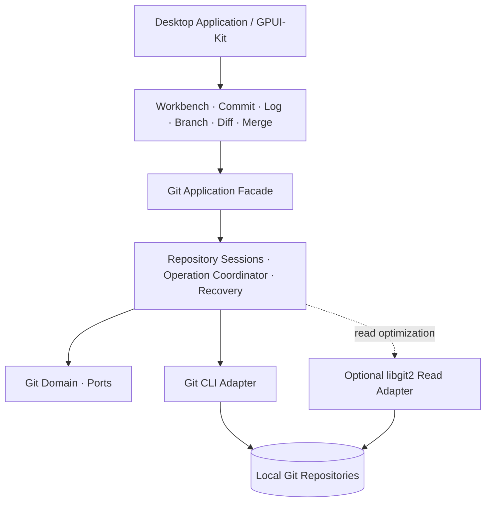

# IdeaGit

> **以 IntelliJ IDEA 2026.x New UI 的 Git 工作流为设计参考，使用 Rust + GPUI-Kit 构建的跨平台独立 Git 桌面客户端。**

[](#项目状态)
[](#技术栈)
[](#支持平台)

> [!IMPORTANT]
> **项目尚处于设计与工程初始化阶段。** 本 README 描述的是已确定的产品方向、架构约束与计划目标，**不代表相关功能已经实现或通过三平台验证**。实际开发状态请以 [`docs/plans/PROGRESS.md`](docs/plans/PROGRESS.md) 和仓库 CI 为准；如果该进度文件尚未建立，应先在 M0 创建。

## 项目简介

**IdeaGit** 是一款面向开发者的原生 Git 桌面客户端，目标是在无需启动完整 IDE 的情况下，提供熟悉 IntelliJ IDEA Git 工具窗口的使用体验：仓库与分支管理、变更查看、暂存与提交、历史日志、Diff、冲突解决，以及 Changelist 和部分提交等高级工作流。

项目采用 **Rust 模块化单体架构**：Git Core 独立于界面运行；Git CLI 是写操作的权威引擎；GPUI-Kit 负责原生桌面 UI 的基础能力；所有变更性 Git 操作统一经过操作协调器、状态校验和仓库重新同步流程。

> IdeaGit 是独立开发项目，**不隶属于 JetBrains，也不受其官方认可或赞助**。IntelliJ IDEA 是 JetBrains 的商标。界面与交互以公开文档和合法获取的参考行为为依据，不应复制未经授权的专有资源。

## 设计目标

- **熟悉的 Git 体验**：参考 IntelliJ IDEA 2026.x New UI 的布局、操作路径和键盘工作流。
- **原生跨平台**：面向 Windows、macOS、Linux，统一核心逻辑，隔离平台特有能力。
- **以数据安全为先**：不静默覆盖 Index、工作区或用户未选择的变更。
- **可恢复的操作模型**：对 Commit、Merge、Rebase、Push 等操作记录状态并提供失败诊断、冲突处理和恢复路径。
- **大型仓库可用**：虚拟化 Git Log/Changes、按需加载 Diff、限制后台工作量与内存占用。
- **可独立测试**：Git Core 无需启动 GUI 即可完成单元、契约和真实仓库集成测试。

## 计划功能

以下均为**目标能力**；开发阶段和实际完成情况以开发进度为准。

| 功能域 | 目标能力 |
| --- | --- |
| 仓库管理 | 打开、克隆、多仓库切换、Worktree 识别 |
| 状态与变更 | Staged/Unstaged/Untracked、文件树、外部变更自动刷新 |
| 提交 | Stage/Unstage、Commit、Amend、Hooks、签名配置支持 |
| 分支与引用 | Branch/Tag、Checkout、创建、重命名、删除、分支搜索 |
| 历史日志 | 提交 DAG、过滤、搜索、提交详情、文件历史 |
| 远程协作 | Fetch、Pull、Push、Push Preview、凭据集成 |
| Diff | Unified、Side-by-side、Three-version、Hunk/Line 操作 |
| 冲突解决 | Merge/Cherry-pick/Rebase 状态检查、三方冲突处理 |
| 高级提交 | IDEA 风格 Changelist、部分提交、临时 Index 安全协调 |
| 高级工作流 | Interactive Rebase、Stash、Shelf、Blame |
| 桌面体验 | Dock、自定义布局、主题、快捷键、操作进度与通知 |

## 技术栈

| 组件 | 设计基线 | 备注 |
| --- | --- | --- |
| 编程语言 | Rust，Edition 2024 | 强类型、跨平台 |
| Rust Toolchain | 计划采用 `1.99.1` | 需执行 M0 兼容性验证 |
| UI 框架 | GPUI-Kit `0.9.0` | 版本与实际 API 须在 M0 验证 |
| GPUI 后端 | 经 GPUI-Kit 匹配的依赖 | 不独立混装不兼容版本 |
| 异步运行时 | Tokio 1.x | 后台查询、进程管理、操作调度 |
| Git 引擎 | 系统 Git CLI | 写操作权威来源 |
| 可选读取优化 | `git2` / libgit2 | 仅在语义与性能验证后启用 |
| 文件系统监控 | `notify` 8.x | 事件仅作为触发信号，最终以 Git 状态为准 |
| 日志与诊断 | `tracing` | 结构化日志与敏感信息脱敏 |
| 持久化 | 用户数据存储 + 可选 SQLite | Journal、Changelist、Shelf 与缓存分级管理 |

**版本说明：** 以上是设计阶段推荐基线，尚非已经编译验证的完整依赖组合。首次工程初始化时必须核实发布与兼容性，生成并提交 `Cargo.lock`，记录 Windows/macOS/Linux 的验证结果。具体参见 [`TECH-BASELINE-001`](docs/architecture/TECH-BASELINE-001.md)。

## 架构概览



核心原则：

1. **UI 不直接执行 Git CLI**，只通过 `GitApplication` 发送命令与查询。
2. **Git Core 不依赖 GPUI**，可在 CLI/测试环境独立运行。
3. **每个 Worktree 对应 Repository Session**；共享 `common_dir` 的资源由统一协调器管理。
4. **写操作统一经过 Operation Coordinator**，并在结束后执行 Reconciliation。
5. **Snapshot 是只读展示状态**；Diff、Log 等大型数据通过独立分页查询获取。
6. **Changelist 不等于 Git Index**；部分提交必须验证选区、保护真实 Index，并提供异常恢复。

### 计划仓库结构

```text
IdeaGit/
├── README.md
├── AGENTS.md
├── Cargo.toml
├── Cargo.lock
├── rust-toolchain.toml
├── apps/
│   └── desktop/
├── crates/
│   ├── core/
│   │   ├── git-domain/
│   │   ├── git-ports/
│   │   ├── git-application/
│   │   ├── git-operations/
│   │   ├── git-diff/
│   │   ├── git-graph/
│   │   └── git-changelist/
│   ├── adapters/
│   │   ├── git-cli/
│   │   ├── git-libgit2/
│   │   ├── repository-watcher/
│   │   ├── credential-broker/
│   │   └── persistence/
│   ├── ui/
│   │   ├── idea-theme/
│   │   ├── idea-ui-primitives/
│   │   ├── idea-shell/
│   │   ├── git-ui-model/
│   │   ├── git-workbench/
│   │   ├── git-commit-ui/
│   │   ├── git-log-ui/
│   │   ├── git-branch-ui/
│   │   ├── git-diff-ui/
│   │   └── git-merge-ui/
│   └── platform/
│       └── desktop-platform/
├── tests/
├── assets/
├── packaging/
├── .github/
│   └── workflows/
└── docs/
    ├── architecture/
    └── plans/
```

> 上面展示的是**规划中的目录树**，M0 实施前并不保证全部路径已存在。应随着任务逐步创建，而不是为了填满目录而添加无用代码。

## 支持平台

| 平台 | 目标 | 需重点验证 |
| --- | --- | --- |
| Windows | Windows 10/11（具体最低版本待确认） | MSVC、Git for Windows、路径/编码、DPI、进程树终止 |
| macOS | Intel / Apple Silicon（具体最低版本待确认） | Metal、签名、公证、Keychain、文件监控 |
| Linux | 主流发行版（最低版本待确认） | Wayland/X11、系统库、字体、凭据与打包 |

正式支持矩阵、最低系统版本和安装包格式将在 M0/M6 阶段经过实际构建及测试后确定。

## 快速开始（开发者）

> [!NOTE]
> **下列命令适用于 M0 初始化完成后的 Rust Workspace。** 在根 `Cargo.toml` 和 `apps/desktop` 尚未创建时，不能直接运行客户端。

### 先决条件

- 已安装 Git。
- 已安装 Rust/Rustup，且 Rust 工具链与项目 `rust-toolchain.toml` 一致。
- 已安装各平台所需的 C/C++ 编译工具及 GPUI-Kit 系统依赖。
- Linux 还需根据锁定版本安装图形和字体相关开发库。
- 确保系统 Git 版本满足工程实际验证的最低要求。

### 获取并验证工程

```bash
# 使用实际仓库 URL 替换占位符
# git clone <REPOSITORY_URL>
# cd IdeaGit

rustc --version
cargo --version
git --version

cargo fmt --all -- --check
cargo check --workspace --locked
cargo test --workspace --locked
cargo clippy --workspace --all-targets --locked -- -D warnings
```

### 启动桌面客户端（待 M0/UI-001 完成）

```bash
cargo run -p desktop
```

`desktop` 是计划中的二进制 Package 名称，实际名称以 `apps/desktop/Cargo.toml` 为准。尚未建立相应 Crate 时，此命令不可用。

## 开发路线图

计划以 **M0～M6 七个里程碑**分阶段交付；并行开展 Git Core、GPUI UI、Commit/Diff 和质量平台工作流。

| 里程碑 | 核心交付目标 | 状态 |
| --- | --- | --- |
| M0 · 工程基础 | Workspace、依赖验证、CI、最小 GPUI 窗口、Git Fixture | 未验证 |
| M1 · Read Core | Repository Discovery、Status、Snapshot、Session、Workbench | 规划中 |
| M2 · Git Core MVP | Stage/Unstage、Commit、Branch、Git Log 闭环 | 规划中 |
| M3 · Daily-use Beta | Remote、Push/Pull、Merge、Conflict、Recovery | 规划中 |
| M4 · Advanced Commit | Diff、Hunk/Line Stage、Changelist、Partial Commit | 规划中 |
| M5 · Advanced Workflows | Interactive Rebase、Shelf、File History | 规划中 |
| M6 · Production v1.0 | 三平台安全、性能、打包、发布验收 | 规划中 |

**第一条必须打通的业务闭环：**

```text
Open Repository
  → Read Status
  → Show Changes
  → Stage File
  → Commit
  → Refresh Snapshot
  → Show New Commit in Git Log
```

任务编号、前置依赖、工期估算、完成标准见 [`IP-001`](docs/plans/IP-001-development-plan.md)。**路线图不是功能已交付的声明。**

## 架构与开发文档

| 文档 | 内容 |
| --- | --- |
| [`ARCH-001-overview.md`](docs/architecture/ARCH-001-overview.md) | 总体架构与分阶段落地方案 |
| [`LLD-GIT-CORE-001.md`](docs/architecture/LLD-GIT-CORE-001.md) | Git Core 生产级详细设计 |
| [`LLD-UI-001.md`](docs/architecture/LLD-UI-001.md) | GPUI-Kit UI 生产级详细设计 |
| [`LLD-CCD-001.md`](docs/architecture/LLD-CCD-001.md) | Commit / Changelist / Diff 深度设计 |
| [`TECH-BASELINE-001.md`](docs/architecture/TECH-BASELINE-001.md) | 核心依赖版本基线 |
| [`IP-001-development-plan.md`](docs/plans/IP-001-development-plan.md) | 可执行开发任务拆解 |
| [`CODEX-GUIDE-001.md`](docs/plans/CODEX-GUIDE-001.md) | 使用 Codex 逐步开发的操作指南 |
| [`PROGRESS.md`](docs/plans/PROGRESS.md) | 开发进度、阻塞项与里程碑验收（待建立/维护） |

使用 Codex 协作前，先阅读根目录的 `AGENTS.md`。如果文档不存在，应按照开发指南创建，并先审核技术版本与接口可行性。

## 使用 Codex 开发

推荐 **一个明确任务 ID → 一个实现分支 → 编码与测试 → 代码审查 → 合并** 的循环：

1. 阅读 `AGENTS.md`、对应 LLD 与 `IP-001` 任务说明。
2. 核对任务前置依赖以及当前代码状态。
3. 让 Codex 仅修改该任务需要的 Crate/文件。
4. 编写 Unit、Contract 和真实 Git Integration Tests。
5. 执行 `cargo fmt`、`check`、`clippy`、`test`。
6. 复核 Git Diff，尤其是写操作的数据安全与恢复行为。
7. 通过审查后合并；更新 `PROGRESS.md`。

示例任务指令：

```text
请按照 AGENTS.md 和 docs/plans/IP-001-development-plan.md
实施 CORE-004（Porcelain v2 Status Parser）。

开始前检查前置依赖和相关 LLD；只修改本任务范围。
提供 Rust 实现、字节级解析测试和真实 Git 仓库契约测试。
运行适用的 fmt/check/clippy/test，并报告实际测试结果。
不得将未执行的验证写成“已通过”。
```

## Git 数据安全与质量要求

涉及仓库写入的模块必须满足以下不可妥协的要求：

- 禁止使用 Shell 字符串拼接 Git 命令；使用受控参数列表和路径协议。
- 禁止对用户仓库自动执行未确认的破坏性操作，例如 `reset --hard` 和 Force Push。
- 不将 RepoPath 强制当作 UTF-8 字符串处理。
- 写操作进入统一 Operation Coordinator，并在结束后重新读取实际 Git 状态。
- 禁止因为 Commit/Hook/Push 超时而假定操作未生效并盲目重试。
- Hunk/Line Stage 和 Partial Commit 必须验证选区新鲜度，保护未选择的 Index/Worktree 修改。
- Rebase/Merge/Cherry-pick 的中断状态必须由真实 Git 状态判定，不只相信缓存或 Journal。
- Credential、Token、私钥和敏感 Remote URL 不得写入日志、诊断报告或 Journal。
- 高风险 Git 写操作必须经过真实仓库集成测试、异常场景测试及跨平台验证。

### 统一验证命令

```bash
cargo fmt --all -- --check
cargo check --workspace --locked
cargo clippy --workspace --all-targets --locked -- -D warnings
cargo test --workspace --locked
git diff --check
```

若项目仍处于初始化阶段、`Cargo.lock` 尚未生成，需先执行依赖解析和编译验证，再启用 `--locked` 作为 CI 门禁。

## 贡献与协作

目前处于项目初始化阶段，正式的贡献指南和行为准则将在工程骨架建立后补充。

预期协作规则：

- 每个 PR 关联一个 `IP-001` 任务 ID，例如 `CORE-004`、`UI-007`、`CCD-006`。
- PR 需写明变更范围、接口影响、测试结果、跨平台风险与是否涉及 Git 数据安全。
- 不在同一个 PR 中混合无关的 UI 重构、依赖升级和 Git Core 行为更改。
- 对公共接口的破坏性调整需有 ADR 或迁移说明。
- UI 高保真验收采用目标 IDEA 版本的实际参考样本，不以想象的像素值替代测量。

## 当前项目状态

- **已确定：** 产品方向、主要模块边界、技术路线、设计文档与任务计划。
- **待完成：** 仓库初始化、实际依赖兼容性验证、三平台 CI、最小 GPUI 窗口与 Git Core 实现。
- **尚不能宣称：** 生产可用、三平台已通过、IDEA 功能已全部复刻。

更新日期：2026-11-06。此后以版本控制记录及项目进度文件为准。

## 许可证

**尚未确定。** 在项目所有者正式选择并添加 `LICENSE` 文件前，请勿假定本仓库已采用 MIT、Apache-2.0 或其他开源许可证。

---

> **开发优先顺序：** 先把 `Repository → Status → Changes → Stage → Commit → Log` 做成真实可运行、可测试的最小闭环，再推进 Remote、Merge、Diff、Changelist 和 Interactive Rebase。以 Git 数据安全和跨平台可靠性为最终验收依据。
