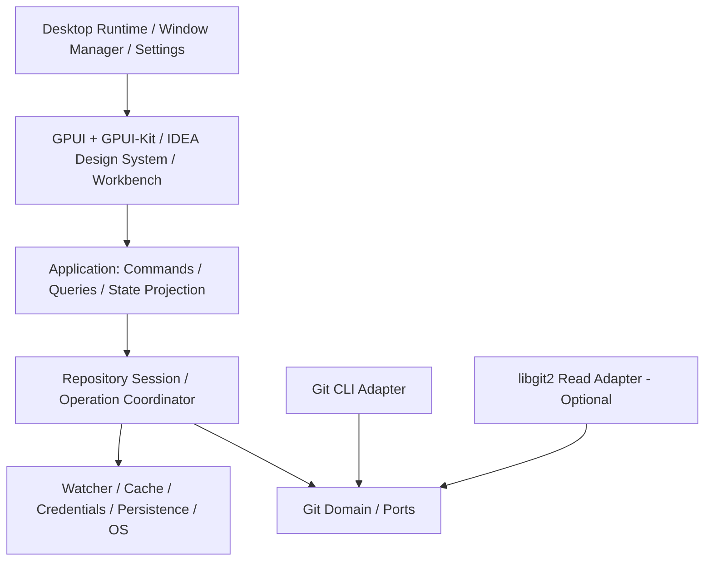
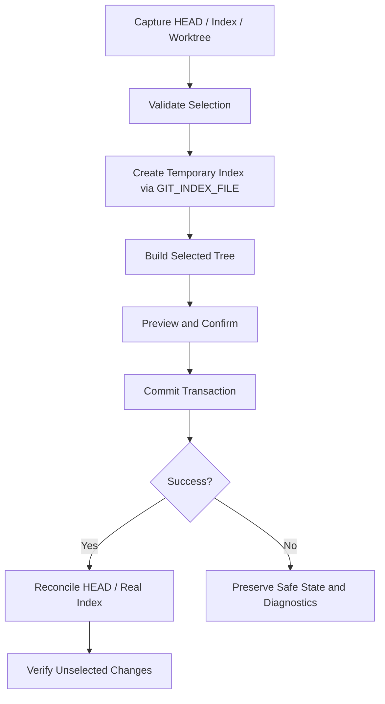
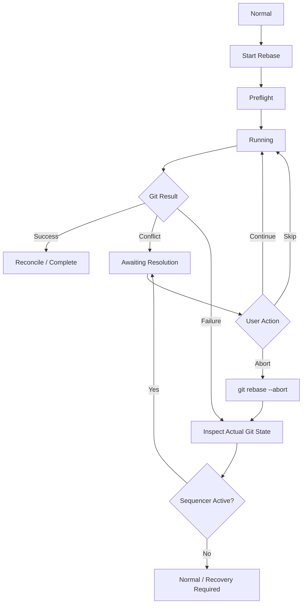

# IdeaGit：IntelliJ IDEA 2026.x 风格独立 Git 桌面客户端——生产级架构与分阶段落地方案

> 修订：2026-11-06，执行已批准的 [ADR-ARCH-REMEDIATION-001](adr/ADR-ARCH-REMEDIATION-001.md) D1–D7。共享契约见 [Git Core §18](LLD-GIT-CORE-001.md)；主里程碑以 IP-001 为准。代码片段仍为设计草案，未做编译或三平台验证。

> 版本：v1.0  
> 日期：2026-11-06  
> 目标平台：Windows / macOS / Linux  
> 技术栈：Rust Stable + GPUI + GPUI-Kit + Git CLI（写操作权威）+ 可选 libgit2（只读加速）  
> 文档类型：产品功能规格、系统详细架构、核心接口设计、实施与验收计划  
> 状态：设计基线，尚非已实现或经过三平台验证的产品

> **命名说明**：IdeaGit 是本设计文档的临时代号。正式发行须采用与 JetBrains 商标明确区分的名称、图标与原创视觉资源。对 IntelliJ IDEA 的 UI、工作流进行参考时，应以实际目标版本及合法获得的参考资料为准。

## 目录

1. [项目目标与架构结论](#1-项目目标与架构结论)
2. [产品功能规格与优先级](#2-产品功能规格与优先级)
3. [总体架构与核心约束](#3-总体架构与核心约束)
4. [Rust Workspace 设计](#4-rust-workspace-设计)
5. [领域模型](#5-领域模型)
6. [Git Backend Ports 与 CLI 执行管线](#6-git-backend-ports-与-cli-执行管线)
7. [Repository Session、并发与状态同步](#7-repository-session并发与状态同步)
8. [GPUI-Kit UI 架构与 IDEA 风格设计系统](#8-gpui-kit-ui-架构与-idea-风格设计系统)
9. [Commit、Staging、Changelist 与部分提交](#9-commitstagingchangelist-与部分提交)
10. [Git Log、Commit Graph 与 Diff](#10-git-logcommit-graph-与-diff)
11. [Branches、远程同步和认证](#11-branches远程同步和认证)
12. [Merge、Rebase 与冲突恢复](#12-mergerebase-与冲突恢复)
13. [三平台适配与持久化](#13-三平台适配与持久化)
14. [安全、性能与测试验收](#14-安全性能与测试验收)
15. [M0–M6 分阶段实施计划](#15-m0m6-分阶段实施计划)
16. [最小垂直切片与任务依赖](#16-最小垂直切片与任务依赖)
17. [架构决策记录（ADR）](#17-架构决策记录adr)
18. [风险登记与发布检查单](#18-风险登记与发布检查单)
19. [参考资料](#19-参考资料)

---

## 1. 项目目标与架构结论

### 1.1 目标

构建一个**独立运行的原生 Git 桌面客户端**，并尽可能高保真复刻 IntelliJ IDEA 2026.x New UI 中 Git 相关功能的：

- **界面结构**：Git Log、Commit、Branches Popup、Changes Tree、Diff Viewer、Merge Conflict Resolver、菜单、状态栏与通知。
- **操作流程**：入口、右键菜单、快捷键、确认弹窗、进度呈现、成功/失败反馈与恢复操作。
- **Git 语义**：Stage/Unstage、Commit、Amend、Push/Pull/Fetch、Merge/Rebase、Cherry-pick、Stash、Reset/Revert、冲突处理等。
- **工程可靠性**：真实仓库安全、异步非阻塞、进程取消、可恢复、跨平台、性能与自动化测试。

因本项目是**独立客户端**，而不是 IDE 插件，必须额外提供仓库管理、多仓库标签、工作台布局、设置与凭据交互、窗口生命周期、轻量编辑与诊断等能力。

### 1.2 版本基线

- 交互参考范围：IntelliJ IDEA **2026.x New UI**。
- 第一轮 UI 验收建议选定一个具体小版本（例如 **2026.2**），建立该版本截图、录屏、菜单树、快捷键与交互步骤清单；之后其他小版本差异采用版本化 UI Spec。
- **不能将多个 IDEA 版本的 UI 行为混合成一个“看起来像 IDEA”的实现。**
- 本文中的视觉尺寸均是**工程原型初值**，不是已经完成像素测量的 JetBrains 官方规格。

### 1.3 最终架构选择

**模块化单体 + 六边形架构 + 单向状态流 + Repository Session/Operation Coordinator + Git CLI 权威写引擎 + 可选 libgit2 只读加速。**



**五条不可破坏的架构约束**：

1. UI 不直接执行 Git 命令。
2. `git-domain` 不依赖 GPUI、Tokio、SQLite、Git CLI 或操作系统 API。
3. 所有变更性操作通过统一协调器，并遵守 Git 资源锁和外部修改检测。
4. Git 仓库才是 HEAD、Index、Refs、Sequencer 等状态的真实来源；UI/SQLite 缓存都是派生状态。
5. 破坏性操作必须进行前置检查、明确确认、结果核验和恢复说明；不能假设“Cancel = 已回滚”。

---

## 2. 产品功能规格与优先级

### 2.1 功能等级

| 等级 | 交付目标 | 核心范围 |
|---|---|---|
| P0 | 基础可用 | 打开仓库、Status、Changes、Diff、Stage/Unstage、Commit、Log、Branches |
| P1 | 日常生产使用 | Clone、Push/Pull/Fetch、Merge、Stash、Reset/Revert、冲突解决、安全与恢复 |
| P2 | 专业 Git 体验 | Rebase、Cherry-pick、Amend、交互式 Rebase、Hunk/Line Stage、多仓库 |
| P3 | IDEA 高保真 | Changelists、Shelf、提交前检查、文件历史/Blame、更多 UI 细节、Worktree 高级管理 |

**最小生产验收：P0 + P1 + 可靠性与跨平台测试**。P2、P3 是规划范围，并非在 MVP 中承诺全部完成。

### 2.2 全量功能域（12 类、每类 8 项）

| 功能域 | 功能清单 |
|---|---|
| 仓库/工作区 | 打开本地仓库、Clone HTTPS/SSH、Init、最近仓库、多仓库标签、Worktree、Submodule、Remote 配置 |
| 本地变更 | Tracked/Untracked/Ignored、Staged/Unstaged、Changes Tree、Stage/Unstage、Hunk/Line Stage、Discard/Rollback、Changelists、部分 Commit |
| Commit | Commit、Commit and Push、Amend、Message History、提交前检查/Hooks、作者/签名、空提交、失败恢复 |
| Branch | Local/Remote、Create/Checkout/Switch、Rename/Delete、搜索、Tracking、Compare、Detached HEAD、批量管理 |
| Git Log | DAG、筛选/搜索、提交详情、File History、Diff with Previous、Compare、Cherry-pick、Revert/Reset |
| Remote | Fetch、Pull、Push、Refspec/远端映射、Ahead/Behind、Push Preview、Force-with-lease、凭据/SSH |
| Merge/Rebase | Merge、Rebase、Interactive Rebase、Squash/Fixup/Reword/Drop、Continue/Skip/Abort、Sequencer、冲突恢复、重启恢复 |
| Diff | Unified/Side-by-side、HEAD/Index/Worktree、字符级高亮、Hunk 操作、Whitespace 选项、Binary/Image、Blame、文件版本 |
| Conflict | 冲突列表、三方编辑、Accept Left/Right/Both、Result 手动编辑、块导航、Mark Resolved、操作类型区分、Abort/Continue |
| Stash/Shelf | Stash Save/List、Apply/Pop/Drop、Stash Diff、Untracked Stash、IDEA 风格 Shelf、Shelf Patch 恢复、独立分组、冲突处理 |
| 桌面集成 | 系统通知、菜单/Keymap、主题、高 DPI、窗口布局持久化、自动更新、Git 发现、诊断日志 |
| 生产工程 | 取消/超时、并发协调、Watcher、崩溃恢复、性能缓存、危险操作保护、E2E、跨平台 CI |

### 2.3 功能验收维度

| 维度 | 验收口径 |
|---|---|
| 视觉 | 对照指定 IDEA 2026.x 版本截图的布局、字体、间距、选中态和焦点态 |
| 交互 | 同一任务的菜单入口、右键动作、操作步骤、弹窗、键盘流程尽量一致 |
| Git 正确性 | 与系统 Git 结果一致，Index/HEAD/Worktree 不被非预期修改 |
| 安全 | 危险操作显式确认；外部 Git 修改可检测；失败可诊断 |
| 稳定性 | 重启后恢复未完成 Git 操作；无 UI 阻塞与无限内存增长 |
| 跨平台 | Windows/macOS/Linux 分别构建、运行、测试与发布 |

---

## 3. 总体架构与核心约束

### 3.1 分层

1. **Presentation**：GPUI Entity、ViewModel、Theme、Action、Dock、Overlay、Focus。
2. **Application**：Command Dispatcher、Query Facade、Use Cases、Repository Session、Snapshot Store、Events。
3. **Domain**：Repository、HEAD、Change、Diff、Commit Graph、Branch、Conflict、Operation State。
4. **Ports & Adapters**：Git CLI、libgit2（只读）、文件监控、凭据、持久化。
5. **Platform**：文件路径、进程、系统通知、系统 Git 发现、打包与更新。

依赖方向：`UI → Application → Domain ← Ports Implementations`。具体实现由启动装配层注入。

### 3.2 运行单元

| 单元 | 职责 | 纪律 |
|---|---|---|
| GPUI UI Thread | 视图、输入、绘制、焦点、Entity 更新 | 不执行阻塞 IO |
| Application Runtime | 任务编排、事件路由、请求取消 | Tokio、有界并发 |
| Git Worker | Git 子进程、文件系统、耗时解析 | 统一 Executor、超时与取消 |

UI 后台任务仅通过消息/安全调度回 UI 上下文更新 Entity，绝不直接从 Tokio 线程任意修改 GPUI 状态。

### 3.3 双 Git 引擎原则

| 能力 | 默认实现 | 说明 |
|---|---|---|
| Repository 发现 | Git CLI / 路径适配 | 支持 Worktree、`.git` 文件 |
| Status | `git status --porcelain=v2 -z --branch` | 用户 Git 的权威语义 |
| Log/对象读取 | CLI，必要时 libgit2 | 先正确，性能瓶颈再加速 |
| Diff | Git CLI + 自定义 Diff AST | 尊重 attributes/filter/textconv 等 |
| Stage/Commit/Refs 修改 | Git CLI | 统一写入路径 |
| Fetch/Push/Pull | Git CLI | 尊重 SSH、Credential Helper |
| Merge/Rebase/Sequencer | Git CLI | 保持 Git 标准行为 |
| Commit Graph 布局 | 自研纯 Rust | 与 UI 渲染分离 |

禁止用两个引擎在同一事务内分别修改真实 Index/Refs。

---

## 4. Rust Workspace 设计

```text
ideagit/
├── Cargo.toml
├── Cargo.lock
├── rust-toolchain.toml
├── .cargo/config.toml
├── apps/
│   └── desktop/src/{main.rs,bootstrap.rs,lifecycle.rs}
├── crates/
│   ├── core/
│   │   ├── git-domain/
│   │   ├── git-ports/
│   │   ├── git-application/
│   │   ├── git-operations/
│   │   ├── git-diff/
│   │   ├── git-graph/
│   │   └── git-changelist/
│   ├── adapters/
│   │   ├── git-cli/
│   │   ├── git-libgit2/
│   │   ├── repository-watcher/
│   │   ├── credential-broker/
│   │   └── persistence/
│   ├── ui/
│   │   ├── idea-theme/
│   │   ├── idea-shell/
│   │   ├── git-workbench/
│   │   ├── git-commit-ui/
│   │   ├── git-log-ui/
│   │   ├── git-branch-ui/
│   │   ├── git-diff-ui/
│   │   └── git-merge-ui/
│   └── platform/
│       └── desktop-platform/
├── assets/{icons,themes,keymaps}/
├── tests/{fixtures,contracts,integration,ui-golden,recovery}/
├── packaging/{windows,macos,linux}/
└── docs/{architecture/adr,ui-spec,testing}/
```

### 4.1 Crate 责任

| Crate | 职责 |
|---|---|
| `git-domain` | 纯领域模型、值对象、约束，不依赖 IO/UI |
| `git-ports` | 可替换的 Git 读写契约 |
| `git-application` | 用户用例、查询、快照投影 |
| `git-operations` | 操作协调器、状态机、取消与恢复 |
| `git-diff` | Diff AST、Patch 校验、行对齐 |
| `git-graph` | DAG 增量 Lane 分配、可视行模型 |
| `git-commit` | 候选预览和临时 Index 事务引擎，通过 Ports 注入 IO |
| `git-changelist` | 逻辑变更集、选区指纹及持久化规则 |
| `git-cli` | 无 Shell 拼接的 Git 子进程执行与输出解析 |
| `git-libgit2` | 性能验证后引入的只读优化 |
| `repository-watcher` | 文件变更事件、Debounce、失效通知 |
| `credential-broker` | Credential Helper / AskPass / SSH 交互 |
| `persistence` | 配置、工作区、Shelf 和缓存的存储与迁移 |
| `idea-theme` | IDEA 风格 Token、组件状态与图标映射 |
| `idea-shell` | 窗口、Dock、菜单、Overlay、Keymap |
| `git-workbench` | Repository UI 编排和跨面板联动 |
| `desktop-platform` | Windows/macOS/Linux 差异适配 |

### 4.2 Cargo 配置示例

> 下列为初始化起点，不是经三平台锁定测试的精确版本。GPUI/GPUI-Kit 应在 Spike 验证后统一固定兼容版本；全部依赖使用 `Cargo.lock`。

```toml
[workspace]
resolver = "3"
members = [
  "apps/desktop",
  "crates/core/*",
  "crates/adapters/*",
  "crates/ui/*",
  "crates/platform/*",
]

[workspace.package]
edition = "2024"
publish = false

[workspace.dependencies]
tokio = { version = "1", features = ["rt-multi-thread", "macros", "process", "sync", "io-util", "time"] }
async-trait = "0.1"
thiserror = "2"
tracing = "0.1"
serde = { version = "1", features = ["derive"] }
serde_json = "1"
notify = "8"
git2 = "0.20"
```

---

## 5. 领域模型

### 5.1 身份与对象

共享类型及接口以 [Git Core §18 统一契约](LLD-GIT-CORE-001.md) 为准；此处不再重复定义。

**注意**：Git 路径不是通用 UTF-8 字符串；Windows 的原生路径与 Unix 字节路径转换需由平台层负责。Git OID 不应固定为 40 位 SHA-1 字符串。

### 5.2 Repository / HEAD / Operation

共享类型及接口以 [Git Core §18 统一契约](LLD-GIT-CORE-001.md) 为准；此处不再重复定义。

### 5.3 HEAD / Index / Worktree 三版本模型

```text
HEAD ──(staged diff)──> INDEX ──(unstaged diff)──> WORKTREE
```

共享类型及接口以 [Git Core §18 统一契约](LLD-GIT-CORE-001.md) 为准；此处不再重复定义。

### 5.4 仓库快照

共享类型及接口以 [Git Core §18 统一契约](LLD-GIT-CORE-001.md) 为准；此处不再重复定义。

`SnapshotRevision` 是会话范围内的应用世代号，不意味着 Git 提供原子快照。读取阶段若仓库发生外部变更，应重试或标记过期，避免混合不同时间点的 HEAD/Index/Refs。

---

## 6. Git Backend Ports 与 CLI 执行管线

### 6.1 拆分接口而非单一巨型 Backend

```text
Git Ports
├── RepositoryReader
├── StatusReader
├── HistoryReader
├── DiffReader
├── BranchReader
├── IndexWriter
├── CommitWriter
├── BranchWriter
├── RemoteOperator
└── SequencerOperator
```

共享类型及接口以 [Git Core §18 统一契约](LLD-GIT-CORE-001.md) 为准；此处不再重复定义。

> 示例为 API 设计草案，`GitError`、`LogQuery` 等需在对应 Crate 定义；不声称可未经补全直接编译。

### 6.2 DiffEndpoint

共享类型及接口以 [Git Core §18 统一契约](LLD-GIT-CORE-001.md) 为准；此处不再重复定义。

冲突版本应结合指定文件的 Index Stage 解析，而非把 ConflictBase/Ours/Theirs 当作通用 Git Tree。

### 6.3 Command Dispatcher

共享类型及接口以 [Git Core §18 统一契约](LLD-GIT-CORE-001.md) 为准；此处不再重复定义。

UI 只能创建强类型业务命令，不可随意拼接任意 shell/Git 命令。

### 6.4 CLI Executor

```rust
pub struct GitCliCommand {
    pub target: SessionTarget,
    pub args: Vec<std::ffi::OsString>,
    pub stdin: Option<Vec<u8>>,
    pub timeout: Option<std::time::Duration>,
    pub operation_id: OperationId,
}

pub struct GitOutput {
    pub stdout: Vec<u8>,
    pub stderr: Vec<u8>,
    pub exit_code: Option<i32>,
}
```

**硬性要求**：

1. 使用 `Command` 直接传参数，不经 shell 字符串拼接。
2. 路径参数使用命令适用的 literal pathspec 协议，并以 OsString/原始字节保真；-- 只隔离选项、NUL 只分隔路径，均不关闭通配/magic。
3. stdout/stderr 并发消费，不因缓冲区填满而阻塞。
4. Git 子进程统一处理 timeout/cancel/进程树清理。
5. 敏感数据（密码、Token、私钥、含凭据 URL）不进入日志。
6. 执行失败后结合 Git 仓库实际状态分类，不仅依据退出码与英文错误文本。
7. 外部 Git 配置、Hooks、Filters、Credential Helper 视为可能执行代码的信任边界。
8. 操作结束必须 reconcile，而不是直接假定状态变化已成功。

推荐机器解析命令：

```bash
git status --porcelain=v2 -z --branch
git ls-files --stage -z
git diff --raw -z
git diff --numstat -z
git for-each-ref
git rev-list
git cat-file --batch
```

实际使用时必须为每条命令定义严格的编码、字段/记录分隔和解析契约，避免解析面向终端的人类可读彩色输出。

### 6.5 执行管线


`GitCliExecutor` 负责进程与 IO；`GitOperationCoordinator` 负责排队、互斥、状态与取消；`GitOperationService` 负责具体 Git 用例语义。避免巨型 `GitService`。

---

## 7. Repository Session、并发与状态同步

### 7.1 Session

```text
DesktopApp
└── RepositoryRegistry
    ├── RepositorySession A
    │   ├── OperationCoordinator
    │   ├── SnapshotStore
    │   ├── FileWatcher
    │   └── QueryService
    └── RepositorySession B
        ├── OperationCoordinator
        ├── SnapshotStore
        ├── FileWatcher
        └── QueryService
```

基本原则：同仓库写操作有序、跨仓库可并行、只读有界并发。但 **多个 Worktree 可能共享 `common_dir`**：需要资源锁而不是仅按 RepositoryId 独立上锁。

- `WorktreeLock`：保护工作区与其 Index。
- `CommonGitDirLock`：保护共享 Refs/公共元数据。
- 锁获取顺序固定；进程内锁并不能阻止外部 Git，仍要遵从 Git 自身锁文件及前后状态核验。

### 7.2 Operation 状态机

共享类型及接口以 [Git Core §18 统一契约](LLD-GIT-CORE-001.md) 为准；此处不再重复定义。

仓库 Sequencer 的 AwaitingConflictResolution 可在冲突命令结束后持续存在；Continue/Skip/Abort 创建关联命令，旧命令不占执行队列。Cancelled 不代表 Git 状态已回滚。

### 7.3 事件与 UI 单向流

```text
User Interaction → UI Action → Application Command
→ Git Operation → Domain Event → Repository Snapshot
→ ViewModel Projection → GPUI Entity Update
```

共享类型及接口以 [Git Core §18 统一契约](LLD-GIT-CORE-001.md) 为准；此处不再重复定义。

事件传 ID/版本，Log 大数据不在事件总线上整体广播。

### 7.4 过期请求丢弃

```rust
pub struct ViewRequestToken {
    pub target: SessionTarget,
    pub request_seq: u64,
    pub snapshot_revision: SnapshotRevision,
}
```

典型情形：用户快速选中 Commit A → B，B 先返回，A 后返回；必须丢弃 A 的过期详情，否则出现 UI 数据错配。应用切换仓库、过滤器、Diff 文件时均需相同机制。

### 7.5 文件监控

采用 **Worktree Watcher + Git Metadata Watcher + Debounce + Snapshot Reconciliation**。监听文件、Index、HEAD、Refs、Rebase/Merge 状态及窗口重新获焦；Watcher 只是失效信号而非真实状态，刷新应重读 Git。

---

## 8. GPUI-Kit UI 架构与 IDEA 风格设计系统

### 8.1 UI 四层

```text
IDEA Design Tokens
    ↓
Reusable UI Primitives (Tree / Toolbar / Menu / Popup / Split)
    ↓
Git Feature Components (Changes / Graph / Diff / Conflict)
    ↓
Git Workbench Composition
```

推荐复用 GPUI-Kit 的 Dock Layout、Virtual List、Data Table、基础组件、Code Editor、焦点与 UI 测试；**自研** IDEA 风格 Changes Tree、Commit Graph、Diff Gutter、Merge Conflict Block、Branches Popup 行为。

### 8.2 独立 Workbench 布局

```text
AppWindow
├── TitleBar / RepositoryTabs / Branch Widget / Search
├── MainDock
│   ├── RepositoryExplorer (Local/Remote/Tags/Stashes/Shelves)
│   ├── GitLog (Toolbar/Filters/GraphTable/Details)
│   ├── CommitPanel (ChangesTree/Message/Checks/Actions)
│   └── DiffWorkspace (TabBar/Unified/SideBySide/ThreeVersion)
├── StatusBar (branch, ahead/behind, Git status)
└── OverlayManager
    ├── BranchPopup
    ├── PushDialog
    ├── RebaseDialog
    ├── ConflictResolver
    ├── ConfirmDialog
    └── NotificationCenter
```

由于不包含完整 IDE 代码编辑器，主区域采用 Git Workbench，但尽量保留 IDEA Git 操作的入口、菜单逻辑与视觉关系。

### 8.3 Entity 与 ViewModel

```rust
pub struct GitLogViewModel {
    pub target: SessionTarget,
    pub selected_commit: Option<ObjectId>,
    pub filter: LogFilter,
    pub rows: Vec<CommitRowViewModel>,
    pub loading: bool,
    pub error: Option<String>,
}
```

Domain Event → ViewModel Projection → Entity Update。Entity 只保存 UI 所需状态与交互，不直接触发 Git 子进程。

### 8.4 Design Tokens（原型初值）

| Token | 初值 |
|---|---:|
| Toolbar Height | 36 px |
| Status Bar Height | 26 px |
| Tree Row Height | 24 px |
| Compact Row Height | 22 px |
| Panel Header Height | 32 px |
| Small Icon | 16 px |
| Panel Padding | 8 px |
| Splitter Width | 4 px |

后续使用 IDEA 2026.x 指定版本的 Windows 100%/150%、macOS Retina、Linux 缩放截图逐项标定。支持 Light/Dark、Hovered/Selected/Focused/Disabled/Loading/Error 等状态；**Selected 与 Focused 不得混淆**。

### 8.5 自研组件名单

`IdeaToolWindowHeader`、`IdeaChangesTree`、`IdeaBranchPopup`、`IdeaGitLogTable`、`IdeaCommitGraph`、`IdeaDiffGutter`、`IdeaConflictBlock`、`IdeaOperationProgress`、`IdeaStatusBarBranchWidget`、`IdeaContextMenu`。

### 8.6 Action Registry / Keymap

```rust
pub enum AppAction {
    OpenRepository,
    ShowGitLog,
    ShowCommitPanel,
    NewBranch,
    CheckoutBranch,
    Fetch,
    Pull,
    Push,
    Commit,
    CommitAndPush,
    ShowDiff,
    NextDifference,
    PreviousDifference,
    ContinueRebase,
    AbortRebase,
}
```

每个 Action 定义 ID、上下文可用性、菜单位置、快捷键、确认规则与 Application Command。分别提供 Windows/Linux 与 macOS 的 IDEA 风格 Keymap，并支持用户重映射和冲突检测。

---

## 9. Commit、Staging、Changelist 与部分提交

### 9.1 两种不同模式

- **Git Staging**：真实 Index 决定提交内容；P0 优先实现。
- **IDEA Changelists**：应用管理逻辑分组；同一个文件可按 Hunk/Line 分类，不能简单等价于 Git Index；P3 阶段实现。

### 9.2 Changelist 模型

共享类型及接口以 [Git Core §18 统一契约](LLD-GIT-CORE-001.md) 为准；此处不再重复定义。

Hunk ID 不能只用当前行号，应结合 Base Blob OID、内容与上下文指纹以及 Diff Generation；选区过期必须重新校验。

### 9.3 Partial Commit 事务



**关键禁令**：

- 不得未经核验将临时 Index 直接覆盖真实 Index。
- 不得默认未选中变更在 HEAD 更新后仍自动正确映射。
- 不得忽略 Hooks、签名或外部 Git 对 Index/Worktree 的修改。
- 不得在操作结果未知时无脑重试 Commit。
- 不得承诺任意错误可完全自动回滚。

```rust
pub struct CommitTransactionRecord {
    pub operation_id: OperationId,
    pub target: SessionTarget,
    pub expected_head: Option<ObjectId>,
    pub expected_index_fingerprint: String,
    pub selected_changes_digest: String,
    pub phase: CommitTransactionPhase,
}
```

优先落地顺序：**普通 Commit → Hunk Stage → Line Stage → Changelists → 逻辑变更集部分 Commit**。

---

## 10. Git Log、Commit Graph 与 Diff

### 10.1 Commit Graph

```text
Git Object Reader
    ↓
Commit Graph Model
    ↓
Incremental Lane Layout
    ↓
Virtual Log Renderer
```

```rust
pub struct CommitNode {
    pub oid: ObjectId,
    pub parents: Vec<ObjectId>,
    pub author: CommitIdentity,
    pub subject: String,
    pub committed_at: i64,
    pub decorations: Vec<RefDecoration>,
}

pub struct GraphRow {
    pub oid: ObjectId,
    pub lane: usize,
    pub segments: Vec<GraphSegment>,
}
```

首屏建议读取 200～500 条，后续分页；Lane 状态跨页保留。分页不能天真地只用 Offset，Refs 改变或历史改写时应使旧游标失效。

### 10.2 Diff 数据模型

共享类型及接口以 [Git Core §18 统一契约](LLD-GIT-CORE-001.md) 为准；此处不再重复定义。

展示 Diff 与可写 Patch 分型：只有完整元数据、未截断的原始字节 Patch 可进入写流程；ignore-whitespace/textconv 展示不可直接重建写入 Patch。编码转换仅用于展示。

### 10.3 Diff Viewer

- Unified / Side-by-side / Three-version。
- Line / Character Highlight、Next/Previous Difference、Ignore Whitespace。
- Hunk Stage/Unstage/Revert；每次操作前重新核验快照与 Patch 适用性。
- 逻辑滚动同步：使用 Left/Right Row Mapping，不能简单复制像素滚动偏移。
- 大文件、Binary、Image、Submodule 使用安全降级 UI。

---

## 11. Branches、远程同步和认证

### 11.1 Branch Popup

功能：当前分支、Local/Remote Branches、搜索、Recent/Favorite、Create、Checkout、Rename、Delete、Merge、Rebase、Compare、右键菜单。

| 操作 | Preflight |
|---|---|
| Checkout | 未提交更改是否会被覆盖；当前 Sequencer |
| Delete | 是否当前分支；是否已合并 |
| Rename | 名称是否合法；Refs 是否冲突 |
| Merge/Rebase | HEAD、工作区、进行中操作 |
| Push | Remote/Upstream/Refspec、目标 Ref 是否已变化 |

### 11.2 Remote Service

```text
RemoteService
├── FetchService
├── PullService
├── PushService
├── RemoteConfigService
├── CredentialBroker
└── TransportProgressParser
```

Push Dialog 必须显示 Source、Target、Outgoing Commits、Force 选项及确认。Force Push 独立确认，优先 `--force-with-lease`，绝不默认强推。

### 11.3 Credentials

默认尊重用户系统 Git 的 Credential Helper/SSH：

- Windows：Git Credential Manager 等。
- macOS：Keychain/Helper/OpenSSH。
- Linux：Credential Helper、Secret Service、SSH Agent。

如需自有登录弹窗，通过受控 AskPass 桥接，避免 Token/密码进入 CLI 参数或日志。必须支持认证超时、取消、主机密钥确认，以及无交互终端场景。

---

## 12. Merge、Rebase 与冲突恢复

### 12.1 Rebase 状态机



应用重启后通过实际 Git Sequencer 状态恢复 UI，而非仅靠旧 Application DB。

### 12.2 Conflict Resolver

Index Stage 1/2/3 分别表达 Base/Ours/Theirs，但可能缺失。支持 Add/Add、Modify/Delete、Rename/Delete、Binary、Submodule 等非标准文本冲突。

流程：读取冲突 → 三方显示 → 用户选择/编辑 Result → 安全写入并校验 → Stage 已解决文件 → 再次检测 → 按 Merge/Rebase/Cherry-pick 类型执行 Continue。

**Ours/Theirs 在 Rebase 中不等同于永远的“本地/远程”。** UI 文案必须根据当前操作语境说明。

### 12.3 操作取消

不能因为 Git 子进程已退出就认定仓库操作完成。`git rebase --abort`、`git merge --abort` 等必须作为明确的后续业务操作，并在执行后再次 reconcile。

---

## 13. 三平台适配与持久化

### 13.1 平台矩阵

| 能力 | Windows | macOS | Linux |
|---|---|---|---|
| Git 发现 | Git for Windows/PATH | PATH/Developer Tools | PATH |
| UI/渲染 | GPUI Windows | GPUI macOS | GPUI Linux |
| Credentials | GCM/Helper | Keychain/Helper | Helper/Secret Service |
| SSH | Windows OpenSSH/Git SSH | OpenSSH | OpenSSH |
| 文件监控 | Windows 文件变更 API | FSEvents | inotify 等 |
| 快捷键 | Ctrl/Alt | Cmd/Option | Ctrl/Alt |
| 路径 | Windows 原生路径语义 | Unix 路径 | Unix 路径 |
| 安装包 | MSI/EXE | DMG/PKG | AppImage/DEB/RPM |

Linux 首轮 CI 建议 Ubuntu 24.04 LTS，随后覆盖常见 Fedora/Wayland/X11 环境。最终系统支持下限应由 GPUI-Kit 依赖与实际验证确定。

### 13.2 Platform Ports

```rust
pub trait DesktopPlatform: Send + Sync {
    fn system_git_candidates(&self) -> Vec<std::path::PathBuf>;
    fn config_directory(&self) -> Result<std::path::PathBuf, PlatformError>;
    fn cache_directory(&self) -> Result<std::path::PathBuf, PlatformError>;
    fn open_external_url(&self, url: &str) -> Result<(), PlatformError>;
}
```

Credentials、Notifications、Update、File Picker 拆成独立适配接口，避免巨大 Platform Trait。

### 13.3 配置和缓存

```text
Application Data/
├── settings.json
├── keymap.json
├── layout.json
├── app.db
├── logs/
└── recovery/
```

正式 ADR 位于 docs/architecture/adr；下文 ADR 编号表为历史主题摘要，不构成与正式 ADR 并列的审批记录。

SQLite 可持久化仓库列表、收藏、Log 派生缓存、Changelist/Shelf 元数据、操作恢复记录和 UI 工作区状态。**用户创建的 Changelist/Shelf 信息必须有备份与迁移策略，不能作为可随时删除的 Cache。**

---

## 14. 安全、性能与测试验收

### 14.1 危险操作保护

| 操作 | 保护 |
|---|---|
| `reset --hard`（规划产品能力） | Agent 禁止在用户真实仓库执行；产品模式需独立安全设计/确认及隔离 fixture 验证 |
| `git clean` | Dry Run 预览，明确删除范围 |
| Force Push | 显示目标与风险、独立确认，优先 force-with-lease |
| Branch Delete | 当前分支/未合并检查 |
| Checkout | 工作区覆盖检查 |
| Rebase Abort | 重新识别 Sequencer 实际状态 |
| Stash Drop | 二次确认 |
| Discard Changes | 文件与 Diff 预览 |
| Partial Commit | 临时 Index + 前后状态验证 |

Git Hooks、Git Config、Filters、外部 Diff、SSH/AskPass 都可能涉及执行程序；应在信任模型中明确处理。

### 14.2 错误分类

共享类型及接口以 [Git Core §18 统一契约](LLD-GIT-CORE-001.md) 为准；此处不再重复定义。

每个错误附带脱敏诊断、Repo/Operation ID、恢复建议、是否需要刷新。不要单靠英文 stderr 文案和 exit code 分类。

### 14.3 性能目标（待实测）

| 场景 | 目标 |
|---|---|
| 10 万 Commit 仓库 Log 首屏 | P95 ≤ 1s |
| Log 滚动 | 目标 60 FPS |
| 普通仓库 Status | P95 ≤ 300ms |
| Branch Popup 热缓存 | P95 ≤ 150ms |
| 1000 变更文件 Changes Tree | 主线程不阻塞 |
| 1 万 Ref 搜索 | 输入流畅 |
| 仓库切换 | 过期请求不污染新 UI |
| 100MB 文本文件 | 降级处理，不耗尽内存 |
| 长时间 Fetch 取消 | UI 仍可响应，仓库状态可恢复 |

测试数据须注明平台、磁盘、仓库大小、冷/热缓存、Git 版本，不能把目标当成已实现事实。

### 14.4 测试层级

| 层 | 内容 |
|---|---|
| Unit | Domain、Diff Parser、Graph Layout、状态机 |
| Contract | Ports/CLI Adapter 语义一致性 |
| Integration | tempfile 创建真实 Git 仓库进行读写 |
| UI | GPUI Headless、键盘焦点、菜单与截图 Golden |
| Recovery | 中途杀进程、锁冲突、重启恢复、重复结果检测 |

**必测高风险场景**：Staged+Unstaged 共存、部分 Hunk、Hook/签名失败、外部 Git 并发修改、Push 拒绝、Merge Conflict、Rebase 中断、Detached HEAD、Unborn Branch、Worktree/Submodule、非 UTF-8/含换行文件名、CRLF、LFS、Index Lock、Git 程序退出但结果未知。

### 14.5 发布及供应链

`Cargo.lock` 固定、依赖审计、SBOM、构建校验、Windows/macOS 代码签名、更新包签名、结构化诊断日志与凭据脱敏；遥测需要明确授权。安装、升级、卸载和历史数据库迁移均需要回归测试。

---

## 15. M0–M6 主计划

执行顺序、任务 ID 和依赖以 [IP-001](../plans/IP-001-development-plan.md) 为唯一主计划。原总体估算不作为另一套阶段验收。

| 主阶段 | 交付及门禁 |
|---|---|
| M0 | 依赖/契约决策、最小工程、锁定工具链、三平台窗口与 Fixture；未验证不标完成 |
| M1 | Discovery/Status/Session/Watcher、Workbench；最小只读 Diff 可在 M1/M2 集成 |
| M2 | Stage/标准 Commit/Branch/Log；必须有 Lock、Journal、基础恢复及真实 Git 测试 |
| M3 | Clone/Fetch/Push、fetch+merge Pull、Merge/冲突/Sequencer 恢复；安全回归随功能执行 |
| M4 | Hunk/Line、编辑 Index、预览生命周期、Changelist/Partial Commit；高级能力先禁用，安全矩阵通过后开放 |
| M5 | Interactive Rebase、Shelf、File History/Blame；执行与恢复联调 |
| M6 | 全量安全/性能/三平台 QA、签名打包/迁移；打包完成不代表获准发布 |

## 16. 最小垂直切片与任务依赖

**第一条可运行的端到端切片**：

```text
Open Repository
  → Repository Discovery
  → StatusSnapshot
  → Changes Tree
  → Select File
  → Unified Diff
  → Stage / Unstage
  → Commit
  → Reconcile HEAD / Index
  → Refresh Git Log and Status Bar
```

推荐开发顺序：

1. `git-domain` Newtypes、HEAD/Index/Worktree、Error 与 Snapshot。
2. `git-ports` Repository/Status/Diff/History/Command 契约。
3. `git-cli` Process Executor + Porcelain V2 解析 + Fixtures。
4. `git-operations` Repository Session、状态机、并发协调。
5. `idea-shell` 基础 App、Dock、Theme、Actions。
6. `git-workbench` Repository 状态投影和 UI 更新。
7. `git-commit-ui` Changes Tree + Stage/Commit。
8. `git-diff-ui` Unified Diff 首版。
9. `git-log-ui` 历史显示与提交详情。
10. 三平台 CI、E2E、Recovery Test。

每个功能遵循统一交付模板：**Use Case → 前置条件 → Domain Types → Port → Adapter → Events → ViewModel → UI → Integration/UI Tests → 失败与恢复验收**。

---

## 17. 架构决策记录（ADR）

| ADR | 主题 | 决策 |
|---|---|---|
| ADR-001 | 整体架构 | Rust 模块化单体 + 六边形架构 |
| ADR-002 | Git 写操作 | Git CLI 为权威写引擎 |
| ADR-003 | Git 只读 | CLI 优先；libgit2 只读加速且可回退 |
| ADR-004 | UI | GPUI + GPUI-Kit + IDEA Design System |
| ADR-005 | 状态 | GPUI Entity + Application Snapshot + 单向事件流 |
| ADR-006 | 并发 | Repository Session + Worktree/CommonDir 资源锁 |
| ADR-007 | Commit | Staging 与逻辑 Changelist 双模式 |
| ADR-008 | Partial Commit | 临时 Index、提交前后核验、恢复日志 |
| ADR-009 | Log | 增量 DAG、分页、虚拟列表 |
| ADR-010 | Diff | 独立 Diff AST + ViewModel + Viewer |
| ADR-011 | Rebase/Merge | Sequencer 实际状态驱动恢复 |
| ADR-012 | 跨平台 | 单一代码库 + Platform Adapters |
| ADR-013 | 缓存 | 派生缓存可重建，用户数据须迁移/备份 |
| ADR-014 | 快捷键 | Action Registry + 平台 Keymap |
| ADR-015 | 危险操作 | Preflight + Confirm + Reconcile + Recovery |

---

## 18. 风险登记与发布检查单

### 18.1 核心风险

| 风险 | 等级 | 缓解 |
|---|---|---|
| Changelist/部分提交污染真实 Index | 极高 | M4 延后开发、临时 Index 事务、故障注入 |
| Git Hooks 或签名失败后状态不明 | 极高 | 执行前指纹、退出后 reconcile、操作日志 |
| 外部 Git 与客户端并发操作 | 高 | Git 锁语义、快照版本、检测和拒绝过期操作 |
| Rebase/Cherry-pick 进行中崩溃 | 高 | 按实际 Sequencer 状态恢复 |
| GPUI-Kit 三平台差异 | 高 | M0 Spike 和跨平台 CI、固定版本 |
| 10 万 Commit / 大型 Diff 卡顿 | 中高 | 分页、虚拟化、有界解析、性能基线 |
| 2026.x UI 目标漂移 | 中高 | 锁定小版本、截图和交互基线、独立 UI Spec |
| SSH/凭据兼容性 | 中高 | 默认系统 Git Helper、受控 AskPass |
| 用户 Shelf/Changelist 数据损坏 | 高 | 迁移、备份、事务和故障恢复 |

### 18.2 发布前必须满足

- [ ] Windows、macOS、Linux 原生安装及基本功能验收。
- [ ] Git 可执行文件发现、配置、凭据和 SSH 认证验证。
- [ ] P0/P1 功能及异常流程覆盖。
- [ ] Commit/Stage/Discard/Reset/Force Push 具有数据保护。
- [ ] Commit 成功但应用响应丢失时能够避免错误重试。
- [ ] Merge/Rebase/Cherry-pick 进行中重启可恢复操作界面。
- [ ] 不同 Worktree 的共享 Git 数据协调测试通过。
- [ ] UI 截图和关键工作流对照 IDEA 2026.x 基线。
- [ ] 大仓库性能数据采集完成且符合既定门槛。
- [ ] Crash Logs、Credential Logs 已脱敏。
- [ ] 依赖扫描、签名、更新与迁移验证完成。
- [ ] 有用户可用的备份、恢复和诊断说明。

---

## 19. 参考资料

下列链接用于技术设计与实现阶段的核验；项目启动时应再次确认当前文档、License、依赖版本和平台支持情况。

- GPUI-Kit 官网：<https://gpui-kit.com/>
- GPUI-Kit GitHub：<https://github.com/longbridge/gpui-kit>
- git2-rs GitHub：<https://github.com/rust-lang/git2-rs>
- IntelliJ IDEA Commit and Push：<https://www.jetbrains.com/help/idea/commit-and-push-changes.html>
- IntelliJ IDEA Git 集成文档：<https://www.jetbrains.com/help/idea/using-git-integration.html>
- Git `status` 格式：<https://git-scm.com/docs/git-status>
- Git `diff`：<https://git-scm.com/docs/git-diff>
- Git `rebase`：<https://git-scm.com/docs/git-rebase>
- Git `worktree`：<https://git-scm.com/docs/git-worktree>
- Git `commit`：<https://git-scm.com/docs/git-commit>

---

## 结论

本项目应遵循 **“Git 正确性与用户数据安全优先，IDEA 交互高保真其次，性能优化在有测试数据时引入”** 的工程次序。首先完成纯 Rust Git Core 与纵向端到端切片，再推进 GPUI-Kit 的完整 UI、Branch/Remote、Merge/Rebase、Changelist/Shelf 及三平台发布。

下一份建议产物：`Git Core Low-Level Design`，细化完整可编译的数据类型、各 Port 契约、CLI 解析器、Operation Coordinator、事务/恢复算法及 Rust 集成测试 Fixture。
