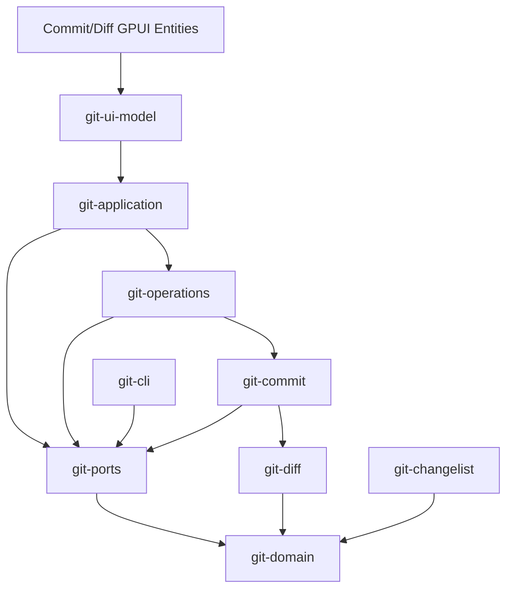
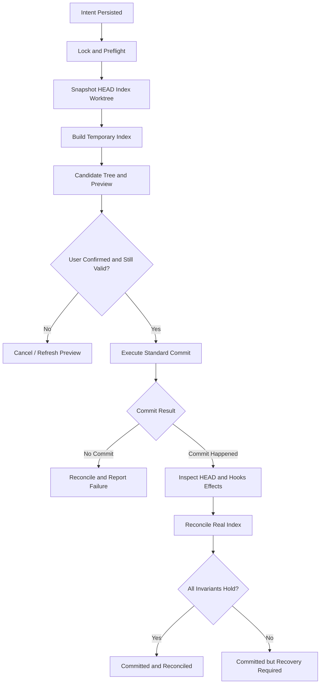
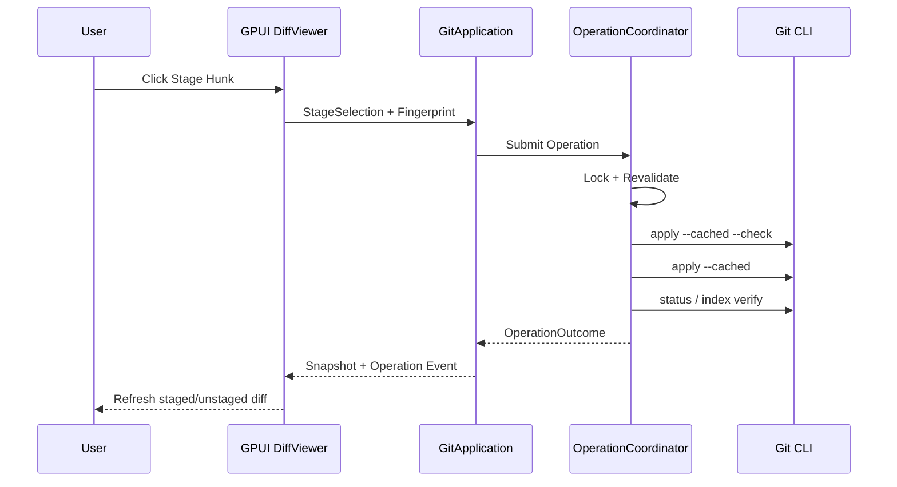

# IdeaGit — Commit / Changelist / Diff 生产级深度设计

> **文档编号**：LLD-CCD-001  
> **版本**：1.0（设计基线，待实现验证）  
> **日期**：2026-11-06  
> **目标产品**：独立 Git 桌面客户端，复刻 IntelliJ IDEA 2026.x New UI 的 Git 使用体验  
> **目标平台**：Windows / macOS / Linux  
> **技术栈**：Rust Stable、GPUI + GPUI-Kit、系统 Git CLI，libgit2 可选只读加速  
> **关联文档**：Git Core LLD、GPUI-Kit UI LLD、总体架构与 M0～M6 计划

> **重要说明**：本文件是可直接指导工程实现的详细设计与验收规范，不是已编译验证的完整代码仓库。代码示例分为「可实现的类型/接口草案」与「流程伪代码」；涉及 Git Index、Hooks、外部并发与恢复的正确性，必须通过真实仓库测试验证。IDEA 2026.x 的视觉与交互以明确锁定的 2026.2 基线为准，不把其他小版本的行为混入验收。

---

## 目录

1. [设计目标与不可变约束](#1-设计目标与不可变约束)
2. [IDEA 交互和 Git 语义映射](#2-idea-交互和-git-语义映射)
3. [模块依赖和 Rust Workspace](#3-模块依赖和-rust-workspace)
4. [核心领域类型](#4-核心领域类型)
5. [Commit / Changelist / Diff Ports](#5-commit--changelist--diff-ports)
6. [Status 与三个版本的数据契约](#6-status-与三个版本的数据契约)
7. [Git Staging：文件、Hunk、行级暂存](#7-git-staging文件hunk行级暂存)
8. [Changelist 归属与持久化](#8-changelist-归属与持久化)
9. [部分提交事务设计](#9-部分提交事务设计)
10. [Commit Hooks、签名和提交前检查](#10-commit-hooks签名和提交前检查)
11. [Diff Core：解析、对齐、编辑和渲染](#11-diff-core解析对齐编辑和渲染)
12. [GPUI-Kit Commit / Diff UI](#12-gpui-kit-commit--diff-ui)
13. [并发控制、快照版本与恢复](#13-并发控制快照版本与恢复)
14. [错误模型和用户安全协议](#14-错误模型和用户安全协议)
15. [跨平台注意事项](#15-跨平台注意事项)
16. [测试矩阵、故障注入与验收](#16-测试矩阵故障注入与验收)
17. [分阶段实施路线](#17-分阶段实施路线)
18. [ADR 和发布门槛](#18-adr-和发布门槛)
19. [参考资料](#19-参考资料)

---

# 1. 设计目标与不可变约束

## 1.1 目标

本子系统须满足：

- 完整表达 `HEAD`（已提交）、`INDEX`（已暂存）、`WORKTREE`（工作区）三个版本。
- 提供 IDEA 风格的 **Changelists** 与 **Git Staging Area** 两种工作模式，并明确各自的状态来源。
- 支持单文件、多个文件、Hunk、单行/行范围与手动编辑 Index 的颗粒度。
- 提交前准确预览**将被提交的树**，提交后保留未选中修改。
- 保留系统 Git 的用户配置、Hooks、提交签名及文件过滤行为。
- 支持文件重命名、删除、类型变化、二进制、符号链接、Submodule、LFS、非 UTF-8 路径等边界。
- 在外部 Git、Hooks 或编辑器并发修改仓库时避免无声覆盖。
- 支持取消、进程中断、程序崩溃后的状态核对与人工恢复。
- UI 的 Commit、Diff、Changelist 数据不直接依赖 Git CLI，而通过 `git-application` Facade 获得。

## 1.2 不可变规则（必须以集成测试执行）

| 编号 | 不可变约束 | 违规后果 |
|---|---|---|
| INV-01 | 用户未选择的工作区内容不得静默丢失 | 发布阻断 |
| INV-02 | 用户未选择的已暂存内容不得被意外提交 | 发布阻断 |
| INV-03 | 任何 Index 写入必须在协调器保护下、校验原始状态 | 发布阻断 |
| INV-04 | UI 显示的待提交预览必须等于实际提交 Tree（在明确的允许变化策略内） | 发布阻断 |
| INV-05 | 操作取消不能被视为事务回滚 | 发布阻断 |
| INV-06 | 过期的行/Hunk 选择不得自动匹配到另一块代码 | 发布阻断 |
| INV-07 | Commit 成功但是后续清理失败时不得重复提交 | 发布阻断 |
| INV-08 | 不绕过用户预期的 Hooks、签名、Git 过滤规则而假称兼容 | 发布阻断 |
| INV-09 | Git 原始路径永远不由 UI 展示字符串反向构造 | 发布阻断 |
| INV-10 | 每个操作对外暴露明确终态和仓库 Reconcile 结果 | 发布阻断 |

## 1.3 非目标

- 不复制 JetBrains 私有实现或其图标资产；只复刻可观察交互模型及用户习惯。
- 不承诺所有 Git 操作具备数据库级 ACID 事务或可无损自动回滚。
- 不把 `git2` 作为 Git 写操作的独立权威来源。
- 第一阶段不实现完备的 IntelliJ 内置代码分析、Reformat/Optimize Imports；只能通过可插拔提交前检查扩展。

# 2. IDEA 交互和 Git 语义映射

JetBrains IDEA 2026.2 的 Commit 文档描述了：Commit Tool Window、Changelist 选择、Diff 中选中 chunk/line、将 chunk 移至其他 Changelist，以及可选 Git Staging Area；Staging 模式还允许 **Compare HEAD, Staged and Local Versions** 三版本编辑。上述是本设计的产品契约，不应把全部界面当成 `git add` 的别名。

| IDEA 风格入口 | 用户语义 | Git Core 能力 | 是否修改真实 Index |
|---|---|---|---|
| Changes Tree 选择文件 | 逻辑提交选择 | `ChangeSelection` | Changelist 模式：否 |
| Stage File | 暂存整个文件 | `StageFile` | 是 |
| Stage Hunk | 仅暂存选中修改块 | `StagePatch` | 是 |
| Stage Lines | 细粒度暂存 | `StageSelection` | 是 |
| HEAD / Staged / Local | 三版本比较并编辑中间版本 | `EditableIndexSession` | Apply 时才是 |
| Commit（Staging） | 提交真实 Index | `CommitIndex` | Git 标准行为 |
| Commit（Changelist） | 提交逻辑选择，保留其他内容 | `CommitSelection` | 临时 Index + 协调真实 Index |
| Amend | 修改最新提交 | `AmendCommit` | 高风险，保护历史语义 |
| Commit and Push | 先提交后推送 | `CommitThenPush` | 两个单独操作与结果 |

### 2.1 两种模式的必须隔离点

**Git Staging 模式**：Git Index 是暂存内容的唯一事实源。文件勾选应表达“选择/执行 Stage”而不是隐含 Changelist 元数据。

**Changelist 模式**：逻辑分组属于应用数据。可以持久化文件或 Hunk/Line 归属，但不能假设 Git 本身有多个 Index。切换模式不得静默修改或删除用户逻辑分组。注意：JetBrains 不同帮助页面对切换时 Changelist 保留/删除有不一致描述；IdeaGit 应定义并验证自己的明确安全策略：**保留数据、可恢复、提示模式差异**。

### 2.2 交互步骤契约

每个功能必须有 `Entry → Selection → Preview → Validate → Confirm → Execute → Reconcile → Feedback` 的可追踪流程。参见 `docs/ui-spec/idea-2026.2/commit.yaml` 和 `diff.yaml`。

# 3. 模块依赖和 Rust Workspace

```text
crates/
├── core/
│   ├── git-domain/          # RepoPath/OID/Status/Selection/Commit/Errors
│   ├── git-ports/           # Repo/Index/Diff/Commit 端口
│   ├── git-diff/            # Git patch AST、对齐、选区、构造/校验
│   ├── git-changelist/      # 逻辑变更集、身份重定位、持久化规则
│   ├── git-commit/          # CommitPolicy、预览、临时 Index 协议
│   ├── git-operations/      # Command 队列、资源协调、Journal/恢复
│   └── git-application/     # Facade / Query / Event
├── adapters/
│   ├── git-cli/             # Git 命令、字节输出解析、执行器
│   ├── persistence/         # SQLite Changelist、草稿、Journal
│   ├── repository-watcher/  # Index/HEAD/Worktree 变更监控
│   └── credential-broker/   # 提交签名/远端认证相关桥接
└── ui/
    ├── git-ui-model/       # VM、Action、Async Request Tokens
    ├── git-commit-ui/      # Commit Tool Window、Changes Tree
    ├── git-diff-ui/        # Unified / Side-by-side / Three-version
    └── idea-ui-primitives/ # Tree、Gutter、Toolbar、Dialog
```

依赖方向：



**建议进一步限制**：`git-commit` 的事务引擎通过 Operation Coordinator 调用；事务引擎自身只接收已获授权的执行上下文，避免反向依赖 `git-operations`。`git-domain` 禁止依赖 GPUI、Tokio、git2、SQLite、Shell。

## 3.1 Cargo 依赖建议

```toml
[workspace]
resolver = "3"
members = ["apps/desktop", "crates/core/*", "crates/adapters/*", "crates/ui/*"]

[workspace.package]
edition = "2024"

[workspace.dependencies]
serde = { version = "1", features = ["derive"] }
thiserror = "2"
uuid = { version = "1", features = ["v4", "serde"] }
async-trait = "0.1"
tokio = { version = "1", features = ["process", "sync", "fs", "time", "io-util", "rt-multi-thread", "macros"] }
tokio-util = "0.7"
tracing = "0.1"
notify = "8"
sha2 = "0.10"
tempfile = "3"
proptest = "1"
```

锁定 Rust MSRV、GPUI-Kit 对应 GPUI 版本以及 `Cargo.lock`，在三平台构建通过后冻结版本矩阵。上表为实现起点，并非宣称所有版本组合已验证。

# 4. 核心领域类型

以下为**类型/API 设计草案**；放入源码时需补充 `use`、DTO 导入、校验构造器及 Serde 适配。

## 4.1 仓库身份与路径

```rust
#[derive(Debug, Clone, Copy, PartialEq, Eq, Hash)]
pub struct RepositoryId(pub uuid::Uuid);

#[derive(Debug, Clone, Copy, PartialEq, Eq, Hash)]
pub struct WorktreeId(pub uuid::Uuid);

#[derive(Debug, Clone, Copy, PartialEq, Eq, Hash)]
pub struct OperationId(pub uuid::Uuid);

#[derive(Debug, Clone, Copy, PartialEq, Eq, Hash)]
pub struct SnapshotRevision(pub u64);

/// Git 路径原始字节；仅通过经过验证的构造器创建。
#[derive(Debug, Clone, PartialEq, Eq, Hash)]
pub struct RepoPath(pub Vec<u8>);

#[derive(Debug, Clone, PartialEq, Eq, Hash)]
pub enum ObjectId {
    Sha1([u8; 20]),
    Sha256([u8; 32]),
}

pub struct RepositoryLocation {
    pub worktree_root: Option<std::path::PathBuf>,
    pub git_dir: std::path::PathBuf,
    pub common_dir: std::path::PathBuf,
    pub is_bare: bool,
}
```

路径必须区分 Git RepoPath 原始字节与 Windows/macOS/Linux 原生 Path。禁止使用 UI Display Path 执行真实文件操作。OID 不固定为 SHA-1。

## 4.2 文件与版本

```rust
pub enum ContentSource {
    Head,
    Index,
    Worktree,
    Commit(ObjectId),
    Tree(ObjectId),
    ConflictStage(u8), // 仅 1/2/3，带文件路径校验
}

pub enum FileKind {
    Regular,
    Executable,
    Symlink,
    Submodule,
    Binary,
}

pub enum ChangeKind {
    Added, Modified, Deleted, Renamed, Copied, TypeChanged, Unmerged,
}

pub struct FileIdentity {
    pub repository: RepositoryId,
    pub path: RepoPath,
    pub previous_path: Option<RepoPath>,
    pub file_kind: FileKind,
}

pub struct FileFingerprint {
    pub head_oid: Option<ObjectId>,
    pub index_oid: Option<ObjectId>,
    pub worktree_digest: Option<[u8; 32]>,
    pub index_generation: u64,
}
```

`worktree_digest` 是用于校验的内容指纹，不能拿 mtime/size 当作强校验；实际可采用有界流式计算。对于 LFS、Filter、CRLF、特殊文件，应区分**工作区原始内容**与**Git clean/filter 后将进入 Index 的内容**。

## 4.3 选择身份与 Changelist

```rust
#[derive(Debug, Clone, Copy, PartialEq, Eq, Hash)]
pub struct ChangelistId(pub uuid::Uuid);

#[derive(Debug, Clone, Copy, PartialEq, Eq, Hash)]
pub struct HunkId(pub uuid::Uuid);

#[derive(Debug, Clone, PartialEq, Eq)]
pub struct LineSpan {
    pub start: u32, // 0-based
    pub end_exclusive: u32,
}

pub enum ChangeSelection {
    WholeFile { file: FileIdentity },
    Hunks { file: FileIdentity, ids: Vec<HunkId> },
    Lines { file: FileIdentity, hunk: HunkId, ranges: Vec<LineSpan> },
}

pub struct SelectionFingerprint {
    pub expected_head: Option<ObjectId>,
    pub expected_index: Option<ObjectId>,
    pub diff_generation: u64,
    pub content_digest: [u8; 32],
}

pub struct Changelist {
    pub id: ChangelistId,
    pub name: String,
    pub description: Option<String>,
    pub is_default: bool,
    pub selections: Vec<ChangeSelection>,
}
```

**核心规则**：HunkId 不能直接等于行号；需要根据基准 Blob OID、修改块内容、上下文以及 Diff Generation 生成稳定但有失效机制的身份。无法无歧义重定位则将选区标为 `Stale`，提示用户重新选择。

## 4.4 Diff AST

```rust
pub struct DiffDocument {
    pub generation: u64,
    pub files: Vec<FileDiff>,
    pub truncated: bool,
}

pub struct FileDiff {
    pub old_path: Option<RepoPath>,
    pub new_path: Option<RepoPath>,
    pub old_oid: Option<ObjectId>,
    pub new_oid: Option<ObjectId>,
    pub old_mode: Option<u32>,
    pub new_mode: Option<u32>,
    pub kind: FileDiffKind,
    pub hunks: Vec<DiffHunk>,
}

pub enum FileDiffKind { Text, Binary, Image, Symlink, Submodule }

pub struct DiffHunk {
    pub id: HunkId,
    pub old_start: u32,
    pub old_count: u32,
    pub new_start: u32,
    pub new_count: u32,
    pub lines: Vec<DiffLine>,
}

pub enum DiffLine {
    Context(Vec<u8>),
    Addition(Vec<u8>),
    Deletion(Vec<u8>),
    NoNewlineMarker,
}
```

实际解析器还需保留 Binary Patch、Extended Headers、rename/copy score、No-Newline 状态和文件属性信息；不能仅靠以上展示 AST 重建任意 Git Patch。

## 4.5 Commit 类型

```rust
pub struct CommitIdentity {
    pub name: String,
    pub email: String,
}

pub enum CommitMode { StagingArea, Changelists }

pub enum SigningPolicy { UseGitConfig, Disable, Require }

pub struct CommitRequest {
    pub repository: RepositoryId,
    pub mode: CommitMode,
    pub message: Vec<u8>,
    pub amend: bool,
    pub allow_empty: bool,
    pub signoff: bool,
    pub author: Option<CommitIdentity>,
    pub signing: SigningPolicy,
    pub selections: Vec<ChangeSelection>,
    pub expected_revision: SnapshotRevision,
}

pub struct CommitPreview {
    pub expected_head: Option<ObjectId>,
    pub candidate_tree: ObjectId,
    pub changed_paths: Vec<RepoPath>,
    pub selection_digest: [u8; 32],
    pub warnings: Vec<String>,
}

pub enum CommitOutcome {
    Committed { oid: ObjectId, tree: ObjectId },
    Rejected { reason: String },
    RecoveryRequired { journal_id: OperationId },
}
```

`CommitPreview` 必须是执行确认依据；提交时重验快照，Hook 或用户脚本改变内容后需要重新检查结果是否仍满足用户确认的选择策略。

# 5. Commit / Changelist / Diff Ports

## 5.1 查询接口

```rust
#[async_trait::async_trait]
pub trait ChangeReader: Send + Sync {
    async fn status(&self, repo: RepositoryId) -> GitResult<StatusSnapshot>;
    async fn file_versions(
        &self,
        repo: RepositoryId,
        path: RepoPath,
    ) -> GitResult<FileVersions>;
}

#[async_trait::async_trait]
pub trait DiffReader: Send + Sync {
    async fn diff(&self, query: DiffQuery) -> GitResult<DiffDocument>;
    async fn blob(&self, query: BlobQuery) -> GitResult<BlobReadHandle>;
}

#[async_trait::async_trait]
pub trait ChangelistRepository: Send + Sync {
    async fn list(&self, repo: RepositoryId) -> GitResult<Vec<Changelist>>;
    async fn save(&self, list: Changelist) -> GitResult<()>;
    async fn delete(&self, repo: RepositoryId, id: ChangelistId) -> GitResult<()>;
}
```

`BlobReadHandle` 应支持流式读取/有界分块；不要强制把超大文件装入 `Vec<u8>`。`GitResult<T>` 来自统一错误模块。

## 5.2 写入命令及上下文

```rust
pub enum ChangeCommand {
    StageFiles { repository: RepositoryId, paths: Vec<RepoPath> },
    UnstageFiles { repository: RepositoryId, paths: Vec<RepoPath> },
    StageSelection { repository: RepositoryId, selection: ChangeSelection, expected: SelectionFingerprint },
    UnstageSelection { repository: RepositoryId, selection: ChangeSelection, expected: SelectionFingerprint },
    ApplyEditedIndex { repository: RepositoryId, session: EditableIndexSessionId },
    Commit(CommitRequest),
}

pub struct ExecutionContext {
    pub operation_id: OperationId,
    pub cancellation: tokio_util::sync::CancellationToken,
    pub progress: tokio::sync::mpsc::Sender<OperationProgress>,
}

#[async_trait::async_trait]
pub trait ChangeCommandPort: Send + Sync {
    async fn execute(
        &self,
        command: ChangeCommand,
        ctx: ExecutionContext,
    ) -> GitResult<ChangeCommandOutcome>;
}
```

UI 不直接使用 `ChangeCommandPort`；通过 `GitApplication::submit(...)` 进入 `OperationCoordinator`，由协调器取得权限与锁后调用具体端口。`EditableIndexSessionId` 是应用内部稳定句柄，指向用户正在编辑的临时 Index 内容。

## 5.3 预览与提交引擎

```rust
#[async_trait::async_trait]
pub trait CommitPlanner: Send + Sync {
    async fn prepare(&self, request: &CommitRequest) -> GitResult<CommitPreview>;
}

#[async_trait::async_trait]
pub trait CommitTransactionEngine: Send + Sync {
    async fn execute(
        &self,
        request: CommitRequest,
        preview: CommitPreview,
        ctx: ExecutionContext,
    ) -> GitResult<CommitOutcome>;
}
```

建议 `prepare` 的结果具有过期策略和有效期，而不是当作可无限期执行的令牌；执行入口必须再次核对 HEAD、Index 指纹和选区内容。

# 6. Status 与三个版本的数据契约

## 6.1 三版本模型

```text
HEAD             最后一次提交（或 Unborn）
  |  HEAD → INDEX        = Staged Changes
INDEX            Git 真正暂存区
  |  INDEX → WORKTREE    = Unstaged Changes
WORKTREE         用户当前本地文件
```

不可把 `HEAD → WORKTREE` 与 `INDEX → WORKTREE` 混为一谈。后者才是对“未暂存内容”的精确描述。

### 推荐 Status 命令

```bash
git status --porcelain=v2 -z --branch
git ls-files --stage -z
git diff --cached --raw -z
git diff --raw -z
```

Porcelain v2 `1/2/u/?/!` 记录按字节解析；Rename/Copy 记录额外携带旧路径。返回对象包括 Index Mode、Worktree Mode、Blob OID、Conflict Stages、Submodule 状态。

## 6.2 Version Reader

```rust
pub struct FileVersions {
    pub head: Option<VersionDescriptor>,
    pub index: Option<VersionDescriptor>,
    pub worktree: Option<VersionDescriptor>,
}

pub struct VersionDescriptor {
    pub source: ContentSource,
    pub oid: Option<ObjectId>,
    pub kind: FileKind,
    pub mode: Option<u32>,
    pub byte_length: Option<u64>,
}
```

三版本 Diff 的中间版本是**可编辑的 Index 内容投影**，不能未经确认就修改真实 Index。

# 7. Git Staging：文件、Hunk、行级暂存

## 7.1 Stage File

默认由 Git CLI 执行受控命令：`git add -- <path>`；涉及任意字节路径、海量路径时使用 Git 支持的 `--pathspec-from-file=- --pathspec-file-nul`（在选定支持的 Git 版本做兼容验证）。

操作流程：

1. UI 捕获仓库、选择、当前 Revision。
2. Coordinator 排队，获取 Worktree Index/Files 资源锁。
3. Preflight 检查路径、冲突/Sequencer、仓库状态及外部 Index 变化。
4. CLI 执行 `git add`，保留用户 Git Attributes/Filters 语义。
5. 读取新的 Index/Status；仅在状态核对完成后宣布成功。

## 7.2 Hunk Stage

使用 `git diff` 生成包含必要 metadata 的 Patch，然后经 `git apply --cached --check` 验证，再用 `git apply --cached`。`--cached` 只更新 Index，不修改 Worktree。`--recount` 可在重算 Hunk Header 后辅助应用，但不能代替正确的 Patch 生成和选区有效性验证。

```text
Diff Query (INDEX ↔ WORKTREE)
   ↓
Select Hunk(s)
   ↓
Validate Expected Index OID / Source Digest
   ↓
Build Patch with sufficient context
   ↓
git apply --cached --check
   ↓
Revalidate index identity under lock
   ↓
git apply --cached
   ↓
Read Index Snapshot / Verify
```

对 Unstage Hunk，可对 `HEAD ↔ INDEX` 的 Patch 使用 `git apply --cached --reverse`；但初始提交、合并状态、特殊模式文件等场景需要单独测试和策略。

## 7.3 行级 Stage：禁止简单按原行号删 Patch 行

**推荐算法**：

1. 将 Diff Hunk 的旧行、新行映射成修改原子（Change Atom）。
2. 将用户选中的行范围转换为完整可应用的原子集合，明确跨行替换的语义。
3. 对未选择的更改，将相应行转化为上下文（或拆分成独立 Hunk）。
4. 重新计算 `@@ -old_start,old_count +new_start,new_count @@`。
5. 保留至少必要上下文；对于缺少上下文的情况不默认使用 `--unidiff-zero`。
6. `--check` 验证；实际应用后比较 Index Blob 内容是否等于预期结果。
7. 如果选区跨越互相依赖的编辑、无法确定无歧义应用结果：拒绝并提供“编辑暂存版本”入口。

**重要限制**：单个替换行中若用户只选中部分字符，行级 Patch 无法准确表达，必须使用三版本编辑式 Index 工作流（参见 §11.6）。

## 7.4 Untracked / Renamed / Deleted

- Untracked 文件在完全暂存前不存在可供普通 Diff 的 Index Blob；Hunk Stage 需要先通过临时 Index/意向添加策略构造候选，再验证后安全更新。
- Rename 与 Copy 不是单纯路径替换，需要保留旧路径、新路径、模式和内容变化；部分提交按底层文件条目展开处理。
- Binary、Symlink、Submodule 不提供未经验证的“按行暂存”；显示整体 Stage 或专用操作。
- `--reject` 产生 `.rej` 残留，不应作为正常生产 Stage 路径。

# 8. Changelist 归属与持久化

## 8.1 数据模型与文件/块归属

Changelist 是 **IdeaGit 私有逻辑元数据**。其归属记录必须包含：

- Changelist ID / 显示名称 / 默认组。
- 仓库身份与 Worktree 身份。
- 文件路径、原路径、类型。
- 选中 Hunk/Line 的内容指纹和基准 OID。
- 更新时间和重定位状态。
- 用户草稿和偏好独立存储。

## 8.2 归属的稳定性

```rust
pub enum SelectionBindingState {
    Valid,
    Relocated { from_generation: u64, to_generation: u64 },
    Ambiguous,
    Stale,
    MissingFile,
    Conflict,
}

pub struct ChangelistBinding {
    pub list_id: ChangelistId,
    pub selection: ChangeSelection,
    pub fingerprint: SelectionFingerprint,
    pub state: SelectionBindingState,
}
```

每次外部修改文件或 Index 更新后：

1. 生成新 Diff Generation；
2. 通过内容指纹尝试重定位；
3. 可唯一对应则更新绑定；
4. 多个位置候选、基准变化过大或不适用则标记 `Ambiguous/Stale`；
5. UI 保留原 Changelist 数据，并提示用户重新选择；
6. 禁止静默挪动代码到其他 Changelist。

## 8.3 与 Staging 模式切换

建议明确产品语义：

- Changelist 的元数据保留在 SQLite，不因切换模式丢失。
- 切换模式不自动 Stage/Unstage 任意文件。
- 进入 Changelist 模式前，检查真实 Index 已存在的暂存内容，提示可能影响 Commit 预览。
- 两种模式的选择与草稿分开缓存，并在 UI 中明确标记当前模式。
- 数据模型与交互文案按照实际 IDEA 2026.2 录屏做后续视觉对齐。

# 9. 部分提交事务设计

> **本章是发布阻断规范。任何一次部分提交导致已暂存或未暂存内容丢失，都视为严重缺陷。**

## 9.1 不使用错误的“直接 Commit”捷径

以下做法不可直接用于生产：

- 直接将用户选择的文件执行 `git add` 后 `git commit`，再恢复“其他文件”。可能覆盖用户原有 Index。
- 只使用 `git commit --only <path>` 实现行级/部分 Hunk 提交。该命令按路径取工作区内容，不表达任意行级选择。
- 使用 `git commit-tree` 替代普通 `git commit`，却宣称完整保留用户 Hooks/签名/提交模板行为。
- 在未核对 HEAD 与 Index 的情况下，生成提交后直接重置 Index。

## 9.2 提交策略分级

| 级别 | 提交方式 | 支持范围 | 交付阶段 |
|---|---|---|---|
| S0 | 真实 Index 的普通 `git commit` | 标准 Staging | CCD-M1 |
| S1 | 文件/Hunk/Line Stage 后普通 Commit | Git Staging 模式 | CCD-M2 |
| S2 | 临时 Index 提交选区 + 协调真实 Index | Changelist / 部分提交 | CCD-M4 |
| S3 | 重叠修改、特殊 Git 状态、Hooks 变更下的完整兼容 | 高级/受限场景 | CCD-M5 |

S2 **只能在经过验证的 Git 状态子集上启用**，例如普通单工作区、无正在进行的 Merge/Rebase、未设置危险外部 Hook/Filter 的受控路径；通过专项测试后逐步扩大范围。

## 9.3 临时 Index 设计

`GIT_INDEX_FILE` 指向临时 Index；可使用 `git read-tree <HEAD tree>` 或其他经过验证的方式初始化，不修改真实 Index。注意 Unborn HEAD 需要空 Tree 的特殊处理。

```rust
pub struct TemporaryIndexContext {
    pub operation_id: OperationId,
    pub path: std::path::PathBuf,
    pub expected_head: Option<ObjectId>,
    pub original_index_digest: [u8; 32],
    pub original_index_backup: Option<std::path::PathBuf>,
    pub candidate_tree: Option<ObjectId>,
}
```

临时 Index 文件必须放在文件系统安全位置，权限受限；不能和真正 `.git/index` 混淆；清理失败需要 Journal 记录。

### 9.3.1 构造候选 Tree

1. 在统一资源锁下读取 HEAD、Index、Worktree、Git 操作状态。
2. 验证所有选择仍能关联原来的 Blob/Hunk。
3. 根据**产品承诺的提交语义**决定候选 Tree 起点：一般是 HEAD Tree，再组合用户选择的变更；不要直接拷贝全部真实 Index 后隐式包含未选中的 staged 内容。
4. 在临时 Index 应用所选文件/块/行的变更，确保 Git Attributes / File Mode / Symlink 等语义得到测试支持。
5. 使用 `git write-tree` 得到 Candidate Tree。
6. 计算 `HEAD ↔ Candidate Tree` 的精确 Diff，交给 UI 预览。
7. 用户确认后重新校验 HEAD/Index/Worktree，必要时废弃预览重新生成。

### 9.3.2 提交执行

建议在受控临时 Index 上执行标准 `git commit`，并明确：

- Commit Hooks 可能直接操作工作区或真实 Index；使用临时 Index **不代表 Hooks 受到完整隔离**。
- Hooks 和外部工具本身是用户可执行代码；需要权限/信任说明与结果核对。
- 用户 Git Config、签名和 commit-msg 模板行为需建立真实测试。
- 如果无法保证与普通 `git commit` 兼容，应声明某些高级组合不支持，而不是静默跳过 Hooks。

### 9.3.3 Commit 成功后的真实 Index 协调

假设：

- 原 HEAD = `H0`
- 原真实 Index = `I0`
- 提交候选 Tree = `C`
- Commit 后 HEAD = `H1`
- 原工作区 = `W0`（可能有外部变化）

目标不是把 `C` 覆盖成真实 Index。目标是把尚未提交的原始已暂存修改在新的 HEAD 基准下表达出来，同时不覆盖外部修改和工作区。

**推荐分两条路径**：

- **无竞争安全路径**：在确认 `I0`/`W0` 未被外部改变、Git 状态允许时，以临时 Index 模拟从 `H0→I0` 的剩余 staged 变更转移到 `H1`，检查三方合并及 Blob/Mode，生成新 Index `I1`，对比预期后安全切换真实 Index。
- **存在竞争或冲突**：禁止覆盖真实 Index，保留备份和 Journal，标记 `RecoveryRequired`，提供用户查看原 Index 与新 HEAD 差异及手动恢复的工具。

**不能假设“HEAD 改了但 Index 保持原文件字节”就一定符合 Git 暂存语义**；必须进行具体对比与验证。

### 9.3.4 原子性边界

- Git 的提交、Index 替换、Hooks 及工作区文件修改之间**没有统一原子事务**。
- 应使用 Git 允许的 Ref 竞争检查机制（如带预期旧值的 Ref 更新）管理特定引用操作，但这并不能自动覆盖标准 `git commit` 的内部流程。
- 即使提交操作成功，只要 Index 协调失败，应返回 `CommittedButNeedsRecovery`，绝不能显示“完全成功”后静默丢弃恢复信息。

## 9.4 事务状态机



```rust
pub enum PartialCommitPhase {
    IntentRecorded,
    SnapshotCaptured,
    TempIndexPrepared,
    PreviewReady,
    PreflightRevalidated,
    CommitInProgress,
    CommitObserved,
    ReconcilingIndex,
    Completed,
    RecoveryRequired,
}

pub enum PartialCommitFinalOutcome {
    CommittedAndReconciled { commit_oid: ObjectId },
    NoCommit { reason: String },
    CommittedButNeedsRecovery { commit_oid: ObjectId, journal_id: OperationId },
    Indeterminate { journal_id: OperationId },
}
```

## 9.5 Journal 约束

日志必须记录操作 ID、预期 HEAD、原始 Index 指纹、Candidate Tree、当前阶段、已观察到的新 Commit OID、备份位置、真实 Index 协调结果；不可记录密码或 Token。

Journal 必须 `fsync`/持久化到适当级别后才开始不可逆写入；对于平台差异和 SQLite WAL 的持久性配置，做故障注入测试确认。

# 10. Commit Hooks、签名和提交前检查

## 10.1 三种检查层

1. **IdeaGit 自身 Preflight**：消息非空、选区有效、仓库状态、签名配置检查。
2. **用户配置的提交前检查**：可插拔并明确展示结果（例如格式检查、测试）。
3. **Git 原生 Hooks**：通过标准 Git Commit 执行，不由 UI 模拟。

## 10.2 Commit Message 输入

消息建议通过受控临时文件/`-F` 传递，支持多行、非 ASCII、尾部换行。避免将整段消息放入命令行。签名与作者环境变量遵循 Git 规范，避免无意覆盖用户全局配置。

```rust
pub struct CommitChecksResult {
    pub checks: Vec<CommitCheckResult>,
    pub can_continue: bool,
}

pub enum CommitCheckResult {
    Passed { id: String },
    Warning { id: String, detail: String },
    Failed { id: String, detail: String },
    Skipped { id: String, reason: String },
}
```

## 10.3 Hook 副作用判定

在 Hook 执行前后记录相关 Git 状态；若 Hook 修改工作区、Index、Refs，必须重新检测候选提交 Tree 与实际 Commit Tree。若偏离用户确认内容：清晰报告偏离，保留诊断，并视实际状态选择 `RecoveryRequired`；**不能假称该提交没有发生**。

## 10.4 Commit and Push

将 Commit 与 Push 表达为两个关联的 Operation：Commit 成功后才允许 Push，Push 失败不会“撤销”本地 Commit。UI 显示“本地提交成功、推送失败”并提供 Retry Push，不自动重做 Commit。

# 11. Diff Core：解析、对齐、编辑和渲染

## 11.1 Diff 查询

```rust
pub struct DiffQuery {
    pub repository: RepositoryId,
    pub left: ContentSource,
    pub right: ContentSource,
    pub paths: Vec<RepoPath>,
    pub context_lines: u32,
    pub ignore_whitespace: bool,
    pub max_bytes: u64,
}
```

基本模式：

- `HEAD ↔ INDEX`（Staged）
- `INDEX ↔ WORKTREE`（Unstaged）
- `HEAD ↔ WORKTREE`（Overall Local）
- `COMMIT A ↔ COMMIT B`（History）
- `HEAD / INDEX / WORKTREE`（可编辑中间版本）
- `ConflictStage(1,2,3)`（解决冲突的 Base/Ours/Theirs，不等同三版本暂存）

## 11.2 解析器与 Patch AST

Git Patch 包含：

- `diff --git`、文件名和 Extended Headers；
- `index <old>..<new> <mode>`；
- rename/copy、new/delete file mode、similarity；
- Hunk Header 与 Context/Addition/Deletion；
- No-Newline 标记；
- Binary Patch / Submodule 特例。

不支持的 Patch 类型必须显式降级为只读展示或拒绝 Stage，而不能丢弃元信息后冒险应用。

## 11.3 Line Alignment

```rust
pub struct AlignedDiffRow {
    pub left: Option<DiffLineRef>,
    pub right: Option<DiffLineRef>,
    pub hunk: Option<HunkId>,
    pub kind: AlignmentKind,
}

pub enum AlignmentKind { Context, Added, Deleted, Modified, Spacer }
```

算法：

1. 将 Hunk 转成逻辑原子行；
2. 识别修改的删除/新增相邻组；
3. 使用局部行相似度形成 Side-by-side 对齐；
4. 为缺失侧插入虚拟 Spacer；
5. 生成可见行索引与原始行号映射；
6. 滚动使用**逻辑映射**，不能简单绑定两个编辑器的像素滚动值。

字符级 Diff 为展示辅助信息，不自动作为 Git 可提交的语义单位。

## 11.4 字节、编码、换行

- 后端 Blob / Patch 保留原始字节。
- 展示层根据编码检测、Git Attributes、用户设置进行解码。
- 单文件混用 CRLF/LF 时不能因为 UI 展示重写全文件。
- `No newline at end of file` 是真实 Diff 语义的一部分。
- `core.autocrlf`、`text/eol`、clean/smudge、LFS 使 Worktree 字节和 Index Blob 不一定相同。
- 乱码/无法解码内容要只读降级或提供明确编码选择。

## 11.5 大文件性能

| 数据规模 | 建议策略 |
|---|---|
| 小/中型文本 | 完整解析 + 虚拟渲染 |
| 大文本 | 流式读取 / 分块 AST / 按需加载 |
| 过大 Diff | 中断解析并展示 `truncated` 和资源上限 |
| 二进制/图片 | 专用元信息或 Image Diff |
| 复杂过滤器输出 | 有界进程输出、超时与错误隔离 |

不把 100MB 文本全量复制到每个 ViewModel 和两侧编辑器。缓存键至少包括 Repository、对象来源、OID/Index Generation、Diff 选项。

## 11.6 三版本可编辑 Index

IDEA Staging 模式的 HEAD/Staged/Local 视图：

```text
LEFT                 CENTER                         RIGHT
HEAD                 EDITABLE INDEX CONTENT         WORKTREE
(last commit)        (candidate staging content)    (local edits)
```

用户编辑 Center 只修改 `EditableIndexSession` 里的内存/临时内容；点击 **Apply** 时：

1. 检查 Session 是否仍基于当前 HEAD/Index。
2. 验证编辑结果的编码、文件模式和过滤规则。
3. 将 Center 内容转换为可写入 Git Index 的 Blob；这里需明确是直接 Index Blob 还是经 Git clean filter 处理后的工作区数据，避免二次过滤。
4. 在 Worktree Index 锁下使用经过验证的 Git Index 写入协议。
5. 再读取 `INDEX` Blob 并与目标内容逐字节比较。
6. UI 仅在 Reconcile 后显示已应用；否则保留用户 Center 编辑草稿。

```rust
#[derive(Debug, Clone, Copy, PartialEq, Eq, Hash)]
pub struct EditableIndexSessionId(pub uuid::Uuid);

pub struct EditableIndexSession {
    pub id: EditableIndexSessionId,
    pub repository: RepositoryId,
    pub path: RepoPath,
    pub original_index_oid: Option<ObjectId>,
    pub original_head_oid: Option<ObjectId>,
    pub desired_content_digest: [u8; 32],
    pub dirty: bool,
}
```

`git update-index --cacheinfo` 等底层命令可作为适配器实现的一部分，但必须处理 File Mode、Blob Hash、Stage 0、冲突 Index 等细节；不要直接用任意 UI 文本覆盖 Index。

# 12. GPUI-Kit Commit / Diff UI

## 12.1 组件树

```text
CommitPanelEntity
├── CommitToolbar
├── ModeSwitcher (Changelist / Staging)
├── ChangesTree (virtualized)
│   ├── ChangelistNodes
│   ├── StagedChanges
│   ├── UnstagedChanges
│   └── UntrackedFiles
├── CommitMessageEditor
├── CommitChecksPanel
├── CommitPreviewPane
└── CommitActions (Commit / Commit and Push)

DiffViewerEntity
├── DiffToolbar
├── FileNavigator
├── UnifiedDiff | SideBySideDiff | ThreeVersionEditor
├── DiffGutter (Hunk/Line actions)
├── DifferenceNavigation
└── DiffStatusBar
```

GPUI-Kit 的 Code Editor、Virtual List、Dock、Focus、Overlay 可提供基础设施；`DiffGutter`、行对齐、三版本暂存语义与 IDEA 专用交互需自研。

## 12.2 ViewModel

```rust
pub struct CommitPanelViewModel {
    pub repository: RepositoryId,
    pub revision: SnapshotRevision,
    pub mode: CommitMode,
    pub groups: Vec<ChangeGroupVm>,
    pub selected: Vec<ChangeSelection>,
    pub draft_message: String,
    pub amend: bool,
    pub preview: LoadState<CommitPreviewVm>,
    pub submission: CommitSubmissionState,
}

pub enum CommitSubmissionState {
    Idle, Validating, Previewing, AwaitingConfirmation,
    Running(OperationId), Committed(ObjectId), Failed(String), RecoveryRequired(OperationId),
}

pub struct DiffViewerViewModel {
    pub repository: RepositoryId,
    pub request_id: u64,
    pub document: LoadState<DiffDocumentVm>,
    pub selected_hunk: Option<HunkId>,
    pub mode: DiffViewMode,
    pub staged_edit_session: Option<EditableIndexSessionId>,
}
```

`LoadState<T>` 与 `ChangeGroupVm` 由 `git-ui-model` 定义。ViewModel 不持有真实 Git 执行器。

## 12.3 Action Contract

```rust
pub enum CommitAction {
    ToggleStage { path: RepoPath },
    StageHunk { hunk: HunkId },
    StageLines { hunk: HunkId, ranges: Vec<LineSpan> },
    OpenThreeVersionDiff { path: RepoPath },
    MoveSelectionToChangelist { id: ChangelistId },
    PreviewCommit,
    ConfirmCommit,
    CommitAndPush,
    CancelOperation,
}
```

UI Action → `GitApplication` → `OperationCoordinator` → Core Service → SnapshotUpdated/OperationFinished → UI Projection。所有 Action 都应通过当前 Repository 与 Request Token 校验，避免切换仓库后错误操作旧项目。

## 12.4 操作流程：Hunk Stage



## 12.5 Commit UI 生命周期

- Commit Draft 独立保存，普通 Snapshot 刷新不得清空消息。
- Commit 失败保留消息与选区。
- Changelist 选择过期时显示明确错误状态。
- Operation Running 时禁止重复提交。
- 已提交但需 Index 恢复，通知不能简单写成“提交失败”，应显示 Commit OID 与恢复状态。
- 切换仓库须隔离 Draft、选区、Diff Tab 与 Request Token。
- Popup 焦点归还、Esc 关闭、键盘快捷键与右键菜单的操作入口须统一至 Action Registry。

# 13. 并发控制、快照版本与恢复

## 13.1 资源协调

操作资源至少包括：

- 当前 Worktree Index（独占写）。
- 当前 Worktree 文件（对需要写工作区的操作）。
- Common Refs（影响 HEAD / Branch 的操作）。
- Sequencer（Merge/Rebase/Cherry-pick 期间特殊处理）。

同一 Common Git Dir 的 Worktree 不能只靠每个 Worktree 自身 Mutex。进程内锁也不能阻止外部 Git；真实 Git 锁、Ref 前置条件与 Reconciliation 必不可少。

## 13.2 Snapshot 语义

```rust
pub struct ChangeSnapshot {
    pub repository: RepositoryId,
    pub worktree: WorktreeId,
    pub revision: SnapshotRevision,
    pub head_oid: Option<ObjectId>,
    pub staged: Vec<FileChange>,
    pub unstaged: Vec<FileChange>,
    pub conflicts: Vec<ConflictEntry>,
}
```

Preview / Hunk 选择使用 Snapshot Revision + 文件指纹，不是只使用 Revision。因为其他文件发生变化时，全局 Revision 可能增长，但所选 Blob 仍有效；然而外部修改目标 Index 时必须阻止过期提交。

## 13.3 恢复协议

```rust
pub enum RecoveryDecision {
    RefreshOnly,
    RetryPreview,
    InspectIndex,
    RestoreOriginalIndexFromBackup,
    PreserveCurrentIndexAndExportPatch,
    ManualResolutionRequired,
}
```

不要自动用备份覆盖当前 Index，尤其当应用崩溃期间有外部 Git 操作发生。先显示旧备份与真实当前 Index 的差异，然后允许用户选择恢复策略。

## 13.4 操作日志最小字段

| 字段 | 用途 |
|---|---|
| `operation_id` | 跨 UI/Core 唯一身份 |
| `repository_id/worktree_id` | 定位工作区 |
| `old_head` | 检查历史变化 |
| `original_index_digest` | 验证外部竞争 |
| `candidate_tree` | 预览核对 |
| `new_commit_oid` | 避免重复提交 |
| `phase` | 恢复状态机 |
| `temp_index_path` | 临时资源诊断 |
| `recovery_actions` | 可执行恢复选项 |

# 14. 错误模型和用户安全协议

```rust
pub enum CcdErrorKind {
    StaleSelection,
    AmbiguousHunk,
    PatchCheckFailed,
    IndexChangedExternally,
    HeadChangedExternally,
    UnsupportedFileKind,
    UnsupportedEncoding,
    HooksMutatedRepository,
    CommitRejected,
    CommitSucceededIndexReconcileFailed,
    UserCancelled,
    RecoveryRequired,
}
```

| 错误 | UI 文案原则 | 允许动作 |
|---|---|---|
| StaleSelection | 选区已过期，重新计算 Diff | Refresh / Reselect |
| PatchCheckFailed | 所选修改无法应用于当前 Index | Inspect / Rebuild |
| IndexChangedExternally | 暂存区被其他 Git 操作修改 | Compare / Refresh |
| HooksMutatedRepository | Hook 修改了仓库，请检查最终提交 | Inspect Commit / Index |
| CommitSucceededIndexReconcileFailed | 本地提交已成功，暂存区仍需恢复 | Open Recovery |
| UnsupportedFileKind | 不能安全按行暂存该类型 | Whole File Stage / Read-only |

危险动作必须确认；确认文案列出受影响文件与是否涉及覆盖，默认不预选 Force 或 Discard。

# 15. 跨平台注意事项

## 15.1 Windows

- PathBuf 原生编码与 Git RepoPath 需无损映射或明确拒绝不支持的边界。
- Git for Windows 的换行转换、路径大小写、长路径、权限及 symlink 必须回归测试。
- 临时 Index 的文件替换、文件锁与防病毒软件占用行为需单独验证。
- Commit Hook、GPG/SSH 签名和凭据程序的 Windows 进程/终端差异需覆盖。

## 15.2 macOS

- 默认 APFS 大小写模式可能不同；不按文件名小写化做身份匹配。
- File Mode、symlink、签名命令与 Keychain 相关环境需验证。
- Retina 缩放与 UI Diff 文本布局为独立验收项。

## 15.3 Linux

- 非 UTF-8 路径、符号链接、权限位、inotify 配额、不同发行版 Git 版本。
- X11/Wayland Diff 编辑器输入法、字体及缩放差异。
- Git Hook 运行时的环境、TTY、GPG agent 处理。

三平台共享 Domain 与事务模型，平台特有操作通过 Adapter 隔离。不得在业务层散布大量 `cfg(target_os)`。

# 16. 测试矩阵、故障注入与验收

## 16.1 测试层级

| 层级 | 方法 | 目标 |
|---|---|---|
| Domain | `cargo test` / property test | 选择重定位、行映射、状态机 |
| Parser | 字节级 Fixture / fuzz | Patch/Status 边界、恶意输入、截断 |
| Git Contract | 临时真实仓库 + Git CLI | Index/Blob/Commit 语义 |
| Transaction | 故障注入 + 多进程竞争 | 不丢失/不误提交 |
| UI | GPUI Headless + E2E | 交互、焦点、草稿保持、请求隔离 |
| Cross-platform | Windows/macOS/Linux CI | 三平台一致性 |

## 16.2 关键用例矩阵

| ID | 场景 | 必须验证 |
|---|---|---|
| T-001 | 同一文件 Staged + Unstaged | 两个版本分别显示，普通 Commit 只含 Index |
| T-002 | 两个 Hunk 仅 Stage 一个 | 未选中的 Hunk 保留在 Worktree |
| T-003 | 同一 Hunk 仅选择一行 | Index Blob 符合选区语义 |
| T-004 | 同一行部分字符修改 | 使用编辑 Index，禁止假装普通行级 Stage |
| T-005 | 已暂存 A，仅 Changelist 提交 B | A 不被误提交；保留可解释的 staged 状态 |
| T-006 | Commit Hook 拒绝 | 消息、选区、原代码保留，报告失败 |
| T-007 | Hook 修改工作区/Index | 检测差异，按最终实际仓库状态报告 |
| T-008 | Commit 签名失败 | 不产生假成功，不清空 Draft |
| T-009 | 提交成功而 Index 协调失败 | 有 Commit OID、有恢复入口、不重复提交 |
| T-010 | 外部 Git 改变 HEAD | 过期 Preview 拒绝执行 |
| T-011 | 外部 Git 改变 Index | 过期 Patch 拒绝静默应用 |
| T-012 | 程序在提交后崩溃 | 启动后检查实际 HEAD，不盲目重试 |
| T-013 | Rename / Delete / Mode Change | 文件身份和内容语义正确 |
| T-014 | Untracked、Unborn HEAD | 初次提交可用、Hunk 场景有明确策略 |
| T-015 | Binary / LFS / Submodule | 安全降级或正确整体处理 |
| T-016 | 非 UTF-8、空格、换行路径 | 不发生路径乱码操作 |
| T-017 | CRLF/LF、无末尾换行 | 不产生非预期整文件变化 |
| T-018 | 100 MB 文件和大 Diff | 有界内存，UI 不冻结 |
| T-019 | 切换仓库后旧 Diff 请求返回 | 不覆盖新仓库 UI |
| T-020 | 用户取消 Commit/Stage | 正确 Reconcile，不假定已回滚 |
| T-021 | 同 common_dir 多 Worktree 操作 | 锁协调和 refs 状态正确 |
| T-022 | 冲突 Index stage 1/2/3 | 非普通暂存路径正确拒绝或特殊处理 |
| T-023 | Changelist 选区重定位二义性 | 标记 Ambiguous，不乱提交 |
| T-024 | Hook 使用外部编辑器/签名代理 | 受控提示/失败处理，不无限卡住 |

## 16.3 必要的性质测试（Property-based）

- 对任意选择集合 S：候选 Tree 与未选中修改之间必须可验证地分离。
- 对任意可应用 Patch P：`apply(P)` 结果应与预先构建的目标 Blob 相同。
- 对适用的文本 Hunk：Line Alignment 前后不改变原始 Diff 内容顺序。
- 过期 Selection 不得被无歧义以外方式自动重定位。
- 解析器对任意字节输入都不 Panic，错误返回结构化诊断。

## 16.4 故障注入点

```text
AfterIntentPersisted
AfterIndexSnapshot
AfterTemporaryIndexCreated
AfterCandidateTreeWritten
BeforeCommitInvocation
AfterGitCommitExit
AfterNewHeadObserved
BeforeRealIndexReconcile
AfterRealIndexReconcile
BeforeJournalCompleted
```

每个注入点测试：进程终止、重启、外部 Git 修改、恢复动作判定、代码/Index 内容校验。

## 16.5 UI 行为验收

- 选中与取消 Hunk 后，预览准确更新。
- Commit 失败后消息与选择完整保留。
- 未经用户确认不得应用三版本 Index 编辑结果。
- “本地提交成功、Push 失败”必须独立提示。
- Git Log 的 Commit OID 与真实 HEAD 一致。
- 同一仓库多窗口操作状态同步；不同仓库完全隔离。
- Diff 右键操作/快捷键入口最终使用同一个 Action ID。
- 持续变化的文件能将旧选择标记 Stale，而不是错误提交。

## 16.6 发布量化目标（工程目标，非实测）

| 指标 | 建议目标 |
|---|---|
| 普通 Diff 打开 | P95 ≤ 300ms（热缓存、明确数据集） |
| 1000 文件 Changes Tree | 不阻塞 UI，按需渲染 |
| 10万行文本 Diff | 虚拟化 + 内存上限 |
| Hunk Stage | 成功后 Index/预览一致 |
| Changelist Partial Commit | 高风险专项用例 100% 通过 |
| 取消与崩溃恢复 | 无静默覆盖/丢失 |
| 平台构建 | Windows/macOS/Linux 全部通过 |

# 17. 分阶段实施路线

此计划是 Commit/Changelist/Diff 子系统的任务排期，可与 Git Core / UI 总计划并行，不应简单与全项目工期相加。

| 阶段 | 估算 | 范围 | 交付物 | Gate |
|---|---|---|---|---|
| CCD-M0 | 1 周 | 领域类型、Ports、Index 快照与 Fixture | `git-domain`/`git-diff` 骨架 | 领域测试编译通过 |
| CCD-M1 | 1～2 周 | Status、Stage File、Unstage File、Commit Index | 标准 Staging MVP | T-001、T-006、T-008 |
| CCD-M2 | 2～3 周 | Patch AST、Hunk/Line Stage、三版本只读 Diff | 部分暂存引擎 | T-002～T-004、T-017 |
| CCD-M3 | 2～3 周 | GPUI Commit Panel、Changes Tree、Side-by-side、Three-version Editor | 真实交互闭环 | UI 草稿/焦点/过期请求测试 |
| CCD-M4 | 3～5 周 | Changelist、选区重定位、候选 Tree、临时 Index 提交 | 受限条件部分提交 Beta | T-005、T-009～T-012 |
| CCD-M5 | 3～5 周 | Hooks 副作用、Index 协调、恢复流程、特殊文件支持 | 高级语义 Beta | T-013～T-024 |
| CCD-M6 | 2～4 周 | 三平台故障注入、性能、安全、发布验证 | Production Candidate | 所有发布阻断测试通过 |

总计约 14～23 周（在有 Git 内部机制经验的工程师与 UI 工程师协作、阶段部分并行情况下的粗估）。

## 17.1 首条垂直切片

**Open Repository → Status → Changes Tree → File Diff → Stage File → Commit → Refresh Log**

验收：

1. 打开真实仓库并正确呈现 HEAD/Index/Worktree。
2. Stage 和 Unstage 文件后，Git CLI 查询结果与 UI 一致。
3. Commit 使用系统 Git 的 Hooks/签名行为。
4. Commit 失败草稿保留，成功后显示 Commit OID。
5. 不启动 GPUI 也能通过纯 Core 集成测试执行完整链路。

## 17.2 第二条垂直切片

**Select Hunk → Patch Validation → Stage Hunk → Three-Version Diff → Edit Index Center → Apply → Commit**

验收：被 Stage 的修改与目标内容一致，未 Stage 的修改保留，过期选择拒绝，无大文件阻塞。

## 17.3 第三条垂直切片

**Create Changelist → Assign Hunks → Preview Candidate Tree → Commit Selection → Reconcile Real Index → Recovery**

验收：真实 Index 中的其他 staged 修改不会被误提交或丢失；外部并发与崩溃场景有安全恢复路径。

# 18. ADR 和发布门槛

| ADR | 决策 |
|---|---|
| CCD-001 | Git Index 是 Staging 模式唯一权威状态 |
| CCD-002 | Changelist 是应用逻辑层、独立持久化 |
| CCD-003 | Hunk/Line 选择使用内容指纹和失效机制 |
| CCD-004 | Patch 应用前后都校验 Blob/Index |
| CCD-005 | 三版本 Diff Center 编辑需显式 Apply |
| CCD-006 | 标准 Commit 保留用户 Git Hooks/Signing |
| CCD-007 | 部分 Commit 用临时 Index + Candidate Tree 预览 |
| CCD-008 | Commit 不是跨 Index/Worktree 的 ACID 事务 |
| CCD-009 | Commit 成功 Index 恢复失败为独立终态 |
| CCD-010 | 不覆盖外部 Git 并发修改 |
| CCD-011 | 原始 RepoPath 字节与 UI 文本严格分离 |
| CCD-012 | 大 Diff 必须虚拟化与限流 |
| CCD-013 | 所有写操作经过统一 Operation Coordinator |
| CCD-014 | 三平台均需真实 Git 集成测试与故障注入 |

**发布阻断（任何一项失败不得发布相应高级功能）**：

- 未选中工作区代码丢失或被提交。
- 已暂存、未选中的代码被误提交或被覆盖。
- UI 呈现成功但实际 Index/Commit 不一致。
- 外部修改时应用过期 Hunk 而未提示。
- Commit 已发生却自动重试产生重复 Commit。
- Hook 执行导致仓库变化却未检测。
- 恢复功能自动覆盖用户在崩溃后做出的新修改。
- 非 UTF-8 路径被错误解码后写入另一文件。

# 19. 参考资料

1. JetBrains IntelliJ IDEA 2026.2 — Commit and push changes：<https://www.jetbrains.com/help/idea/commit-and-push-changes.html>
2. JetBrains IntelliJ IDEA — Git settings：<https://www.jetbrains.com/help/idea/settings-version-control-git.html>
3. Git — `git apply`：<https://git-scm.com/docs/git-apply>
4. Git — `git commit`：<https://git-scm.com/docs/git-commit>
5. Git — `git read-tree`：<https://git-scm.com/docs/git-read-tree>
6. Git — `git update-index`：<https://git-scm.com/docs/git-update-index>
7. Git — `git update-ref`：<https://git-scm.com/docs/git-update-ref>
8. Git — `git status`：<https://git-scm.com/docs/git-status>
9. GPUI-Kit：<https://github.com/longbridge/gpui-kit>

---

## 最终实施建议

**必须按 S0 → S1 → S2 → S3 顺序推进**。先实现正确可靠的原生 Index/Commit，再加入 Hunk/Line Staging，最后实现 Changelist 临时 Index 部分提交与恢复事务。对不能证明安全的特殊场景，明确限制/只读降级，而不是强行追求表面上的“与 IDEA 一样”。

下一步可据此进一步生成：`git-diff` 的 Parser/Builder 逐模块实现任务、`git-commit` 事务机规格、SQLite Schema、GPUI Entity 接口，以及逐项 Rust 集成测试代码。
