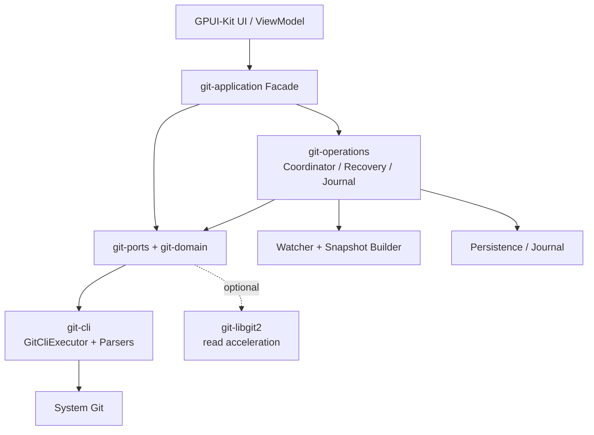
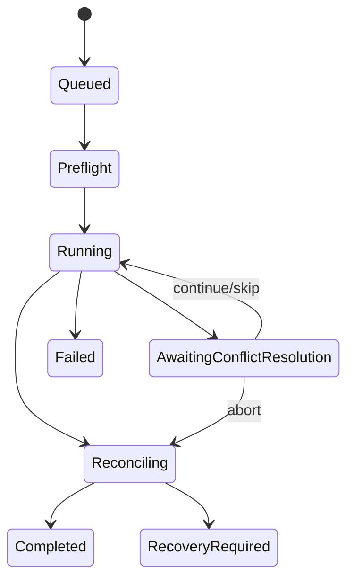

# IdeaGit — Git Core 生产级详细设计

**文档编号**：LLD-GIT-CORE-001　　**版本**：v1.0　　**状态**：可直接指导编码

> 适用范围：IntelliJ IDEA 2026.x Git 交互基准；独立 Rust + GPUI-Kit 桌面客户端；Windows、macOS、Linux。

## 1. 设计目标与结论

Git Core 是不依赖 GPUI 的、可独立运行和测试的 Git 业务内核。它将工作区、Index、HEAD、Refs、Sequencer 转换为稳定领域模型，管理多仓库并发、取消、进度、异常恢复和外部变更，并为 IDEA 风格的 Commit、Changelist、部分暂存、Diff、Graph、Branch、Remote 和 Rebase UI 提供统一 Facade。

| 领域 | 决策 |
|---|---|
| 架构 | Hexagonal Architecture + 模块化单体 |
| 写操作 | 系统 Git CLI，保持 hooks、LFS、filter、credential 配置一致 |
| 读取 | Git CLI 为基准；libgit2 仅作可替换读取加速 |
| 运行单元 | Repository Session |
| 并发 | Actor 式 Operation Coordinator + 资源锁 |
| UI 数据 | 不可变 Snapshot + 单调 Revision |
| 异步 | Tokio；子进程使用 `tokio::process::Command` |
| 监控 | `notify` + 主动校验和退避刷新 |
| 持久化 | Journal；可选 SQLite 操作索引 |
| 路径 | Git 原始 RepoPath 与 OS LocalPath 分离 |

Git Core 负责仓库发现、Status/Index/Diff/Log、Commit/Branch/Merge/Rebase、CLI、凭据协商、并发、恢复、监控和结构化事件；不负责窗口、GPUI Entity、主题、弹窗绘制和输入焦点。

## 2. 总体架构



### 2.1 Crate 与模块

```text
crates/
├── core/
│   ├── git-domain/       ids, oid, path, repository, status, branch,
│   │                     commit, diff, conflict, operation, error
│   ├── git-ports/        reader/writer traits and DTOs
│   ├── git-application/  facade, registry, session, commands, queries,
│   │                     events, snapshot_store
│   ├── git-operations/   coordinator, scheduler, locks, preflight,
│   │                     executor, state_machine, journal, recovery
│   ├── git-diff/         diff model, hunks, intraline and virtual paging
│   ├── git-graph/        commit graph lanes and refs projection
│   └── git-changelist/   IDEA changelist and staging projection
└── adapters/
    ├── git-cli/          executor, environment, discovery, parsers,
    │                     index, commit, branch, remote, sequencer
    ├── git-libgit2/      optional read adapter
    ├── repository-watcher/
    ├── credential-broker/
    └── persistence/
```

依赖必须单向：`git-domain <- git-ports <- (git-operations, git-application) <- adapters`。Domain 不能依赖 GPUI、CLI 或文件系统；CLI 不能反向依赖 Application；出现循环依赖即为架构错误。

## 3. 领域类型

```rust
#[derive(Debug, Clone, Copy, PartialEq, Eq, Hash, Serialize, Deserialize)]
pub struct RepositoryId(pub Uuid);
#[derive(Debug, Clone, Copy, PartialEq, Eq, Hash, Serialize, Deserialize)]
pub struct WorktreeId(pub Uuid);
#[derive(Debug, Clone, Copy, PartialEq, Eq, Hash, Serialize, Deserialize)]
pub struct OperationId(pub Uuid);
#[derive(Debug, Clone, Copy, PartialEq, Eq, PartialOrd, Ord)]
pub struct SnapshotRevision(pub u64);

#[derive(Debug, Clone, PartialEq, Eq, Hash)]
pub enum ObjectId { Sha1([u8; 20]), Sha256([u8; 32]) }

#[derive(Debug, Clone)]
pub struct RepositoryLocation {
    pub worktree_root: Option<PathBuf>,
    pub git_dir: PathBuf,
    pub common_dir: PathBuf,
    pub is_bare: bool,
}

#[derive(Debug, Clone, PartialEq, Eq)]
pub enum HeadState {
    Unborn { branch: String },
    Attached { branch: String, oid: ObjectId },
    Detached { oid: ObjectId },
}

#[derive(Debug, Clone, Copy, PartialEq, Eq)]
pub enum ChangeKind { Unmodified, Added, Modified, Deleted, Renamed,
    Copied, TypeChanged, Unmerged }

#[derive(Debug, Clone)]
pub struct FileChange {
    pub path: RepoPath,
    pub original_path: Option<RepoPath>,
    pub index_status: ChangeKind,
    pub worktree_status: ChangeKind,
    pub head_oid: Option<ObjectId>,
    pub index_oid: Option<ObjectId>,
    pub conflict: Option<ConflictEntry>,
}

#[derive(Debug, Clone)]
pub struct RepositorySnapshot {
    pub repository: RepositoryId,
    pub worktree: WorktreeId,
    pub revision: SnapshotRevision,
    pub head: HeadState,
    pub operation: RepositoryOperation,
    pub changes: Vec<FileChange>,
    pub untracked: Vec<RepoPath>,
    pub ahead: Option<u64>, pub behind: Option<u64>,
}
```

`RepoPath` 保存 Git 原始字节，`LocalPath` 保存 OS 原生路径，严禁将 UI 展示字符串用于实际文件操作。必须支持普通仓库、linked worktree、bare、submodule、nested repository，并通过规范化 `common_dir`、符号链接和文件系统身份确定共享协调域。Snapshot 不包含 Log、完整 Branch、Diff 或 Blob，避免大仓库刷新时复制海量数据。

## 4. Ports 与错误模型

```rust
#[derive(Debug, Clone, PartialEq, Eq)]
pub enum GitErrorKind {
    RepositoryNotFound, InvalidRepository, GitUnavailable, UnsupportedGitVersion,
    DirtyWorktree, IndexLocked, ReferenceChanged, InvalidPath, ObjectNotFound,
    AuthenticationRequired, AuthenticationFailed, NetworkFailure,
    MergeConflict, OperationAlreadyInProgress, HookRejected, SigningFailed,
    PermissionDenied, TimedOut, Cancelled, UnsupportedFeature, OutputTooLarge, Internal,
}
#[derive(Debug, Clone)]
pub struct GitError { pub kind: GitErrorKind, pub message: String,
    pub diagnostic: Option<String>, pub recoverable: bool }
pub type GitResult<T> = Result<T, GitError>;

#[async_trait]
pub trait RepositoryReader: Send + Sync {
    async fn discover(&self, path: &Path) -> GitResult<RepositoryLocation>;
    async fn read_head(&self, repo: &RepositoryLocation) -> GitResult<HeadState>;
}
#[async_trait]
pub trait StatusReader: Send + Sync {
    async fn status(&self, repo: &RepositoryLocation, options: StatusOptions)
        -> GitResult<StatusData>;
}
#[async_trait]
pub trait HistoryReader: Send + Sync {
    async fn log(&self, repo: &RepositoryLocation, q: LogQuery) -> GitResult<CommitPage>;
    async fn commit_details(&self, repo: &RepositoryLocation, oid: ObjectId)
        -> GitResult<CommitDetails>;
}
#[async_trait]
pub trait DiffReader: Send + Sync {
    async fn diff(&self, repo: &RepositoryLocation, q: DiffQuery)
        -> GitResult<DiffDocument>;
}
#[async_trait]
pub trait IndexWriter: Send + Sync {
    async fn stage(&self, repo: &RepositoryLocation, paths: Vec<RepoPath>) -> GitResult<()>;
    async fn unstage(&self, repo: &RepositoryLocation, paths: Vec<RepoPath>) -> GitResult<()>;
}
#[async_trait]
pub trait CommitWriter: Send + Sync {
    async fn commit(&self, repo: &RepositoryLocation, req: CommitRequest)
        -> GitResult<CommitOutcome>;
}
#[async_trait]
pub trait BranchWriter: Send + Sync {
    async fn create_branch(&self, repo: &RepositoryLocation, req: CreateBranchRequest)
        -> GitResult<BranchInfo>;
    async fn checkout(&self, repo: &RepositoryLocation, req: CheckoutRequest) -> GitResult<()>;
}
#[async_trait]
pub trait RemoteOperator: Send + Sync {
    async fn fetch(&self, repo: &RepositoryLocation, req: FetchRequest) -> GitResult<()>;
    async fn push(&self, repo: &RepositoryLocation, req: PushRequest) -> GitResult<()>;
}
```

长操作统一携带：

```rust
pub struct ExecutionContext {
    pub operation_id: OperationId,
    pub cancellation: CancellationToken,
    pub progress: mpsc::Sender<OperationProgress>,
    pub deadline: Option<Instant>,
}
```

诊断必须脱敏，不得写入密码、Token 或完整敏感环境变量。

## 5. CLI Executor 与解析器

### 5.1 进程边界

`GitCliExecutor` 只负责参数、环境、stdin/stdout/stderr、退出码、超时和取消；`GitOperationCoordinator` 负责排队和生命周期；Application Service 负责业务语义。命令参数必须由强类型 Command 构造，禁止 UI 传入任意 Git 字符串。

```rust
pub struct GitCliExecutor { git_path: PathBuf, limits: ProcessLimits }
pub struct CommandSpec { pub args: Vec<OsString>, pub env: Vec<(OsString, OsString)>,
    pub cwd: PathBuf, pub stdin: StdinMode, pub output_limit: usize }
pub struct CommandOutput { pub status: ExitStatus, pub stdout: Vec<u8>, pub stderr: Vec<u8> }

pub enum GitCommand {
    Stage { repo: RepositoryId, paths: Vec<RepoPath> },
    Unstage { repo: RepositoryId, paths: Vec<RepoPath> },
    Commit { repo: RepositoryId, request: CommitRequest },
    Checkout { repo: RepositoryId, target: BranchTarget },
    Fetch { repo: RepositoryId, remote: String },
    Push { repo: RepositoryId, request: PushRequest },
    Merge { repo: RepositoryId, request: MergeRequest },
    Rebase { repo: RepositoryId, request: RebaseRequest },
    ContinueOperation { repo: RepositoryId, kind: SequencerKind },
    AbortOperation { repo: RepositoryId, kind: SequencerKind },
}
```

默认使用 `git -C <worktree> -c core.quotepath=false`，机器接口优先：

```text
status --porcelain=v2 -z --branch
ls-files --stage -z
diff --raw -z
for-each-ref --format=...
log --format=... --numstat -z
cat-file --batch
```

不得解析面向人的彩色输出。每次写操作前保存 HEAD、Index 锁状态和操作前 Snapshot；结束后不猜测结果，必须重新读取 Git 实际状态。

### 5.2 Status Parser

解析器按 NUL token 工作，支持 branch header、普通 `1` 记录、rename/copy `2` 记录、unmerged `u` 记录、untracked `?` 和 ignored `!`。解析结果必须保留 XY（Index/Worktree）、HEAD/Index OID、mode、rename score、原路径、submodule 位和 conflict stages。测试中覆盖带空格、Tab、换行、Unicode、非 UTF-8、引号、重命名和 NUL 终止边界。

## 6. Repository Session、Snapshot 与 Watcher

每个 Worktree 一个 `RepositorySession`，由 Registry 以 `RepositoryId` 管理；同一 `common_dir` 的 Session 共享写资源锁，但各自拥有 worktree 状态。

```rust
pub struct RepositorySession {
    pub id: RepositoryId,
    pub location: RepositoryLocation,
    pub snapshot: ArcSwap<RepositorySnapshot>,
    pub revision: AtomicU64,
    pub coordinator: Arc<OperationCoordinator>,
    pub refresh: RefreshController,
}
```

Watcher 只产生“可能变化”信号，不直接修改领域状态。事件经过 100–300ms debounce、路径过滤和刷新合并后执行 `read_head + status + sequencer_probe`。Watcher 丢事件、外部编辑器写入、分支切换和恢复后必须由定时校验兜底。Snapshot 以不可变对象发布；UI 只能观察版本，不可原地修改。

## 7. Operation Coordinator、Journal 与 Recovery

```rust
pub enum OperationPhase { Queued, Preflight, Running, AwaitingCredentials,
    AwaitingConfirmation, AwaitingConflictResolution, Reconciling }
pub enum OperationOutcome { Success, Failed(GitError), Cancelled(CancelOutcome),
    Conflict(ConflictSummary), RecoveryRequired(RecoveryInfo) }
pub enum OperationState { Active(OperationPhase), Finished(OperationOutcome) }

#[async_trait]
pub trait GitCommandDispatcher: Send + Sync {
    async fn submit(&self, command: GitCommand) -> GitResult<OperationId>;
    async fn cancel(&self, id: OperationId) -> GitResult<CancelOutcome>;
    async fn state(&self, id: OperationId) -> GitResult<OperationSnapshot>;
}
```

资源键至少包括 `common_dir`、`worktree`、`index`、`refs`、`network(remote)`。同一 Index 的写操作互斥；只读 Status 可并行但必须在写操作结束后重新校验。Preflight 检查 Git 版本、仓库位置、Index lock、当前 sequencer、目标 ref 和路径合法性。

Journal 记录 `operation_id、command_kind、repository、before_head、before_index_stat、phase、argv_digest、started_at、finished_at、outcome`，不记录凭据。状态采用追加写、长度/校验和校验、原子替换和崩溃恢复。启动时扫描未完成记录，然后以 Git 实际状态为权威：若 Rebase/Merge/Cherry-pick 目录仍在，恢复为 AwaitingConflictResolution；若 Git 已完成，标记 Reconciled；无法判断则 RecoveryRequired 并要求用户确认。



取消只停止子进程并重新读取仓库，不能把“进程退出”当成“仓库回滚”。Hook 拒绝、认证等待、冲突和网络失败均返回结构化恢复动作。

## 8. Commit、Changelist 与 Index

Changelist 是 Application/UI 分组，不是 Git Index；必须持久化为路径集合和排除规则。Git Staging 模式直接映射 Index，IDEA Changelist 模式则在提交前由 `stage_selected` 将所选路径写入 Index，并在提交完成或取消后按策略恢复原 Index。任何恢复都要以 Index lock、外部变更和用户确认作为前置条件。

```rust
pub struct CommitRequest {
    pub message: String,
    pub author: Option<Signature>,
    pub committer: Option<Signature>,
    pub amend: bool,
    pub sign: SignMode,
    pub hooks: HookPolicy,
    pub selected_paths: Vec<RepoPath>,
}
pub struct CommitOutcome { pub oid: ObjectId, pub changed_paths: Vec<RepoPath> }
```

提交前校验空消息、无 staged 变更、冲突项、作者信息、签名可用性和 hooks。Commit 后刷新 HEAD、Index、Status、ahead/behind 和 Log 缓存。

## 9. Branch、Remote、Sequencer

Branch 模型区分 local、remote-tracking、tag、symbolic HEAD、upstream、ahead/behind、可删除和保护状态。Checkout 前检查 dirty worktree、目标冲突和 linked worktree 占用；成功后重新发现 HEAD。

Remote 操作统一支持 Fetch、Push、Pull（fetch + merge/rebase 策略），通过 CredentialBroker 处理 SSH、HTTPS、askpass 和主机确认。凭据永不进入 Journal、错误文本或 UI 日志。

Sequencer 统一抽象 Merge、Rebase、Cherry-pick、Revert：

```rust
pub enum SequencerKind { Merge, Rebase, CherryPick, Revert }
pub struct SequencerStatus { pub kind: SequencerKind, pub active: bool,
    pub current: Option<u32>, pub total: Option<u32>, pub conflicts: Vec<RepoPath> }
```

每次 Continue/Skip/Abort 前探测 Git 实际状态；不要依赖进程内标志或数据库单独判断。

## 10. Diff 与 Graph

```rust
pub enum DiffEndpoint { Head, Index, WorkingTree, Commit(ObjectId), Tree(ObjectId),
    ConflictBase, ConflictOurs, ConflictTheirs }
pub struct DiffQuery { pub left: DiffEndpoint, pub right: DiffEndpoint,
    pub paths: Vec<RepoPath>, pub context_lines: u32, pub ignore_whitespace: bool }
```

Diff 解析为文件、hunk、line、line kind、old/new line number、binary、rename、mode 和 encoding 元数据；大文件采用分段读取和虚拟列表，禁止一次性加载无上限内容。冲突三方 Diff 根据 Index stage 1/2/3 解析。

Graph 使用 commit parent 关系计算 lane：第一遍读取 commit/parents，第二遍维护活动 lane 和合并折线，第三遍投影 refs、HEAD、选中状态。大历史分页、取消和缓存必须是 Graph API 的一部分；不要把 Graph 画线逻辑放入 GPUI View。

## 11. Application Facade 与事件

```rust
#[async_trait]
pub trait GitApplication: Send + Sync {
    async fn open_repository(&self, path: PathBuf) -> GitResult<RepositoryId>;
    async fn close_repository(&self, id: RepositoryId) -> GitResult<()>;
    async fn snapshot(&self, id: RepositoryId) -> GitResult<RepositorySnapshot>;
    async fn submit(&self, command: GitCommand) -> GitResult<OperationId>;
    async fn diff(&self, id: RepositoryId, q: DiffQuery) -> GitResult<DiffDocument>;
}

pub enum GitDomainEvent {
    RepositoryOpened(RepositoryId),
    SnapshotUpdated { repository: RepositoryId, revision: SnapshotRevision },
    HeadChanged { repository: RepositoryId, head: HeadState },
    OperationChanged { repository: RepositoryId, operation: OperationId },
    RepositoryClosed(RepositoryId),
}
```

UI 单向流为：`User Action -> Application Command -> Operation -> Domain Event -> Snapshot -> ViewModel -> GPUI Entity`。每个异步请求携带 `repository、request_seq、snapshot_revision`；只接受当前序号和版本允许的结果，防止旧 Diff 覆盖新选择。

## 12. 跨平台设计

Windows：使用 `OsString`/宽字符路径、处理 `.exe` 查找、进程树终止、CRLF 和 `core.longpaths`；macOS：支持 app bundle、Keychain、Retina 缩放和 SSH agent；Linux：支持 PATH/常见 Git 安装位置、XDG 配置、SSH agent 和 Wayland/X11。所有平台都必须使用 Git 自己报告的 `git_dir/common_dir`，不得拼接 `.git` 猜路径。CI 覆盖 Windows 11、macOS 当前支持版本和 Ubuntu LTS，至少包含 UTF-8、非 UTF-8、大小写敏感/不敏感和符号链接差异。

## 13. 测试策略

| 层级 | 重点 | 最低验收 |
|---|---|---|
| Domain 单测 | OID、Path、Status、State Machine | 关键分支 80%+ |
| Parser 单测 | porcelain v2、raw diff、refs、log | 固定 bytes fixture 全覆盖 |
| Adapter 集成 | 真实 Git 临时仓库 | Git 2 个主版本 |
| Operation 集成 | 并发、锁、取消、hook、认证 | 无死锁、无悬挂进程 |
| Recovery | 崩溃、Journal 截断、冲突重启 | 可恢复或明确告警 |
| Property/Fuzz | NUL、非法 UTF-8、随机状态 | 不 panic、不越界 |
| UI 合约 | Snapshot/Event/ViewModel | 旧请求不覆盖新状态 |
| E2E | Commit、Branch、Push、Rebase、Diff | 三平台关键流程通过 |

必备用例：空仓库 Unborn HEAD；staged + unstaged 同一路径；重命名含换行文件名；三方冲突；Index.lock；hook 拒绝；认证等待；网络中断；外部 checkout；watcher 丢事件；应用在 rebase conflict 时重启；SHA-256 仓库；linked worktree；bare repository；超大 diff 与超长 stderr。

## 14. Core-M0～M6 落地计划

| 阶段 | 交付内容 | 完成门槛 |
|---|---|---|
| M0 基础 | Workspace、Domain IDs/OID/Path、错误、CLI 进程封装、CI | 三平台编译；无 UI 依赖 |
| M1 只读 | Discovery、HEAD、Status porcelain v2、Snapshot、Watcher | 临时仓库测试稳定；状态刷新正确 |
| M2 写入 | Index、Commit、Branch/Checkout、Coordinator、锁、取消 | 写操作串行安全；进程可回收 |
| M3 Diff/Log | Diff parser、Log/Graph、分页、缓存 | 大仓库不阻塞 UI；二进制与重命名正确 |
| M4 远程 | Fetch/Push/Pull、CredentialBroker、进度 | 凭据不泄漏；网络错误可恢复 |
| M5 Sequencer | Merge/Rebase/Cherry-pick、冲突、Continue/Abort、Journal | 重启后可识别并继续/终止 |
| M6 生产化 | 跨平台 CI、Fuzz、性能、诊断、SQLite 可选持久化、验收 | 质量门禁全部通过，发布包可重复构建 |

每阶段都必须先保留上一阶段 API 与测试，不以 UI 进度代替 Core 验收。M2 之后禁止任何 UI 直接调用 Git CLI。

## 15. 验收标准

1. 所有 Git 写操作都经过强类型 Command、Preflight、资源锁、Journal、Reconcile。
2. Status、Diff、Log 不解析面向人的终端文本；复杂路径和非 UTF-8 不丢失。
3. 同一仓库并发写操作不会破坏 Index、Refs 或产生悬挂 Git 子进程。
4. 应用被终止并重启后，能以 Git 实际状态恢复正常、冲突等待或 Recovery Required。
5. GPUI 线程不执行阻塞 Git/文件 IO；旧异步结果不会覆盖新选择。
6. 凭据、Token、askpass 内容和敏感环境变量不会进入日志或 Journal。
7. Windows/macOS/Linux 的关键流程、路径、缩放和 Git 安装发现均通过 CI/人工验收。
8. Domain/Ports 可在无 GPUI、无真实远程网络条件下独立测试；关键模块覆盖率达到 80% 以上。

## 16. 依赖清单

```toml
tokio = { version = "1", features = ["rt-multi-thread", "process", "sync", "time", "fs"] }
tokio-util = { version = "0.7", features = ["rt"] }
async-trait = "0.1"
serde = { version = "1", features = ["derive"] }
uuid = { version = "1", features = ["v4", "serde"] }
thiserror = "2"
notify = "8"
arc-swap = "1"
parking_lot = "0.12"
tracing = "0.1"
```

可选：`git2`/libgit2（只读加速）、`rusqlite` 或 `sqlx`（持久化索引）、`proptest`/`quickcheck`（属性测试）、`cargo-fuzz`（解析器 fuzz）、`criterion`（性能基准）。GPUI、GPUI-Kit、主题和平台窗口依赖只能位于 Desktop/UI 层，不得进入 `git-domain` 与 `git-ports`。

## 17. 最终实现原则

Git 仓库是真实状态来源，Journal 只记录意图和生命周期；CLI 是兼容性边界，libgit2 是可替换优化；Snapshot 是 UI 的读取契约，Operation Coordinator 是所有写入的唯一入口。先保证状态正确、可恢复、可诊断，再优化速度和视觉一致性。
