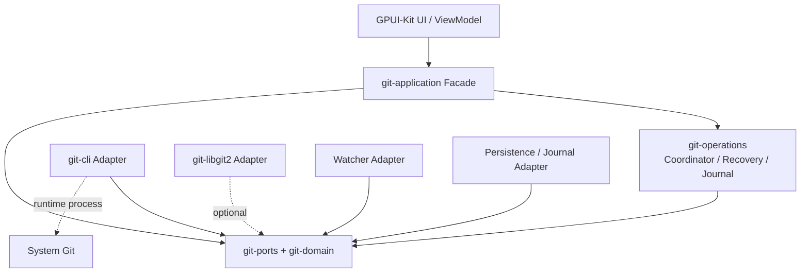

# IdeaGit — Git Core 生产级详细设计

> 修订：2026-11-06，执行已批准的 [ADR-ARCH-REMEDIATION-001](adr/ADR-ARCH-REMEDIATION-001.md) D1–D7。共享契约见 [Git Core §18](LLD-GIT-CORE-001.md)；主里程碑以 IP-001 为准。代码片段仍为设计草案，未做编译或三平台验证。

**文档编号**：LLD-GIT-CORE-001　　**版本**：v1.0　　**状态**：已按 ADR 收敛的设计规范，待工程验证

> 适用范围：IntelliJ IDEA 2026.x Git 交互基准；独立 Rust + GPUI-Kit 桌面客户端；Windows、macOS、Linux。

## 1. 设计目标与结论

Git Core 是不依赖 GPUI 的、可独立运行和测试的 Git 业务内核。它将工作区、Index、HEAD、Refs、Sequencer 转换为稳定领域模型，管理多仓库并发、取消、进度、异常恢复和外部变更，并为 IDEA 风格的 Commit、Changelist、部分暂存、Diff、Graph、Branch、Remote 和 Rebase UI 提供统一 Facade。

| 领域 | 决策 |
|---|---|
| 架构 | Hexagonal Architecture + 模块化单体 |
| 写操作 | 系统 Git CLI，保持 hooks、LFS、filter、credential 配置一致 |
| 读取 | Git CLI 为基准；libgit2 仅作可替换读取加速 |
| 运行单元 | Repository Session |
| 并发 | Actor 式 Operation Coordinator + 资源锁 |
| UI 数据 | 不可变 Snapshot + 单调 Revision |
| 异步 | Tokio；子进程使用 `tokio::process::Command` |
| 监控 | `notify` + 主动校验和退避刷新 |
| 持久化 | Journal；可选 SQLite 操作索引 |
| 路径 | Git 原始 RepoPath 与 OS LocalPath 分离 |

Git Core 负责仓库发现、Status/Index/Diff/Log、Commit/Branch/Merge/Rebase、CLI、凭据协商、并发、恢复、监控和结构化事件；不负责窗口、GPUI Entity、主题、弹窗绘制和输入焦点。

## 2. 总体架构



### 2.1 Crate 与模块

```text
crates/
├── core/
│   ├── git-domain/       ids, oid, path, repository, status, branch,
│   │                     commit, diff, conflict, operation, error
│   ├── git-ports/        reader/writer traits and DTOs
│   ├── git-application/  facade, registry, session, commands, queries,
│   │                     events, snapshot_store
│   ├── git-operations/   coordinator, scheduler, locks, preflight,
│   │                     executor, state_machine, journal, recovery
│   ├── git-diff/         diff model, hunks, intraline and virtual paging
│   ├── git-graph/        commit graph lanes and refs projection
│   ├── git-commit/       candidate preview and commit transaction
│   └── git-changelist/   IDEA changelist and staging projection
└── adapters/
    ├── git-cli/          executor, environment, discovery, parsers,
    │                     index, commit, branch, remote, sequencer
    ├── git-libgit2/      optional read adapter
    ├── repository-watcher/
    ├── credential-broker/
    └── persistence/
```

编译依赖：Application → Operations → Ports → Domain；Adapters → Ports/Domain；git-commit → Ports/Diff，Operations → git-commit。具体实现由 Desktop 注入，Ports 不依赖 Adapters。完整允许边见 §18.1。

## 3. 领域类型

共享类型及接口以 [Git Core §18 统一契约](LLD-GIT-CORE-001.md) 为准；此处不再重复定义。

`RepoPath` 保存 Git 原始字节，`LocalPath` 保存 OS 原生路径，严禁将 UI 展示字符串用于实际文件操作。必须支持普通仓库、linked worktree、bare、submodule、nested repository，并通过规范化 `common_dir`、符号链接和文件系统身份确定共享协调域。Snapshot 不包含 Log、完整 Branch、Diff 或 Blob，避免大仓库刷新时复制海量数据。

## 4. Ports 与错误模型

共享类型及接口以 [Git Core §18 统一契约](LLD-GIT-CORE-001.md) 为准；此处不再重复定义。

长操作统一携带：

共享类型及接口以 [Git Core §18 统一契约](LLD-GIT-CORE-001.md) 为准；此处不再重复定义。

诊断必须脱敏，不得写入密码、Token 或完整敏感环境变量。

## 5. CLI Executor 与解析器

### 5.1 进程边界

`GitCliExecutor` 只负责参数、环境、stdin/stdout/stderr、退出码、超时和取消；`GitOperationCoordinator` 负责排队和生命周期；Application Service 负责业务语义。命令参数必须由强类型 Command 构造，禁止 UI 传入任意 Git 字符串。

共享类型及接口以 [Git Core §18 统一契约](LLD-GIT-CORE-001.md) 为准；此处不再重复定义。

普通工作区使用 git -C <worktree> -c core.quotepath=false；bare 查询按 RepositoryLocation 使用正确 git_dir，不拼空 worktree 路径。机器接口优先：

```text
status --porcelain=v2 -z --branch
ls-files --stage -z
diff --raw -z
for-each-ref --format=...
log --format=... --numstat -z
cat-file --batch
```

不得解析面向人的彩色输出。每次写操作前保存 HEAD、Index 锁状态和操作前 Snapshot；结束后不猜测结果，必须重新读取 Git 实际状态。

### 5.2 Status Parser

解析器按 NUL token 工作，支持 branch header、普通 `1` 记录、rename/copy `2` 记录、unmerged `u` 记录、untracked `?` 和 ignored `!`。解析结果必须保留 XY（Index/Worktree）、HEAD/Index OID、mode、rename score、原路径、submodule 位和 conflict stages。测试中覆盖带空格、Tab、换行、Unicode、非 UTF-8、引号、重命名和 NUL 终止边界。

## 6. Repository Session、Snapshot 与 Watcher

每个 Worktree 一个 RepositorySession；Registry 以 repository/worktree 组合和会话世代定位，返回引用计数句柄。同一 common_dir 共享 RepositoryId 及公共资源锁。bare 会话无 WorktreeId，仅暴露可用读取能力。

共享类型及接口以 [Git Core §18 统一契约](LLD-GIT-CORE-001.md) 为准；此处不再重复定义。

Watcher 只产生“可能变化”信号，不直接修改领域状态。事件经过 100–300ms debounce、路径过滤和刷新合并后执行 `read_head + status + sequencer_probe`。Watcher 丢事件、外部编辑器写入、分支切换和恢复后必须由定时校验兜底。Snapshot 以不可变对象发布；UI 只能观察版本，不可原地修改。

## 7. Operation Coordinator、Journal 与 Recovery

共享类型及接口以 [Git Core §18 统一契约](LLD-GIT-CORE-001.md) 为准；此处不再重复定义。

资源键至少包括 `common_dir`、`worktree`、`index`、`refs`、`network(remote)`。同一 Index 的写操作互斥；只读 Status 可并行但必须在写操作结束后重新校验。Preflight 检查 Git 版本、仓库位置、Index lock、当前 sequencer、目标 ref 和路径合法性。

Journal 的字段、耐久化和恢复协议统一见 §18.5。mtime/size 只能辅助诊断，不能替代强指纹或内容备份。重启依据实际 Git 状态恢复；已提交但待恢复须保留 OID，未知结果不得自动重试。

命令转移表和持久 Sequencer 状态见 §18.5；所有可能已有副作用的失败均先 Reconciling，不使用 Running → Failed 的捷径。

取消只停止子进程并重新读取仓库，不能把“进程退出”当成“仓库回滚”。Hook 拒绝、认证等待、冲突和网络失败均返回结构化恢复动作。

## 8. Commit、Changelist 与 Index

Changelist 是独立持久化的逻辑选择及指纹，不是 Git Index。M2 仅实现标准 Index Commit。禁止先将逻辑选择写入真实 Index 再恢复；高级选择提交只允许在临时 Index 生成候选并经过安全门禁后开放，详见 CCD §9 和本文件 §18.5。恢复不得自动覆盖当前 Index。

共享类型及接口以 [Git Core §18 统一契约](LLD-GIT-CORE-001.md) 为准；此处不再重复定义。

提交前校验空消息、无 staged 变更、冲突项、作者信息、签名可用性和 hooks。Commit 后刷新 HEAD、Index、Status、ahead/behind 和 Log 缓存。

## 9. Branch、Remote、Sequencer

Branch 模型区分 local、remote-tracking、tag、symbolic HEAD、upstream、ahead/behind、可删除和保护状态。Checkout 前检查 dirty worktree、目标冲突和 linked worktree 占用；成功后重新发现 HEAD。

Remote 操作统一支持 Fetch、Push、Pull（fetch + merge/rebase 策略），通过 CredentialBroker 处理 SSH、HTTPS、askpass 和主机确认。凭据永不进入 Journal、错误文本或 UI 日志。

Sequencer 统一抽象 Merge、Rebase、Cherry-pick、Revert：

```rust
pub enum SequencerKind { Merge, Rebase, CherryPick, Revert }
pub struct SequencerStatus { pub kind: SequencerKind, pub active: bool,
    pub current: Option<u32>, pub total: Option<u32>, pub conflicts: Vec<RepoPath> }
```

每次 Continue/Skip/Abort 前探测 Git 实际状态；不要依赖进程内标志或数据库单独判断。

## 10. Diff 与 Graph

共享类型及接口以 [Git Core §18 统一契约](LLD-GIT-CORE-001.md) 为准；此处不再重复定义。

Diff 解析为文件、hunk、line、line kind、old/new line number、binary、rename、mode 和 encoding 元数据；大文件采用分段读取和虚拟列表，禁止一次性加载无上限内容。冲突三方 Diff 根据 Index stage 1/2/3 解析。

Graph 使用 commit parent 关系计算 lane：第一遍读取 commit/parents，第二遍维护活动 lane 和合并折线，第三遍投影 refs、HEAD、选中状态。大历史分页、取消和缓存必须是 Graph API 的一部分；不要把 Graph 画线逻辑放入 GPUI View。

## 11. Application Facade 与事件

共享类型及接口以 [Git Core §18 统一契约](LLD-GIT-CORE-001.md) 为准；此处不再重复定义。

UI 单向流为：`User Action -> Application Command -> Operation -> Domain Event -> Snapshot -> ViewModel -> GPUI Entity`。每个异步请求携带 `repository、request_seq、snapshot_revision`；只接受当前序号和版本允许的结果，防止旧 Diff 覆盖新选择。

## 12. 跨平台设计

Windows：使用 `OsString`/宽字符路径、处理 `.exe` 查找、进程树终止、CRLF 和 `core.longpaths`；macOS：支持 app bundle、Keychain、Retina 缩放和 SSH agent；Linux：支持 PATH/常见 Git 安装位置、XDG 配置、SSH agent 和 Wayland/X11。所有平台都必须使用 Git 自己报告的 `git_dir/common_dir`，不得拼接 `.git` 猜路径。CI 覆盖 Windows 11、macOS 当前支持版本和 Ubuntu LTS，至少包含 UTF-8、非 UTF-8、大小写敏感/不敏感和符号链接差异。

## 13. 测试策略

| 层级 | 重点 | 最低验收 |
|---|---|---|
| Domain 单测 | OID、Path、Status、State Machine | 关键分支 80%+ |
| Parser 单测 | porcelain v2、raw diff、refs、log | 固定 bytes fixture 全覆盖 |
| Adapter 集成 | 真实 Git 临时仓库 | Git 2 个主版本 |
| Operation 集成 | 并发、锁、取消、hook、认证 | 无死锁、无悬挂进程 |
| Recovery | 崩溃、Journal 截断、冲突重启 | 可恢复或明确告警 |
| Property/Fuzz | NUL、非法 UTF-8、随机状态 | 不 panic、不越界 |
| UI 合约 | Snapshot/Event/ViewModel | 旧请求不覆盖新状态 |
| E2E | Commit、Branch、Push、Rebase、Diff | 三平台关键流程通过 |

必备用例：空仓库 Unborn HEAD；staged + unstaged 同一路径；重命名含换行文件名；三方冲突；Index.lock；hook 拒绝；认证等待；网络中断；外部 checkout；watcher 丢事件；应用在 rebase conflict 时重启；SHA-256 仓库；linked worktree；bare repository；超大 diff 与超长 stderr。

## 14. Core 子阶段与主计划映射

主排期以 [IP-001](../plans/IP-001-development-plan.md) 为准。Core-M0 基础映射主 M0/M1；Core-M1 只读映射 M1；Core-M2 写入映射 M2（包括 Lock/Journal/基础恢复门禁）；原 Core-M3 Diff/Log 拆至主 M1/M2；Core-M4 远程和 Core-M5 Sequencer 映射主 M3，交互 Rebase 扩展为 M5；Core-M6 加固映射 M6。子阶段名不是主里程碑承诺。

每阶段保留前阶段契约与测试。所有阶段均禁止 UI 直接调用 Git CLI。

## 15. 验收标准

1. 所有 Git 写操作都经过强类型 Command、Preflight、资源锁、Journal、Reconcile。
2. Status、Diff、Log 不解析面向人的终端文本；复杂路径和非 UTF-8 不丢失。
3. 同一仓库并发写操作不会破坏 Index、Refs 或产生悬挂 Git 子进程。
4. 应用被终止并重启后，能以 Git 实际状态恢复正常、冲突等待或 Recovery Required。
5. GPUI 线程不执行阻塞 Git/文件 IO；旧异步结果不会覆盖新选择。
6. 凭据、Token、askpass 内容和敏感环境变量不会进入日志或 Journal。
7. Windows/macOS/Linux 的关键流程、路径、缩放和 Git 安装发现均通过 CI/人工验收。
8. Domain/Ports 可在无 GPUI、无真实远程网络条件下独立测试；关键模块覆盖率达到 80% 以上。

## 16. 依赖清单

```toml
tokio = { version = "1", features = ["rt-multi-thread", "process", "sync", "time", "fs"] }
tokio-util = { version = "0.7", features = ["rt"] }
async-trait = "0.1"
serde = { version = "1", features = ["derive"] }
uuid = { version = "1", features = ["v4", "serde"] }
thiserror = "2"
notify = "8"
arc-swap = "1"
parking_lot = "0.12"
tracing = "0.1"
```

可选：`git2`/libgit2（只读加速）、`rusqlite` 或 `sqlx`（持久化索引）、`proptest`/`quickcheck`（属性测试）、`cargo-fuzz`（解析器 fuzz）、`criterion`（性能基准）。GPUI、GPUI-Kit、主题和平台窗口依赖只能位于 Desktop/UI 层，不得进入 `git-domain` 与 `git-ports`。

## 17. 最终实现原则

Git 仓库是真实状态来源，Journal 只记录意图和生命周期；CLI 是兼容性边界，libgit2 是可替换优化；Snapshot 是 UI 的读取契约，Operation Coordinator 是所有写入的唯一入口。先保证状态正确、可恢复、可诊断，再优化速度和视觉一致性。

## 18. 统一业务契约（ADR 修订后的权威定义）

依据 [ADR-ARCH-REMEDIATION-001](adr/ADR-ARCH-REMEDIATION-001.md) D1–D5，本节是六份设计中共享契约的唯一权威定义。以下为字段/语义规格，尚非完整可编译 Rust；实现须补齐构造器、导入、序列化、错误实现及契约测试。其他章节的流程例子不得自行新增另一套同名 DTO。

### 18.1 类型所有权和依赖

| 模块 | 所有权 / 允许的编译依赖 |
|---|---|
| git-domain | ID、RepoPath、HEAD、Snapshot、GitCommand、Commit/Diff/Selection DTO、错误；纯类型，不依赖 Tokio/GPUI/IO 实现 |
| git-ports | → domain；读写/存储/凭据/Journal/监控接口和 ExecutionContext |
| git-diff / git-changelist / git-graph | → domain；算法，需外部持久化时通过 ports 注入 |
| git-commit | → ports/diff；候选预览与事务引擎，不依赖 operations |
| git-operations | → ports/commit；队列、锁、Journal 编排、恢复 |
| git-application | → operations/ports；会话、Facade、事件、投影，可重导出领域命令 |
| adapters | → ports/domain；实现端口，不依赖 application/UI |
| UI / desktop | UI → application/共享 UI model；desktop 装配实现；Shell/Feature 不互相导入具体类型 |

### 18.2 身份、快照和选择

| 类型 | 统一定义 |
|---|---|
| RepositoryId | 规范化 common Git dir 对应的逻辑仓库身份，同一仓库 linked worktree 共享 |
| WorktreeId | 具体工作区身份；不以显示路径大小写归一化替代文件系统身份 |
| SessionTarget | repository: RepositoryId、worktree: Option<WorktreeId>、session_generation: u64；bare 的 worktree 为 None；已关闭世代不得执行新请求 |
| RepositorySessionHandle | target: SessionTarget；每个打开方持有引用；close 仅释放该使用方，最后引用关闭会话并停止任务 |
| RepositoryLocation | worktree_root: Option<PathBuf>、git_dir、common_dir、is_bare；位于适配边界，不能用空路径冒充 bare 工作区 |
| RepoPath | 私有原始字节，验证构造器拒绝非法 NUL/越界；实现所需 Eq/Hash；反序列化同样验证；不能由展示文本还原 |
| HeadState | Unborn { branch } / Attached { branch, oid } / Detached { oid } |
| SnapshotRevision | u64 世代，作用域为 SessionTarget；不是 Git 原子快照 |
| RepositorySnapshot | repository、worktree: Option<WorktreeId>、revision、head、operation、changes: Vec<FileChange>、untracked、ahead/behind: Option<u64>；附读取一致性/陈旧标记 |
| FileChange | path/original_path、index_status/worktree_status、head_oid/index_oid、mode/submodule/conflict 元数据；Staged/Unstaged 为 UI 投影 |
| ChangeKind | Unmodified/Added/Modified/Deleted/Renamed/Copied/TypeChanged/Unmerged；untracked 由独立集合表达 |
| FileIdentity | repository、worktree、path、previous_path、file_kind；必须与执行目标一致 |
| ChangeSelection | WholeFile { file } / Hunks { file, ids } / Lines { file, hunk, ranges }；LineSpan 为零起点半开区间 |
| SelectionFingerprint | expected_head/index、diff_generation、content_digest；有 Valid/Ambiguous/Stale 等绑定状态 |
| Changelist | repository、worktree、id、schema_version、name/description/is_default、bindings；每个 binding 含选择、指纹与失效状态，空列表也有归属 |

bare 只开放 capability 允许的查询；缺工作区不等于干净仓库。写工作区/Index 的请求必须带 Some(worktree)。多窗口可共享快照但不共享焦点和请求序号。

### 18.3 Facade、Ports 与进程边界

GitApplication 使用 async_trait，Send + Sync。以下参数/返回类型是设计契约，错误统一 GitResult：

| 方法 | 参数 → 返回 |
|---|---|
| open_repository | PathBuf → RepositorySessionHandle |
| close_repository | RepositorySessionHandle → ()，释放调用方引用 |
| snapshot | SessionTarget → Arc<RepositorySnapshot> |
| log / commit_details | SessionTarget + LogQuery / ObjectId → CommitPage / CommitDetails |
| diff | SessionTarget + DiffQuery → DiffDocument |
| submit | GitCommand（含唯一 target）→ OperationId |
| cancel / operation | OperationId → CancelOutcome / OperationSnapshot |
| subscribe | SessionTarget → 事件订阅句柄；支持报告 lag/关闭 |
| prepare_commit | SessionTarget + SelectionCommitRequest → CommitPreview |
| open/read/close_edited_index | SessionTarget + 文件/会话句柄 → 编辑会话/候选读取/释放；仅修改临时内容，Apply 必须经 submit |

高级方法未开放时返回 UnsupportedFeature，不能旁路协调器。事件统一 GitEvent，包含 target、SnapshotUpdated(revision)、HeadChanged(head)、OperationChanged(id) 及会话生命周期。先订阅再读快照，按版本去重；lag 时重新获取快照和操作结果。OperationFinished 不另建一套事件语义，终态由 OperationChanged 后查询 operation 获取。

底层 RepositoryReader.discover(Path) → RepositoryLocation；read_head(Location) → HeadState。StatusReader.status(Location, options) → StatusData；HistoryReader.log/commit_details(Location, query/oid)；DiffReader.diff(Location, query)、blob(Location, query)。Facade 的 ID 由 Application 解析，不要求 adapter 反向访问 Application Registry。

ChangelistRepository.list/save/delete 均显式携带 repository/worktree；save 的作用域与数据不一致必须拒绝。存储 schema 迁移/备份为用户数据契约。

ExecutionContext 位于 ports：operation_id、CancellationToken、有界 progress Sender、deadline: Option<Instant>。长操作与写端口显式接收 ctx。所有普通写端口只由已获授权的协调器调用。

ProcessSpec/CommandSpec 统一 executable、cwd、args: Vec<OsString>、env（含敏感字段标记/覆盖规则）、stdin（空/受控字节/流）、timeout、stdout/stderr 限额。并发消费管道，超限/超时必须终止并回收子进程；进程组/Windows Job 等平台实现验证后才能声称进程树取消。Token 或丢弃 future 本身不是终止证明。

### 18.4 Command、Commit 与 Diff

GitCommand 的每个变体只携带一个 SessionTarget；包括 StageFiles/UnstageFiles、StageSelection/UnstageSelection（选择+指纹）、ApplyEditedIndex（会话句柄）、CommitIndex、CommitSelection、Checkout/Branch、Remote 和 Sequencer Continue/Skip/Abort。未实现命令可显式拒绝。任何 nested FileIdentity/preview 目标与 target 不同均拒绝。

CommitOptions：message: Vec<u8>、amend、allow_empty、signoff、author/committer 可选覆盖、signing: UseGitConfig/Disable/Require。默认尊重原生 Hooks，不隐式跳过。StandardCommitRequest = options + expected_revision + Index/HEAD 基线；SelectionCommitRequest = options + selections + fingerprints + preview 身份。不得再用通用 selected_paths 偷换两种提交模式。

CommitPreview：目标、expected_head/index 强指纹、candidate_tree、selection_digest、过期身份、warnings；必须绑定实际确认内容。CommitOutcome 统一：
- CommittedAndReconciled { oid, tree }；
- CommittedButNeedsRecovery { oid, journal_id }；
- NoCommit { reason }（必须确认提交未发生）；
- Indeterminate { journal_id }。

ContentSource：Head/Index/Worktree/Commit(OID)/Tree(OID)/ConflictStage(1..3)。DiffQuery 只含比较端点、paths、context_lines、ignore_whitespace、max_bytes，目标由 Facade 参数提供一次；冲突来源必须绑定路径及有效 stage。DiffDocument 含 generation、files、truncated，FileDiff 保留路径/OID/mode/类型及字节行/no-newline 元数据。完整可写 Patch 为另一类型，需所有 headers、基线/目标 Blob、未截断证明；展示 AST 不是通用 Patch 序列化器。

### 18.5 生命周期、Journal 与开放条件

命令阶段：Queued → ResourceWait → Preflight → Running → Reconciling → Finished(outcome)，凭据等待为 Running 的等待阶段。副作用可能已发生时，失败/取消不得跳过 Reconciling；队列中确认未执行的取消可直接结束。

Sequencer 状态与命令状态分开：冲突命令结束为 Conflict，仓库维持 AwaitingConflictResolution；Continue/Skip/Abort 创建关联 Operation，重新获锁，不让等待用户的旧命令占队列。UI 的 Saved Result 不等于 Resolved，Stage 后仍需检查是否允许 Continue。

Journal 统一 schema、目标身份、command、预期 HEAD、原 Index 强指纹/备份、候选 Tree、已观察 commit OID/父提交、phase、reconcile 结果；敏感信息不得入日志。PartialCommitPhase 统一为 IntentRecorded、SnapshotCaptured、TempIndexPrepared、PreviewReady、PreflightRevalidated、CommitInProgress、CommitObserved、ReconcilingIndex、Completed、RecoveryRequired；它是持久子阶段，不与 OperationPhase 混用。写前耐久化、提交后响应丢失和截断日志都要有恢复测试；不自动重试 Commit，不自动覆盖当前 Index。

M2 仅标准 Index Commit。高级候选 Index 发布需单独证明锁内比较/发布协议：应用资源锁不是外部锁；不得占有真实 index.lock 又调用争用该锁的 Git。标准命令由 Git 自行获锁。高级写入协议未证明前关闭该 capability。Git 自有锁不提供跨 HEAD/Index/Worktree/Hooks 原子事务。

部分提交和编辑 Index 的对外开放依赖 CCD-007/008/009、TEST-004 与恢复门禁；无法证明的 Hook/HEAD 竞态、重叠暂存转移、filter/sparse/split Index 组合必须拒绝或只读。后验检测只支持诊断恢复，不承诺能阻止已经发生的偏离提交。

### 18.6 结构化错误与取消

GitResult<T> = Result<T, GitError>。GitError 包含 kind、脱敏 message/diagnostic、target/operation_id 可选上下文及 recovery_actions；可否重试由操作结果与恢复动作决定，不能只根据一个 recoverable 布尔值自动重做。

GitErrorKind 统一 RepositoryNotFound、InvalidRepository、GitUnavailable、UnsupportedGitVersion、DirtyWorktree、IndexLocked、ReferenceChanged、InvalidPath、ObjectNotFound、AuthenticationRequired、AuthenticationFailed、NetworkFailure、MergeConflict、OperationAlreadyInProgress、HookRejected、SigningFailed、PermissionDenied、TimedOut、Cancelled、UnsupportedFeature、OutputTooLarge、StaleSelection、AmbiguousHunk、PatchCheckFailed、IndexChangedExternally、HeadChangedExternally、UnsupportedFileKind、UnsupportedEncoding、HooksMutatedRepository、Internal。不得另建同义错误名；已提交需恢复/未知结果由 CommitOutcome 表达，不降成普通 GitError。

OperationOutcome 统一 Success（含具体业务结果）、Failed(GitError)、Cancelled(CancelOutcome)、Conflict（含 Sequencer 身份）、RecoveryRequired（含诊断和已观察业务结果）。CancelOutcome 明确未执行/已停止并核对/需恢复三类，不承诺回滚。UI 消费结构化业务结果，不只展示字符串错误。
