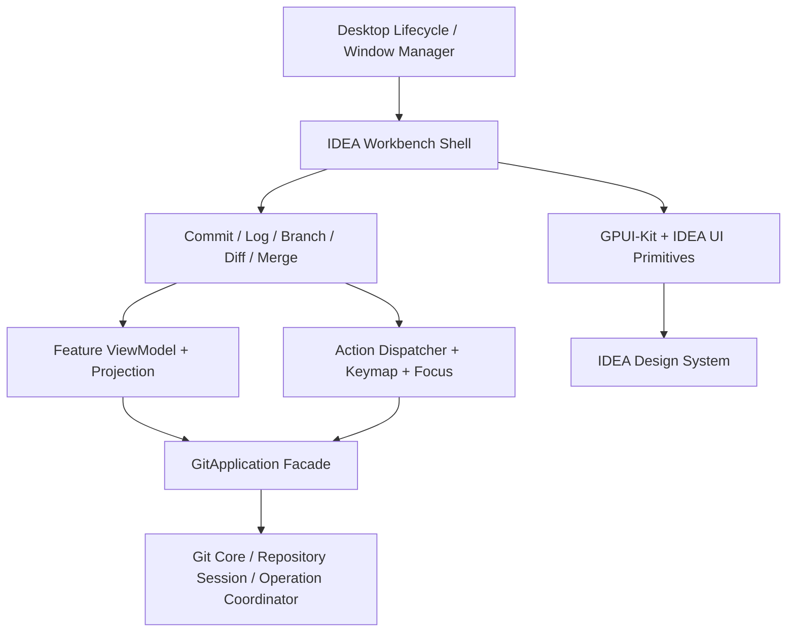
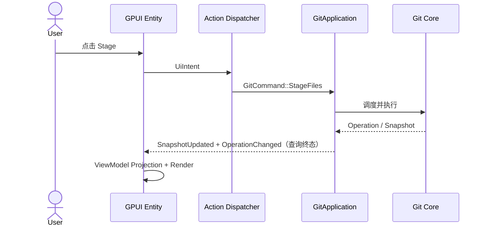
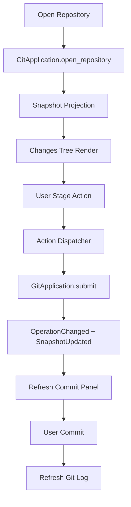

# IdeaGit — GPUI-Kit UI 生产级详细设计

> 修订：2026-11-06，执行已批准的 [ADR-ARCH-REMEDIATION-001](adr/ADR-ARCH-REMEDIATION-001.md) D1–D7。共享契约见 [Git Core §18](LLD-GIT-CORE-001.md)；主里程碑以 IP-001 为准。代码片段仍为设计草案，未做编译或三平台验证。

> **文档编号**：LLD-UI-001  
> **版本**：v1.0  
> **日期**：2026-11-06  
> **目标产品**：独立 Rust + GPUI-Kit Git 桌面客户端  
> **复刻基准**：IntelliJ IDEA 2026.x New UI（首版建议锁定 2026.2）  
> **平台**：Windows / macOS / Linux  
> **文档状态**：实现设计基线；代码示例为设计接口草案，需锁定实际依赖版本后编译验证。

## 目录

1. [目标、范围与验收原则](#1-目标范围与验收原则)
2. [总体分层及架构约束](#2-总体分层及架构约束)
3. [Rust Workspace 与模块依赖](#3-rust-workspace-与模块依赖)
4. [GPUI-Kit 基础接入与 Dock](#4-gpui-kit-基础接入与-dock)
5. [Workbench、窗口与 Entity 生命周期](#5-workbench窗口与-entity-生命周期)
6. [UI 数据模型、ViewModel 和异步桥接](#6-ui-数据模型viewmodel-和异步桥接)
7. [Action System、Keymap 与 Focus](#7-action-systemkeymap-与-focus)
8. [Git Log UI](#8-git-log-ui)
9. [Commit Panel 与 Changes Tree](#9-commit-panel-与-changes-tree)
10. [Branches Popup](#10-branches-popup)
11. [Diff Viewer](#11-diff-viewer)
12. [Merge Conflict Resolver](#12-merge-conflict-resolver)
13. [Theme、Design Tokens、Overlay](#13-themedesign-tokensoverlay)
14. [跨平台工程策略](#14-跨平台工程策略)
15. [性能、测试及生产验收](#15-性能测试及生产验收)
16. [UI-M0～UI-M6 分阶段计划](#16-ui-m0ui-m6-分阶段计划)
17. [首个垂直切片与任务拆解](#17-首个垂直切片与任务拆解)
18. [架构决策记录与风险](#18-架构决策记录与风险)

---

## 1. 目标、范围与验收原则

### 1.1 产品定位

打造一个以 **IntelliJ IDEA 2026.x Git 功能交互**为参考、使用 **Rust + GPUI + GPUI-Kit** 实现的 **原生独立 Git 桌面客户端**。界面包括仓库列表、Git Log、Commit、Branches、Diff、Merge、Stash、Push/Pull 等。与 IDE 内嵌模式不同，本产品自行负责窗口、仓库标签、工作台、设置、快捷键及布局恢复。

**高保真三层目标：**

- **视觉**：标题栏、工具窗口、表格、树、弹窗、状态栏、间距、颜色及交互状态与选定 IDEA 版本尽量一致。
- **流程**：入口位置、步骤、操作前检查、确认弹窗、键盘导航、操作完成/失败反馈与 IDEA 尽量一致。
- **语义**：所有 Git 操作以 Git Core 的真实仓库状态为准，UI 不凭本地推断伪造成功。

商业发布应使用原创品牌名称、图标与视觉资产，避免直接复制 JetBrains 的受保护资产；可借鉴布局与交互模式。

### 1.2 版本基线

2026.x 可能出现小版本行为差异。建立 `docs/ui-spec/idea-2026.2/`：实际截图、录屏、菜单树、尺寸记录、键位记录、交互 YAML。只有经实测的属性才能标记为“IDEA 完全一致”；工程初值不能冒充精确像素测量。

### 1.3 产品功能域

| 域 | 主要功能 | 优先级 |
|---|---|---|
| Workbench | 主窗口、仓库标签、Dock、布局恢复 | P0 |
| Changes/Commit | Staged/Unstaged、Commit Draft、Commit/Amend、Changelists | P0/P2 |
| Git Log | DAG、搜索过滤、Commit Details、Changed Files | P0 |
| Branches | 分支搜索、Checkout、Create、Rename、Delete、Merge/Rebase 入口 | P0/P1 |
| Diff | Unified、Side-by-side、Three Version、Hunk Actions | P0/P2 |
| Remote | Fetch、Pull、Push Dialog、Progress、Credentials | P1 |
| Conflict | 三方编辑、冲突导航、Apply/Continue/Abort | P1 |
| Advanced | Shelf、Stash、Interactive Rebase、Blame | P2 |
| App | Theme、Keymap、通知、设置、辅助功能、跨平台 | 全阶段 |

### 1.4 禁止事项

1. UI Crate 不直接运行 `git` 子进程。
2. UI 不写 Index/Refs/Worktree；必须通过 `GitApplication`。
3. 不跨线程直接修改 GPUI Entity。
4. 不将 Git Log、Diff 全量内容放入全局 Workbench Entity。
5. 不将 `selected`、`focused`、`hovered` 互斥建模。
6. 不在异步操作真正完成前将 Git 状态“乐观更新”为成功。
7. 不将 UI 截图测试等同于业务正确性测试。

---

## 2. 总体分层及架构约束



| 层 | 职责 | 约束 |
|---|---|---|
| Desktop | 启动、窗口生命周期、配置、三平台差异 | 不实现 Git 业务 |
| Shell | Dock、仓库 Tabs、StatusBar、Overlay Host | 不运行 Git CLI |
| Feature UI | 绘制、交互、局部焦点/选择/滚动 | 不持有真实 Git 写状态 |
| UI Model | DTO、投影、选择、请求身份 | 不依赖 GPUI 控件细节为佳 |
| Action | 统一入口、可用性策略、分发 | 执行前再次校验上下文 |
| GitApplication | Command、Query、Subscription | 独立于 GPUI |
| Git Core | 仓库事实、变更事务、Sequencer | UI 不反向依赖 |

**四类状态独立：** Git Domain State（HEAD/Index/Refs）；Application State（Session、Operation）；Feature View State（过滤、选中项、分页）；Transient UI State（Focus/Hover/Popup/Drag）。

---

## 3. Rust Workspace 与模块依赖

```text
crates/ui/
├── idea-theme/
│   └── src/{colors,typography,metrics,icons,semantic,theme_registry}.rs
├── idea-ui-primitives/
│   └── src/{toolbar,tool_window_header,tree_view,popup,context_menu,split_view,
│           loading_state,notification,search_field}.rs
├── idea-shell/
│   └── src/{app_window,workbench,titlebar,repository_tabs,dock_layout,dock_skin,
│           statusbar,overlay_host,window_manager,layout_persistence}.rs
├── git-ui-model/
│   └── src/{command,action,selection,events,projection,request_token,presentation}.rs
├── git-workbench/
│   └── src/{workspace_controller,repository_explorer,action_dispatcher,keyboard,subscriptions}.rs
├── git-commit-ui/
│   └── src/{commit_panel,commit_vm,changes_tree,staging_view,changelist_view,
│           message_editor,commit_checks}.rs
├── git-log-ui/
│   └── src/{log_panel,log_vm,commit_table,commit_graph,log_toolbar,log_filters,commit_details}.rs
├── git-branch-ui/
│   └── src/{branch_popup,branch_vm,branch_tree,branch_actions,branch_dialogs}.rs
├── git-diff-ui/
│   └── src/{diff_viewer,diff_vm,unified,side_by_side,three_version,
│           diff_gutter,line_alignment,diff_toolbar}.rs
├── git-merge-ui/
│   └── src/{conflict_list,merge_resolver,merge_vm,conflict_block,result_editor}.rs
├── git-stash-ui/
├── git-settings-ui/
└── ui-testing/
```

### 3.1 依赖约束

`apps/desktop` 装配 Shell、Workbench、Feature UI。Feature UI 依赖 UI Model 与 Primitives；Primitives 依赖 Theme；UI Model 依赖 `git-application` 发布的 API 类型（或通过独立 Port 适配），绝不依赖 `git-cli`。

第一阶段可将 `git-stash-ui` 与设置 UI 暂时作为模块目录，不必立即独立 Crate，控制编译复杂度。

### 3.2 核心依赖示意

```toml
# 版本仅为设计参考；应核对选定 gpui-kit 发布版本和 API 后锁定 Cargo.lock
[dependencies]
gpui-kit = "=0.9.0"
serde = { version = "1", features = ["derive"] }
serde_json = "1"
tracing = "0.1"

[dev-dependencies]
# 若锁定版本支持该 feature，再启用
gpui-kit = { version = "=0.9.0", features = ["test-support"] }
```

**注意**：下文中带有 `Idea*`、`Git*` 的类型均为项目自定义。GPUI-Kit/Dock 的代码是接入方向和 API 草案，实际名称、trait、生命周期及 feature gate 必须基于锁定的 Git commit/tag 编译验证，不能视为已验证源码。

---

## 4. GPUI-Kit 基础接入与 Dock

### 4.1 Application Composition Root

启动顺序：读取配置 → 初始化日志 → 构建 GitApplication → 加载主题与 Action Registry → 初始化 GPUI-Kit → 创建窗口 → 注册 Panel Builder → 恢复布局 → 订阅仓库快照。

```rust
// 结构性示例，不是复制即编译的完整程序
pub struct AppServices {
    pub git: std::sync::Arc<dyn GitApplication>,
    pub actions: std::sync::Arc<ActionRegistry>,
    pub settings: std::sync::Arc<dyn SettingsStore>,
}

pub struct DesktopBootstrap {
    pub services: AppServices,
}
```

### 4.2 Dock 区域

- TitleBar：应用名、当前仓库、分支、搜索。
- RepositoryTabBar：多仓库切换。
- Left Dock：Branches、Repositories、Tags、Stash。
- Center Dock：Git Log、Commit、Diff。
- Right Dock：Commit Details、Changed Files。
- Bottom Dock：Console、Operation Queue。
- StatusBar：当前 Branch、Ahead/Behind、Git 状态。
- Overlay Host：Branch Popup、Push Dialog、Merge Resolver、Confirm Dialog。

```text
AppWindow
├── TitleBar
├── RepositoryTabBar
├── DockArea
│   ├── Left: RepositoryExplorer
│   ├── Center: GitLog / Commit / Diff Tabs
│   ├── Right: Details / ChangedFiles
│   └── Bottom: Console / OperationQueue
├── StatusBar
└── OverlayHost
```

### 4.3 Dock 实现策略

优先使用 GPUI-Kit 提供的 DockArea、PaneTree、序列化布局能力；创建 `IdeaDockSkin` 自定义 Tab、Splitter、Header、选中样式。不要重新实现拖拽树与分割布局引擎。

```rust
pub enum PanelKind {
    RepositoryExplorer,
    GitLog,
    Commit,
    Diff,
    CommitDetails,
    GitConsole,
    OperationQueue,
}

#[derive(serde::Serialize, serde::Deserialize)]
pub struct WorkspaceLayoutRecord {
    pub schema_version: u32,
    pub workspace_key: String,
    pub layout_json: serde_json::Value,
}
```

持久化协议：Dock LayoutChanged → 事件 Debounce → 导出 Dock State → 原子写入；重启时注册 Panel Builder，再尝试恢复；Schema 不兼容时执行迁移或使用 Default Layout。移除 Panel 与隐藏 Panel 的生命周期必须分开处理。

---

## 5. Workbench、窗口与 Entity 生命周期

### 5.1 Entity 树

```text
WorkbenchEntity
├── TitleBarEntity
├── RepositoryTabBarEntity
├── MainDockEntity
│   ├── RepositoryExplorerEntity
│   ├── GitLogEntity
│   │   ├── LogToolbar / CommitTable / CommitGraph / Details
│   ├── CommitPanelEntity
│   │   ├── ChangesTree / CommitMessage / CommitActions
│   ├── DiffWorkspaceEntity
│   │   ├── DiffTabs / Unified / SideBySide / ThreeVersion
│   └── GitConsoleEntity
├── StatusBarEntity
└── OverlayManager
    ├── BranchPopup / PushDialog / ConflictResolver / ConfirmDialog
    └── NotificationCenter
```

### 5.2 Workbench 公共状态

```rust
use std::sync::Arc;

pub struct WorkbenchModel {
    pub active_target: Option<SessionTarget>,
    pub active_panel: PanelKind,
    pub open_diff_tabs: Vec<DiffTabId>,
    pub overlays: OverlayState,
    pub notifications: Vec<NotificationModel>,
}

pub struct WorkbenchDependencies {
    pub git: Arc<dyn GitApplication>,
    pub actions: Arc<ActionRegistry>,
}
```

SessionTarget/ChangeGroupId/ContentSource 须满足节点键所需 Eq/Hash；此处仅为接口草案，不是完整 Render 实现。

真实 GPUI Entity 可持有 `Entity<...>`、Subscription、FocusHandle 等，但不持有整个历史数据集。多个窗口可以共享 Git Core Session，但独立保存 selection、focus、scroll、Dock、Popup。

### 5.3 生命周期

```rust
pub enum PanelLifecycle {
    Created,
    Mounted,
    Active,
    Inactive,
    Suspended,
    Removed,
}
```

- Created：创建最小 UI 模型。
- Mounted：连接订阅。
- Active：启动高频可见区查询。
- Inactive：保留用户选择、过滤和滚动。
- Suspended：取消非必要查询、释放缓存。
- Removed：取消任务、释放订阅/编辑器资源。

不为 Git Log 每一行创建常驻 Entity；列表行由虚拟列表绘制。

---

## 6. UI 数据模型、ViewModel 和异步桥接

### 6.1 状态流



### 6.2 通用状态类型

```rust
pub enum LoadState<T> {
    Idle,
    Loading,
    Ready(T),
    Empty,
    Failed(String),
}

#[derive(Clone, Copy, Debug, PartialEq, Eq)]
pub struct RequestToken {
    pub target: SessionTarget,
    pub sequence: u64,
    pub snapshot_revision: SnapshotRevision,
}
```

复杂查询应定义各自失效规则：Status 查询可能依赖 Snapshot Revision，历史 Blob 查询更多依赖 Repository + OID + Request Sequence，不应滥用单一全局版本机制。

### 6.3 UI Task Manager

```rust
#[derive(Debug, Clone, PartialEq, Eq, Hash)]
pub enum UiTaskKey {
    LoadCommitDetails,
    LoadDiff(DiffTabId),
    SearchBranches,
    FilterGitLog,
    RefreshChanges,
}
```

各任务具备请求 ID、取消句柄、生命周期、完成回调。后台 Tokio 不直接持有 `&mut Entity`；结果通过线程安全通道/GPUI 异步任务机制桥接回 UI 上下文后调用 Entity Update。过期结果必须丢弃。

**典型竞态：** 用户选择 A 后选 B；B 先完成，A 后完成；最终只能展示 B。仓库切换后旧仓库查询结果绝不能落到新仓库视图。

---

## 7. Action System、Keymap 与 Focus

### 7.1 统一 Action ID

```rust
#[derive(Debug, Clone, Copy, PartialEq, Eq, Hash)]
pub enum ActionId {
    OpenRepository,
    CloneRepository,
    ShowGitLog,
    ShowCommitPanel,
    ShowBranchesPopup,
    RefreshRepository,
    StageSelected,
    UnstageSelected,
    Commit,
    CommitAndPush,
    AmendCommit,
    NewBranch,
    CheckoutBranch,
    RenameBranch,
    DeleteBranch,
    Fetch,
    Pull,
    Push,
    Merge,
    Rebase,
    CherryPick,
    RevertCommit,
    ResetHead,
    OpenDiff,
    NextDifference,
    PreviousDifference,
    ContinueRebase,
    SkipRebase,
    AbortRebase,
}
```

同一个业务动作可从菜单、工具栏、右键、状态栏和快捷键进入，但只能有一个 Action 分发入口和一个最终 Git Core Command。

```rust
pub struct ActionContext {
    pub target: Option<SessionTarget>,
    pub selected_files: Vec<RepoPath>,
    pub selected_commits: Vec<ObjectId>,
    pub selected_branch: Option<BranchRef>,
    pub active_panel: PanelKind,
    pub repository_revision: Option<SnapshotRevision>,
}

pub enum ActionAvailability {
    Enabled,
    Disabled { reason: String },
    Hidden,
}

pub trait ActionPolicy: Send + Sync {
    fn evaluate(&self, action: ActionId, ctx: &ActionContext) -> ActionAvailability;
}
```

执行 Action 时须再次评估当前上下文，不能仅依赖早先绘制的 Enabled 状态；菜单弹出后仓库可能已经变化。

### 7.2 UI Intent

```rust
pub enum UiIntent {
    InvokeAction(ActionId),
    SelectCommit(ObjectId),
    SelectBranch(BranchRef),
    OpenDiff(DiffRequest),
    ShowContextMenu(ContextMenuRequest),
    CloseOverlay,
    SetActiveSession(SessionTarget),
}
```

### 7.3 Keymap

```json
{
  "schema_version": 1,
  "profile": "idea-2026",
  "bindings": [
    {
      "action": "git.commit",
      "keys": {
        "windows": "Ctrl+K",
        "macos": "Cmd+K",
        "linux": "Ctrl+K"
      },
      "when": "repositoryOpen && !textEditing"
    }
  ]
}
```

该 JSON 是格式示意，快捷键须针对实际 IDEA 版本及平台实测。重点处理文本编辑器焦点、系统快捷键冲突、Keymap 覆盖、Context Menu 焦点返回、Escape 关闭层级。

---

## 8. Git Log UI

### 8.1 组件

```text
GitLogPanel
├── LogToolbar (Branch/Author/Date/Text Filter, Refresh)
├── CommitTable
│   ├── GraphColumn
│   ├── SubjectColumn
│   ├── AuthorColumn
│   ├── DateColumn
│   └── HashColumn
├── ChangedFiles
└── CommitDetails
```

### 8.2 ViewModel

```rust
pub struct GitLogViewModel {
    pub target: SessionTarget,
    pub filter: LogFilterViewModel,
    pub rows: Vec<CommitRowViewModel>,
    pub selected_oid: Option<ObjectId>,
    pub pagination: LogPaginationState,
    pub details: LoadState<CommitDetailsViewModel>,
}

pub struct CommitRowViewModel {
    pub oid: ObjectId,
    pub subject: String,
    pub author: String,
    pub date_label: String,
    pub graph: GraphRowViewModel,
    pub refs: Vec<RefBadgeViewModel>,
    pub selected: bool,
}
```

### 8.3 渲染策略

- `git-graph` 提供 lane 和 edges；UI 只负责可见区绘制。
- 首批分页 200～500 条（工程初值），滚动时预加载下一页。
- 虚拟列表 + Overscan，不创建全量行 Entity。
- 只在选择 Commit 时查询 Details，快速选择时取消/丢弃过期请求。
- Commit Graph 的 Lane State 需要跨页保留，避免连接线跳动。

### 8.4 操作契约

| 操作 | 行为 |
|---|---|
| 单击 Commit | 选择并加载详情 |
| 双击 Commit | 打开 Commit Diff |
| 右击 Commit | 上下文菜单：Cherry-pick、Revert、Reset 等 |
| Ctrl/Cmd/Shift | 多选与范围选择 |
| Filter | 后台查询、取消旧任务 |
| 点击 Ref Badge | 打开关联分支菜单 |
| 点击 Changed File | 打开历史 Diff |

---

## 9. Commit Panel 与 Changes Tree

### 9.1 功能结构

```text
CommitPanel
├── CommitToolbar
├── ChangesTree
│   ├── Changelists
│   ├── Staged
│   ├── Unstaged
│   └── Untracked
├── CommitMessageEditor
├── CommitChecks / Amend / Signing
└── Commit / CommitAndPush
```

### 9.2 ViewModel

共享类型及接口以 [Git Core §18 统一契约](LLD-GIT-CORE-001.md) 为准；此处不再重复定义。

### 9.3 Changes Tree

```rust
#[derive(Debug, Clone, PartialEq, Eq, Hash)]
pub enum ChangeTreeNodeId {
    Group { target: SessionTarget, group: ChangeGroupId },
    Directory { target: SessionTarget, group: ChangeGroupId, path: RepoPath },
    File { target: SessionTarget, group: ChangeGroupId, source: ContentSource, path: RepoPath },
}

pub enum ChangeTreeNodeKind { Group, Directory, File }

pub enum CheckState { Checked, Unchecked, Indeterminate }

pub struct ChangeTreeNode {
    pub id: ChangeTreeNodeId,
    pub parent: Option<ChangeTreeNodeId>,
    pub depth: u16,
    pub label: String,
    pub kind: ChangeTreeNodeKind,
    pub checked: CheckState,
    pub expanded: bool,
    pub change_kind: Option<ChangeKind>,
}
```

**核心区别：** Changelist 模式 Checkbox 表达逻辑提交选择；Staging Area 模式 Stage/Unstage 对应真实 Git Index。不能将二者无条件映射为同一个布尔字段。

### 9.4 Commit Draft

```rust
pub struct CommitDraft {
    pub target: SessionTarget,
    pub mode: CommitMode,
    pub draft_revision: u64,
    pub message: String,
    pub amend: bool,
    pub signoff: bool,
    pub selected_changes: Vec<ChangeSelectionId>,
    pub updated_at: std::time::SystemTime,
}
```

切换仓库、Status 刷新和 Commit 失败均不得丢失 Draft。仅 CommittedAndReconciled 且草稿版本仍等于提交时版本时按策略清理；已提交待恢复/未知结果保留草稿并禁止自动重提。多窗口保存采用 draft_revision 比较，防止清除新输入。

### 9.5 Commit 关键流程

`Click Commit → Validate Draft → Freeze Selection → Submit GitCommand → Observe Operation → Reconcile Snapshot → Update Changes + Log → Clear/Preserve Draft by Policy`

验收用例：Staged+Unstaged 同时存在、错误 Hook、签名失败、Amend、部分 Hunk、快速仓库切换、键盘操作，以及真正成功前不误报成功。

---

## 10. Branches Popup

### 10.1 组件

```text
BranchPopup
├── Header
├── SearchInput
├── CurrentBranch
├── BranchList (Recent/Local/Remote)
├── BranchActionMenu
└── Footer
```

```rust
pub struct BranchPopupViewModel {
    pub target: SessionTarget,
    pub search_query: String,
    pub selected_branch: Option<BranchRef>,
    pub sections: Vec<BranchSectionViewModel>,
    pub loading: bool,
    pub error: Option<String>,
}

pub struct BranchRowViewModel {
    pub reference: BranchRef,
    pub display_name: String,
    pub is_current: bool,
    pub is_favorite: bool,
    pub ahead: Option<u64>,
    pub behind: Option<u64>,
}
```

### 10.2 交互状态

- 打开后搜索框获得焦点；上下键选分支；Enter 执行默认操作；Escape 关闭并恢复焦点。
- Branch Context Menu 显示 Checkout、Create、Rename、Delete、Merge、Rebase、Compare 等，遵循 Action Policy。
- 删除当前分支、Checkout 覆盖修改等必须禁用或显式确认。
- 操作执行期间防止重复提交；操作完成后更新当前分支与 Log。

---

## 11. Diff Viewer

### 11.1 支持范围

| 比较 | 含义 |
|---|---|
| HEAD ↔ Worktree | 本地总体修改 |
| HEAD ↔ Index | 已暂存 |
| Index ↔ Worktree | 未暂存 |
| Commit A ↔ B | 历史比较 |
| HEAD / Index / Worktree | 三版本暂存比较 |
| Base / Ours / Theirs | 冲突相关版本 |

支持 Unified、Side-by-side、Three-Version、Syntax Highlight、差异导航、Whitespace 设置、Hunk Stage/Unstage、Binary/Image 类型视图。

### 11.2 UI State

```rust
pub enum DiffViewMode { Unified, SideBySide, ThreeVersion }
pub enum DiffSide { Left, Center, Right }

pub struct DiffViewerState {
    pub tab_id: DiffTabId,
    pub target: SessionTarget,
    pub mode: DiffViewMode,
    pub document: LoadState<DiffDocumentViewModel>,
    pub selected_hunk: Option<HunkId>,
    pub active_side: DiffSide,
    pub show_whitespace: bool,
    pub ignore_whitespace: bool,
}
```

### 11.3 行对齐

```rust
pub struct AlignedDiffRow {
    pub left: Option<DiffLineRef>,
    pub right: Option<DiffLineRef>,
    pub kind: AlignedRowKind,
    pub hunk_id: Option<HunkId>,
}

pub enum AlignedRowKind {
    Context,
    Added,
    Deleted,
    Modified,
    Spacer,
}
```

左右同步必须以逻辑行映射为准，不能只同步滚动像素：两侧折行、删除、虚拟空行及动态高度不同。`DiffAlignmentEngine` 独立于编辑器和 GPUI 组件，可单独测试。

### 11.4 Diff Gutter

自研可见区绘制组件：行号、变更色带、差异块、Stage/Unstage 按钮、冲突标记。文本缓冲区共享，Blob 不复制到每一行 ViewModel。超大 Diff 需要分块解析、虚拟渲染、有界内存、安全降级。

### 11.5 Hunk 操作流程

`User Select Hunk → Capture Selection+Fingerprint → GitApplication.submit(StageSelection + Fingerprint) → Git Core Validate Current Index → Apply Patch → Snapshot Updated → UI Confirmed State`

用户点击后可以显示 Pending，但不能提前把它标为真实已 Stage。

---

## 12. Merge Conflict Resolver

### 12.1 组件

```text
ConflictResolverWindow
├── ConflictToolbar (Previous/Next, Apply, Cancel)
├── ConflictFileList
├── ThreeWayMergeEditor
│   ├── OursView
│   ├── BaseContext
│   ├── TheirsView
│   └── ResultEditor
├── ConflictNavigation
└── MergeStatusBar
```

```rust
pub struct MergeResolverViewModel {
    pub target: SessionTarget,
    pub conflict_files: Vec<ConflictFileViewModel>,
    pub selected_file: Option<RepoPath>,
    pub active_conflict: Option<ConflictBlockId>,
    pub result: MergeResultState,
    pub validation: MergeValidationState,
}

pub enum MergeResultState {
    Uninitialized,
    Loading,
    Editing,
    Saving,
    Saved,
    Failed(String),
}

pub struct MergeDocumentViewModel {
    pub base: Option<CodeDocument>,
    pub ours: Option<CodeDocument>,
    pub theirs: Option<CodeDocument>,
    pub result: EditableDocument,
    pub conflicts: Vec<ConflictBlock>,
}
```

### 12.2 操作规则

支持 Accept Ours、Accept Theirs、Accept Both、手动编辑 Result、Next/Previous Conflict、Mark Resolved。Git Rebase 下 Ours/Theirs 不可简单写成“我的/远程”。Add/Add、Modify/Delete、Rename/Delete、Binary、Submodule 等需要不同 UI 状态。

**重要：** Save Result 与 Apply Resolution 分离。关闭编辑器不意味着冲突解决。Apply 时携带冲突 stage OID、工作区强指纹、mode 与候选内容，由 Git Core 验证写入、Stage，然后根据 Merge/Rebase/Cherry-pick 真实状态决定 Continue/Abort 入口。

---

## 13. Theme、Design Tokens、Overlay

### 13.1 Design Tokens

```rust
pub struct IdeaColors {
    pub window_background: u32,
    pub panel_background: u32,
    pub editor_background: u32,
    pub border: u32,
    pub separator: u32,
    pub text_primary: u32,
    pub text_secondary: u32,
    pub text_disabled: u32,
    pub selection_background: u32,
    pub hover_background: u32,
    pub focus_border: u32,
    pub git_added: u32,
    pub git_modified: u32,
    pub git_deleted: u32,
    pub git_conflicted: u32,
}

pub struct IdeaMetrics {
    pub toolbar_height: f32,
    pub statusbar_height: f32,
    pub tree_row_height: f32,
    pub compact_row_height: f32,
    pub tab_height: f32,
    pub icon_size: f32,
    pub panel_padding: f32,
    pub splitter_width: f32,
}
```

工程初值（**非 IDEA 精确测量**）：Toolbar 36、StatusBar 26、Tree Row 24、Compact Row 22、Tab 30、Icon 16、Padding 8、Splitter 4（逻辑像素单位）。正式数值由截图测量与多 DPI 视觉测试确认。

交互状态 `hovered`、`selected`、`focused`、`disabled`、`busy`、`error` 为可叠加状态，不宜简单互斥 Enum。

### 13.2 Overlay Manager

```rust
pub enum OverlayKind {
    BranchPopup,
    PushDialog,
    PullDialog,
    ConfirmDialog,
    ContextMenu,
    NotificationDetails,
    ConflictResolver,
}

pub struct OverlayRequest {
    pub kind: OverlayKind,
    pub target: Option<SessionTarget>,
    pub return_focus: Option<FocusTarget>,
}
```

统一负责层级、模态拦截、Escape、焦点栈、菜单锚点、关闭后焦点恢复。所有危险操作确认仅是 UI 许可，Git Core 仍需 Preflight。

### 13.3 用户通知

绑定 `RepositoryId` 与 `OperationId`：成功、失败、进度、认证请求、Rebase/Conflict 恢复。通知可点击定位操作详情。不得将“子进程退出”直接翻译为“操作完成”。

---

## 14. 跨平台工程策略

| 能力 | Windows | macOS | Linux |
|---|---|---|---|
| Window & Rendering | GPUI Windows Backend | GPUI macOS Backend | GPUI Linux Backend |
| 快捷键 | Ctrl/Alt | Cmd/Option | Ctrl/Alt |
| 窗口缩放 | 100/125/150/200% | Retina | X11/Wayland 可用缩放 |
| 文件选择器 | 平台桥接 | 平台桥接 | 桌面环境适配 |
| 通知/系统菜单 | 原生接口 | 原生接口 | 桌面环境差异 |
| 字体 | Windows 字体回退 | macOS 字体回退 | 发行版字体回退 |
| 视觉测试 | 真实窗口截图 | 可用时离屏截图 | 固定桌面环境截图 |

不能把逻辑尺寸、物理像素、字体排版混为一谈；应分别验收中英文混排、极长路径、辅助功能缩放、多显示器窗口恢复。

Linux 首批建议锁定 Ubuntu 24.04 LTS 及具体 X11/Wayland 环境，后续扩展发行版；最低支持系统版本必须经 CI 与实际运行测试确定。

---

## 15. 性能、测试及生产验收

### 15.1 性能指标（工程目标）

| 场景 | 建议验收目标 |
|---|---|
| 10 万 Commit Log | 不全量创建 UI 行 Entity |
| Log 持续滚动 | 目标 60 FPS |
| Branch Popup 热缓存 | P95 ≤ 150ms |
| 1000 个变更文件 | 树可流畅展开/筛选/选择 |
| 大 Diff | 虚拟渲染、分块、内存有界 |
| 异步 Git | UI 不冻结 |
| 快速选择/仓库切换 | 旧结果不覆盖新状态 |
| 高 DPI | 无明显裁剪、重叠和焦点错位 |

以上是验收目标，不是框架已保证的性能。

### 15.2 分层测试

| 测试 | 工具/方式 | 核心内容 |
|---|---|---|
| Unit | `cargo test` | ViewModel Projection、Policy、Diff Alignment、Tree Flatten |
| Entity | GPUI 测试支持 | 事件、选择、焦点、生命周期 |
| Interaction | Headless/真实事件模拟 | 按钮、菜单、快捷键、Popup、拖拽 |
| Visual | Golden Screenshot | 主题、尺寸、布局、边框、选中态 |
| E2E | GPUI + 真实 Git Core | Stage→Commit→Log、Merge 等 |
| Cross-platform | 三平台 CI/设备 | 输入、窗口、字体、DPI、渲染 |

GPUI-Kit 测试 API、离屏截图能力须以锁定版本核验，不能假定三平台具有相同的像素捕获路径。建议在 macOS 运行自动离屏 Golden，在 Windows/Linux 采用固定真实桌面环境截图并结合语义断言。

### 15.3 最低测试用例

- Commit 失败后 Draft 保留。
- Branch Popup 打开后 Search 获取焦点，Escape 后焦点返回原控件。
- Commit A/B 选择竞态，旧请求不覆盖新选中。
- 同一 Repository 多窗口状态共享但 Focus/Selection 独立。
- Git Log 大列表仅渲染可见区。
- Stage 后 UI 对真实 Index 变化进行刷新。
- 危险快捷键在 Message Editor 聚焦时不误触发。
- 关闭未保存 Merge Result 有确认与恢复。
- 保存 Dock 并重启恢复，未知 Panel/旧 Schema 安全降级。
- Windows/macOS/Linux 的窗口缩放、多语言标签及长路径不破坏布局。

### 15.4 发布阻断缺陷

以下任意问题未解决，对应功能不得标记为生产可用：Git 操作失败被显示为成功；Draft 意外丢失；跨仓库错误执行；过期异步结果污染当前视图；Diff Hunk UI 与真实 Index 不符；Merge 未确认覆盖内容；危险快捷键误触；关闭窗口丢失未保存结果；大规模列表持续冻结 UI。

---

## 16. UI 子阶段计划（映射主 IP，不独立决定发布）

| 阶段 | 预计周期 | 交付内容 | 验收门槛 |
|---|---:|---|---|
| UI-M0 基线与 Design System | 1～2 周 | GPUI-Kit 三平台启动、主题、Tokens、基础 Primitive | 三平台启动并切换主题 |
| UI-M1 Workbench Shell | 2～3 周 | TitleBar、Repository Tabs、Dock、StatusBar、Overlay、Layout Restore | 拖拽/隐藏/保存/恢复 |
| UI-M2 Git Log | 3～4 周 | Table、DAG、Filter、ChangedFiles、Details | 10 万 Commit 虚拟化与选择正确 |
| UI-M3 Commit & Branches | 3～4 周 | Changes Tree、Draft、Stage、Commit、Branch Popup | Stage/Commit/Branch 业务闭环 |
| UI-M4 Diff Viewer | 4～6 周 | Unified、Side-by-side、ThreeVersion、Gutter、Hunk Actions | 对齐/导航/暂存与 Core 一致 |
| UI-M5 Merge 与高级 UI | 3～5 周 | Conflict、Rebase、Stash、Shelf、Remote Dialog | 冲突/异常/确认流程完整 |
| UI-M6 三平台生产加固 | 3～5 周 | 截图、键盘、无障碍、DPI、性能、打包适配 | 发布阻断项全部通过 |

UI-M0/M1 对应主 M0/M1；UI-M2/M3 的 Log/Commit/Branch 对应主 M2；UI-M4 的最小只读 Diff 前移主 M1/M2，高级写操作仍对应主 M4；UI-M5 的 Merge/Remote 对应主 M3、Rebase/Shelf 对应主 M5；UI-M6 对应主 M6。原 UI 子阶段序号不表示主里程碑时间。

预计 **19～29 周 UI 工作量粗估**，与 Git Core 可并行，不应简单相加为项目总日历时间。

### 16.1 各阶段工程产物

**UI-M0**：`idea-theme`、基本按钮/Toolbar/Tree、`ui-golden` 基线、CI。  
**UI-M1**：WorkbenchEntity、Dock Skin、Overlay Host、布局迁移及状态持久化。  
**UI-M2**：GitLogVM、Table/Graph Renderer、分页、Selection、Filter。  
**UI-M3**：CommitPanelVM、Changes Tree、Action Dispatcher、Branches Popup。  
**UI-M4**：DiffAlignmentEngine、共享文本缓冲、Diff Gutter、Patch Selection。  
**UI-M5**：Merge Editor、Sequencer Controls、Push/Pull、错误与恢复通知。  
**UI-M6**：性能基准、平台截图、无障碍回归、跨平台 QA。

---

## 17. 首个垂直切片与任务拆解

**首个端到端流程：** 打开仓库 → 显示 Workbench → 查看 Changes → Stage → Commit → 刷新 Git Log。



### 17.1 推荐任务顺序

1. 创建 `idea-theme`，定义暗/亮色 Token。
2. 验证 GPUI-Kit DockArea 接入，构建 `IdeaDockSkin`。
3. 实现 Workbench、Repository Tabs、StatusBar 和基础 Overlay。
4. 注入 GitApplication，建立 Repository Snapshot 订阅桥接。
5. 构建 Changes Tree VM 与可见节点模型。
6. 将 Stage/Unstage 映射到 Action Dispatcher 和 GitCommand。
7. 添加 Commit Draft Editor、Commit Action 与错误反馈。
8. 构建最小 Git Log 虚拟列表。
9. 实现 Layout 与 Draft 持久化。
10. 添加三平台 CI 与核心交互测试。

### 17.2 首个切片 Done Definition

- 三平台启动，打开真实仓库并显示当前分支。
- 变更列表区分 Staged/Unstaged/Untracked。
- Stage/Unstage 由 Git Core 执行，结果反馈准确。
- 输入 Commit Message 能真实 Commit；失败保留 Draft。
- Log 显示最新 Commit，切换仓库不交叉污染。
- 重启恢复布局与未提交的输入草稿。
- UI 线程不运行阻塞 Git IO。

---

## 18. 架构决策记录与风险

| ADR | 决策 |
|---|---|
| UI-001 | GPUI-Kit 作为唯一原生 UI 基础 |
| UI-002 | 自建 IDEA Design System，版本化视觉基线 |
| UI-003 | 使用 DockArea，不自建 Dock Engine |
| UI-004 | Feature Entity / ViewModel 分离 |
| UI-005 | Action Dispatcher 统一所有操作入口 |
| UI-006 | UI 只依赖 GitApplication Facade |
| UI-007 | Log、Changes 采用虚拟列表 |
| UI-008 | Diff Alignment 独立于编辑器和 GPUI |
| UI-009 | Overlay Host 统一 Popup/Dialog |
| UI-010 | 所有异步请求具备过期判定规则 |
| UI-011 | Layout、Draft 与 Git 数据分别持久化 |
| UI-012 | Windows/macOS/Linux 独立验收 |

### 18.1 实施风险

1. **GPUI-Kit 实际 API 差异**：锁定版本后先编译验证 Dock、Editor、Virtual List、Test Support，不应直接假设示例与当前源码完全一致。
2. **IDEA UI 行为版本漂移**：选择 2026.2 作为基准，并为未来 2026.x 变更建立差异记录。
3. **独立客户端与 IDE 空间不同**：无法逐像素复制整个 IDEA IDE；目标是 Git 工具窗口与交互流程高保真，Workbench 主布局需合理重组。
4. **Diff 大文件性能**：共享缓冲区、虚拟化、分块加载、内存上限必须从一开始设计。
5. **UI 与真实 Git 状态竞态**：统一 Request Token、Operation ID、Snapshot Revision 和 Action Context 校验。
6. **跨平台视觉差异**：分别测试 Windows、macOS、Linux，不能只依靠一个平台截图。
7. **Git 高风险操作**：UI 确认不替代 Core 的最终 Preflight 和真实事务验证。

### 18.2 最终结论

本设计作为 **LLD-UI-001 v1.0**，可用于团队按 Crate、Feature、Action、ViewModel、UI 测试拆分开发任务。建议先完成 UI-M0/M1 的可编译 Workbench 骨架，再与 Git Core 的 Repository/Status/Stage/Commit 形成第一条真实业务链。代码片段是目标接口蓝图而非已经验证的完整源码；生产可用必须以三平台编译、真实仓库集成测试、交互回归和性能验收为准。

### 参考资料

- [GPUI-Kit 官方文档](https://gpui-kit.com/docs/)
- [GPUI-Kit GitHub](https://github.com/longbridge/gpui-kit)
- [GPUI-Kit Dock](https://gpui-kit.com/base/dock/)
- [IntelliJ IDEA Git Log](https://www.jetbrains.com/help/idea/log-tab.html)
- [IntelliJ IDEA Commit & Push](https://www.jetbrains.com/help/idea/commit-and-push-changes.html)

