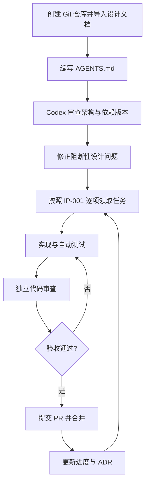
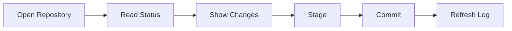

# IdeaGit：使用 Codex 逐步完成开发的实施指南

> 文档编号：CODEX-GUIDE-001  
> 版本：v1.0  
> 日期：2026-11-06  
> 适用：IntelliJ IDEA 2026.x Git 功能高保真复刻；Rust + GPUI-Kit 独立桌面客户端；Windows / macOS / Linux。

## 1. 目标与基本原则

现有项目设计基线包括总体架构、Git Core 详细设计、GPUI-Kit UI 详细设计、Commit / Changelist / Diff 深度设计、技术依赖版本基线，以及 IP-001 可执行开发任务计划。本指南说明如何将这些文档转化为 Codex 可以逐项完成、测试、审查和合并的开发任务。

**推荐流程：架构文档驱动 → `AGENTS.md` 约束 → 单任务实现 → 自动测试 → 独立审查 → Git 合并 → 里程碑验收。**

不要要求 Codex 一次性开发完整的 IdeaGit；每次明确一个任务编号、范围、依赖、接口和验收标准。你负责架构决策、危险操作审批和最终验收，Codex 负责具体实现、测试和修复。

## 2. 整体工作流程



## 3. 第一步：创建项目仓库并放入设计文档

以 Windows PowerShell 为例：

```powershell
mkdir IdeaGit
cd IdeaGit
git init
git branch -M main
New-Item -ItemType Directory -Force docs\architecture,docs\plans,docs\specs,docs\reviews
```

建议目录：

```text
IdeaGit/
├── AGENTS.md
├── README.md
├── Cargo.toml
├── Cargo.lock
├── rust-toolchain.toml
├── docs/
│   ├── architecture/
│   │   ├── ARCH-001-overview.md
│   │   ├── LLD-GIT-CORE-001.md
│   │   ├── LLD-UI-001.md
│   │   ├── LLD-CCD-001.md
│   │   └── TECH-BASELINE-001.md
│   ├── plans/
│   │   ├── IP-001-development-plan.md
│   │   └── PROGRESS.md
│   ├── reviews/
│   ├── specs/
│   └── adr/
├── apps/
├── crates/
├── tests/
├── assets/
└── .github/workflows/
```

上述文件名是建议统一后的名称，需将已经生成的原始 Markdown 文件复制并重命名至相应位置。**切勿先创建空文件代替真实内容**。六份基线文件是总体架构、Git Core、GPUI UI、CCD、依赖版本和开发计划。

先提交设计文档：

```bash
git add docs README.md
git commit -m "docs: establish IdeaGit architecture baseline"
```

## 4. 第二步：安装并启动 Codex

适合此项目的初期组合是 **Codex CLI + VS Code 或其他编辑器 + 本地 Git + 三平台 CI**。Rust 原生窗口、GPU、系统 Git 与真实文件系统集成测试在本机或相应系统 Runner 上更容易验证。

通过官方提供的安装方式安装 Codex CLI；也可使用 npm：

```bash
npm install -g @openai/codex
```

在仓库根目录运行：

```bash
codex
```

首次使用按提示登录。建议允许在仓库内读取、编辑、编译与测试；对仓库外写入、网络脚本、破坏性 Git 命令、凭据操作和历史改写保留人工审批。可在 Codex 中检查 `/status` 和 `/permissions`（命令以当前安装版本为准）。

> 注意：Codex 的安装方式和命令可能变化，执行前应核对当前官方文档：<https://developers.openai.com/codex/>。

## 5. 第三步：根目录 `AGENTS.md` 模板

下面的内容可直接保存为项目根目录 `AGENTS.md`：

````markdown
# IdeaGit Agent Development Rules

## 1. Project

IdeaGit is a production-grade, cross-platform Git desktop client.

- Language: Rust
- Edition: 2024
- UI: GPUI + GPUI-Kit
- Git backend: system Git CLI
- Platforms: Windows, macOS, Linux
- UI reference: IntelliJ IDEA 2026.x New UI

## 2. Authoritative Documents

Read relevant documents before implementing a task:

- docs/architecture/ARCH-001-overview.md
- docs/architecture/LLD-GIT-CORE-001.md
- docs/architecture/LLD-UI-001.md
- docs/architecture/LLD-CCD-001.md
- docs/architecture/TECH-BASELINE-001.md
- docs/plans/IP-001-development-plan.md

If documents conflict, report the conflict before implementation.
Do not silently change architectural decisions.

## 3. Architecture

Dependency direction:

UI -> Application -> Domain / Ports
Adapters implement Ports.

Rules:

- git-domain must not depend on GPUI.
- UI must not invoke Git CLI directly.
- Git write operations must use OperationCoordinator.
- Backend adapters must not depend on UI.
- Avoid circular crate dependencies.
- Preserve Git path and object identity semantics.

## 4. Git Safety

Never silently discard user changes.

- Never overwrite the real Git index without validation.
- Never use git reset --hard on user repositories.
- Never force push without explicit user approval.
- Never automatically retry operations with uncertain results.
- Preserve unstaged and unselected changes.
- Use actual Git repository tests for write operations.
- Treat external Git processes as possible concurrent writers.

## 5. Implementation Workflow

For every development task:

1. Read relevant specifications.
2. Inspect existing code and APIs.
3. Explain the implementation plan.
4. Identify files to modify.
5. Implement only the requested scope.
6. Add unit or integration tests.
7. Run relevant checks.
8. Review the diff.
9. Report results and remaining risks.

Do not claim tests passed unless they actually ran.

## 6. Rust Quality

- Prefer strong types over raw strings.
- Use structured errors.
- Avoid unwrap() and expect() in production paths.
- Do not introduce unsafe Rust without justification.
- Do not block the GPUI UI thread.
- Use bounded async concurrency.
- Preserve cancellation and recovery semantics.

## 7. Required Checks

When applicable:

cargo fmt --all -- --check
cargo check --workspace --locked
cargo clippy --workspace --all-targets --locked -- -D warnings
cargo test --workspace --locked

If a command cannot run, explain why.

## 8. Definition of Done

A task is complete only when:

- Implementation matches the relevant LLD.
- APIs are documented.
- Tests cover normal and failure paths.
- Existing tests pass.
- Cross-platform implications are addressed.
- No unrelated files are changed.
- The final response includes changed files, test results, risks, and follow-up items.

## 9. Task Scope

Implement one tracked development task at a time.

Do not implement unrelated features.
Do not perform broad refactoring without authorization.
Do not update dependencies without explaining the reason.

## 10. Language

Explain implementation decisions, plans, reviews, and test results in Simplified Chinese.
Keep Rust identifiers and code comments clear and consistent.
````

`AGENTS.md` 应短而准确：长篇设计、代码示例和计划留在 docs 里，通过链接引用。版本基线尚未经过三平台真实编译前，不要要求 Codex 无条件假设依赖组合已经可用。

## 6. 第四步：第一次先让 Codex 做架构审查，而不是编码

首次 Codex 提示词：

> 你现在担任 IdeaGit 项目的首席 Rust 架构师和技术负责人。请先阅读根目录 `AGENTS.md`，以及 `docs/` 下的架构、版本基线和开发计划文档。
>
> 本次任务只审查，不修改源代码、不创建 Cargo Workspace。
>
> 1. 检查六份文档中的接口、模块依赖、状态机冲突。
> 2. 核对 Rust、GPUI-Kit、GPUI 和其他核心依赖版本及实际 API。
> 3. 检查 Rust Workspace 是否存在循环依赖。
> 4. 检查 Git Core 与 UI 接口可实现性。
> 5. 审核 Git Index、Partial Commit、Changelist、Diff 的数据安全风险。
> 6. 标明哪些 Rust 代码是设计草案，不能直接编译。
> 7. 检查 IP-001 的 M0～M6 任务依赖。
> 8. 给出 M0 必须先处理的问题及建议。
>
> 生成 `docs/reviews/ARCH-REVIEW-001.md`、`docs/reviews/API-CONFLICTS-001.md` 和 `docs/plans/M0-EXECUTION-CHECKLIST.md`。每项发现注明严重程度、关联文件、原因和建议；不要擅自修订设计文档。

先人工确认审查结论，再按 ADR 流程修正阻断问题。

## 7. 第五步：逐项完成 M0 工程基础

| 顺序 | 任务 | 交付物 |
|---:|---|---|
| 1 | INFRA-001 | Rust Workspace 骨架 |
| 2 | INFRA-002 | Toolchain / 依赖验证与锁定 |
| 3 | INFRA-003 | 三平台 CI |
| 4 | INFRA-004 | 架构与编码规则 |
| 5 | UI-001 | GPUI-Kit 三平台启动验证 |
| 6 | UI-002 | IDEA Design Tokens |
| 7 | TEST-001 | Git Fixture Harness |

### 7.1 INFRA-001 — 创建 Rust Workspace 的 Codex 提示词

> 请执行 IdeaGit `INFRA-001`：建立 Rust Workspace。
>
> 开始前阅读 `AGENTS.md`、`ARCH-001-overview.md`、`TECH-BASELINE-001.md` 和 `IP-001-development-plan.md`。
>
> 任务范围：创建根 Cargo Workspace，建立 Git Core、Application、Adapters、UI、Platform 的 Crate 最小骨架；为各 Crate 创建 Cargo.toml 与 lib.rs/main.rs；使用 Rust 2024 Edition 和 Resolver 3；确保依赖无环；添加必要的模块说明。
>
> 暂不实现 Git 功能或真实 UI，不引入暂不需要的第三方依赖，也不提前执行其他任务。
>
> 执行 `cargo fmt --all -- --check`、`cargo check --workspace`、`cargo test --workspace`，修复本次改动造成的问题。
>
> 最终中文汇报：变更文件、依赖关系、实际测试结果、设计差异与遗留事项。

### 7.2 INFRA-002 — 锁定依赖的 Codex 提示词

> 请执行 `INFRA-002`：Rust 与核心依赖的版本兼容性验证。
>
> 阅读 `AGENTS.md`、`TECH-BASELINE-001`、全部 Cargo.toml。目标候选基线为 Rust 1.99.1、Edition 2024、GPUI-Kit 0.9.0；但不得假设该组合已经通过测试。
>
> 验证候选版本存在及可安装；核对 GPUI-Kit 对 GPUI、gpui-base、相关组件依赖；检查项目实际 API；配置 rust-toolchain.toml 和统一 workspace dependencies；创建并提交 Cargo.lock；执行当前平台 cargo check；记录其他平台尚未验证的事项。不擅自升级到新大版本。
>
> 如果遇到冲突，提出最小修正并说明依据。生成 `docs/reviews/DEPENDENCY-VERIFICATION-001.md`，报告确切版本和验证结果。

### 7.3 M0 验收

- 三平台 CI 可以构建项目最小工程。
- 核心 Crate 与 UI 分层清晰，依赖无环。
- GPUI-Kit 最小窗口在目标测试系统可运行。
- 真实 Git Fixture 能隔离用户全局 Git 配置。
- Cargo.lock 已提交，CI 使用 `--locked`。
- 未执行的测试明确标注，不得声称已通过。

## 8. 第六步：每个任务都要单独测试与审查

开发循环：

```text
领取任务 ID → 读取相关 LLD → 检查依赖 → 说明计划 → 编码 → 单元/集成测试
      → git diff 审查 → 修复问题 → PR → 合并 main → 更新进度
```

Codex 可以使用当前版本提供的代码审查功能，例如 `/review`，审查未提交变更或与 main 的差异。针对 Git 高风险模块，再使用独立审查提示词：

> 请作为独立代码审查员，审查当前分支相对 main 的 Git Diff。
>
> 检查是否违反 AGENTS.md、架构依赖约束、Git Index 与 Ref 语义；是否可能丢失或误提交用户代码；是否存在竞态、死锁、资源泄露、非 UTF-8 路径错误；是否有缺失的边界与失败测试；是否修改无关文件。
>
> 按 Critical / High / Medium / Low 分级报告，给出具体文件、位置、原因和修复方案。只审查，不修改代码。如无发现，也说明检查范围与未验证风险。

审查通过后重新运行相关测试。Git Index、Commit、Merge、Reset、Rebase、凭据等高风险能力须保留人工复核。

## 9. M0～M6 里程碑推进顺序

| 里程碑 | 主要任务路径 | 验收交付 |
|---|---|---|
| M0 工程基础 | INFRA-001/002/003/004、UI-001/002、TEST-001 | 三平台构建、最小 UI、Git Fixture |
| M1 只读仓库 | CORE-001/003/002/004/006/007、UI-003/005 | Open Repository → Status → Changes |
| M2 基础写操作 | CORE-010、GIT-001/002/003/004、UI-006/007/009 | Stage → Commit → Branch → Log |
| M3 日常 Git | REMOTE-001～004、GIT-005～008、MERGE-001/002、RECOVERY-001 | Push/Pull/Merge/Conflict/Recovery |
| M4 高级提交 | DIFF-003～007、CCD-001～007、UI-011～013 | Hunk/Line Stage、Changelist、Partial Commit |
| M5 高级工作流 | REBASE-001～004、SHELF-001/002、HISTORY-001、GRAPH-002 | Interactive Rebase、Shelf、File History |
| M6 生产发布 | PERF-*、SECURITY-*、QA-*、RELEASE-* | 三平台安全、性能、安装与发布 |

此表为主路径摘要，不能跳过完整 IP-001 中的其他任务和测试门禁。UI 与 Core 可以使用 Mock 并行开发，但所有公开接口必须以一致的 Contract 为准。

## 10. 通用 Codex 任务提示词模板

后续每次任务只更换 `<TASK-ID>` 和 `<MODE>`：

```text
请阅读 AGENTS.md、docs/plans/IP-001-development-plan.md，
以及任务 <TASK-ID> 涉及的相关 LLD 文档。

本次任务：<TASK-ID>
工作模式：<MODE>（编码实现 / 代码审查 / 测试与修复）

要求：
1. 确认任务前置依赖已完成，并检查真实代码状态。
2. 找到对应 Crate、接口、Rust 类型及允许修改的文件。
3. 给出最小实现计划。
4. 仅处理本任务，不提前实现后续任务。
5. 遵守 Git 数据安全和 UI 分层规则。
6. 根据任务增加 Unit、Contract、真实 Git Integration Tests。
7. 执行相关 cargo fmt/check/clippy/test；未执行的命令说明原因。
8. 审查 git diff 与潜在回归。
9. 用中文汇报修改文件、测试结果、风险和遗留事项。

禁止通过删除测试、降低验收标准或修改无关模块来让任务“通过”。
```

Codex 应实际读取 IP-001 中任务编号对应的完整描述，不得凭编号猜测任务内容。

## 11. Git 分支与 PR 工作流

建议**一个任务对应一个短生命周期分支**：

```bash
git switch main
git pull --ff-only
git switch -c feat/CORE-004-status-parser
```

开发后运行：

```bash
cargo fmt --all -- --check
cargo check --workspace --locked
cargo clippy --workspace --all-targets --locked -- -D warnings
cargo test --workspace --locked
git diff --check
git status
```

仅暂存已确认的相关文件：

```bash
git add crates/adapters/git-cli crates/core/git-domain
git commit -m "feat(git): implement porcelain v2 status parser"
```

按需建立 PR，独立审查、CI 通过之后合并 main。避免未经确认的 `git add .` 将日志、凭据或临时文件一同提交。

可使用 Git Worktree / Codex 云端任务并行处理互不冲突的功能，但 CORE-003 → CORE-004 → CORE-007 → CORE-010 等有强接口依赖的任务，须在共同契约稳定后再并行。

## 12. 防止 Codex 长期开发失控

| 风险 | 对策 |
|---|---|
| 忘记设计约束 | `AGENTS.md` + 引用权威 LLD |
| 需求范围膨胀 | 一个任务编号、固定 Scope |
| 随意增加依赖 | 依赖变更说明及审批 |
| Crate API 互相冲突 | 冻结 Contract、集成测试 |
| 为过测试而修改测试 | 禁止削弱测试或静默跳过 |
| 过度重构 | 最小修改原则 |
| Git 行为与 Mock 不一致 | 真实 Git Integration Tests |
| UI 与 IDEA 差异过大 | 截图、交互契约、键盘验证 |
| 没有任务进度 | 更新 PROGRESS.md / Issue |
| 重复犯错 | 将可验证规则加入测试与 AGENTS.md |

建议维护：

- `docs/plans/PROGRESS.md`：当前里程碑、已完成任务、测试状态、阻塞项、下一任务。
- `docs/adr/`：每次重大架构改动的背景、选择与影响。
- `docs/reviews/`：架构审查、依赖兼容验证、关键安全审查结果。

## 13. 第一周行动计划

1. 创建 Git 仓库，导入全部六份文档。
2. 创建并人工检查 `AGENTS.md`。
3. 使用 Codex 进行一次只读架构审查。
4. 解决 P0/P1 级阻断问题并记录 ADR。
5. 完成 INFRA-001：最小可编译 Workspace。
6. 完成 INFRA-002：依赖核验、Toolchain、Cargo.lock。
7. 创建三平台 CI 和最小 GPUI 窗口验证任务。

### 第一周完成标准

- [ ] 真实设计文档已完整进入仓库。
- [ ] AGENTS.md 可指导重复开发。
- [ ] 架构审查记录已保存。
- [ ] Cargo Workspace 能编译。
- [ ] 关键依赖版本已真实验证并记录局限。
- [ ] Git Fixture 可隔离地创建测试仓库。
- [ ] CI 能编译和测试基础工程。
- [ ] 后续任务的先后依赖已明确。

以上是计划目标，不代表当前已完成。

## 14. 推荐的第一条完整垂直切片



这条链路既测试 Git Core，也验证 Application API、GPUI UI、异步事件、写操作协调和真实仓库状态一致性。**只有它通过三平台与真实 Git 集成测试，才开始逐步扩大 Remote、Merge、Diff、Changelist 和 Rebase 功能。**

## 15. 参考

- Codex 官方资料：<https://developers.openai.com/codex/>
- Rust：<https://www.rust-lang.org/>
- GPUI-Kit：<https://github.com/longbridge/gpui-kit>
- Git 官方文档：<https://git-scm.com/docs>

---

**结论：** 用设计文档确定方向，用 `AGENTS.md` 约束 Codex，用 IP-001 给出每个任务，用真实 Git 与三平台 CI 验证正确性。始终保持“一个任务 → 一组代码变更 → 一组可复现测试 → 一次独立审查 → 一次受控合并”的开发节奏。
