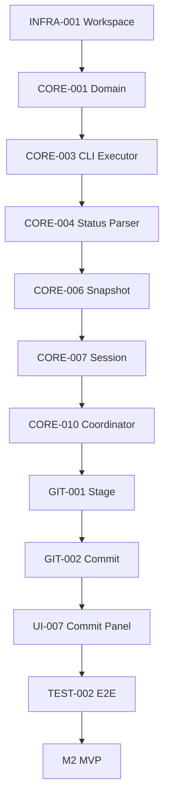
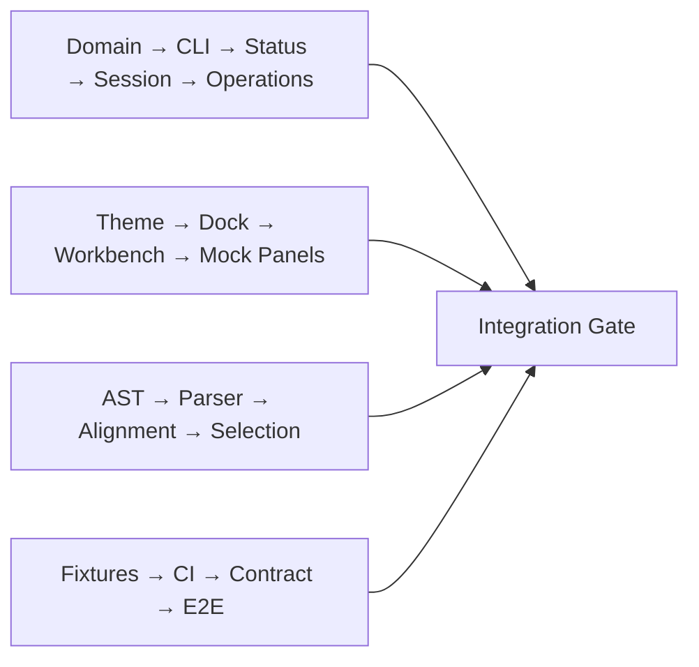

# IdeaGit — 可执行开发任务拆解与工程实施计划

> 2026-11-06 修订：执行已批准的 [ADR](../architecture/adr/ADR-ARCH-REMEDIATION-001.md) D1–D7。主任务依赖表是执行依据；共享契约统一引用 [Git Core §18](../architecture/LLD-GIT-CORE-001.md)。本计划未执行，文档修订不代表 M0 或安全验证完成。

> **文档编号**：IP-001  
> **版本**：v1.0  
> **日期**：2026-11-06  
> **目标**：独立 Rust + GPUI-Kit Git 桌面客户端，高保真复刻 IntelliJ IDEA 2026.x Git 体验  
> **平台**：Windows / macOS / Linux  
> **关联基线**：LLD-GIT-CORE-001、LLD-UI-001、LLD-CCD-001

## 目录

1. [执行目标与里程碑](#1-执行目标与里程碑)
2. [工作流、任务规范与完成定义](#2-工作流任务规范与完成定义)
3. [M0：工程初始化与技术基线](#3-m0工程初始化与技术基线)
4. [M1：Git Read Core 与 Workbench](#4-m1git-read-core-与-workbench)
5. [M2：Stage、Commit、Branch 与 Log](#5-m2stagecommitbranch-与-log)
6. [M3：Remote、Merge、Conflict 与 Recovery](#6-m3remotemergeconflict-与-recovery)
7. [M4：Diff、Changelist 与 Partial Commit](#7-m4diffchangelist-与-partial-commit)
8. [M5：Interactive Rebase、Shelf 与高级功能](#8-m5interactive-rebaseshelf-与高级功能)
9. [M6：跨平台生产加固与发布](#9-m6跨平台生产加固与发布)
10. [跨模块接口与代码契约](#10-跨模块接口与代码契约)
11. [任务依赖、并行计划与前四周安排](#11-任务依赖并行计划与前四周安排)
12. [测试矩阵与关键验收脚本](#12-测试矩阵与关键验收脚本)
13. [风险、ADR 与项目治理](#13-风险adr-与项目治理)
14. [Sprint 1 开发清单](#14-sprint-1-开发清单)

---

## 1. 执行目标与里程碑

开发完成的产品应具备 IntelliJ IDEA 2026.x 风格的 Git Log、Commit、Branches、Diff、Merge Conflict、Changelist、Shelf、Interactive Rebase 等流程，且保持真实 Git 仓库语义与用户数据安全。独立客户端需要自行管理窗口、仓库会话、凭据、进程、持久化和更新。

### 1.1 里程碑

| 里程碑 | 计划周次 | 主要成果 | 阶段门槛 |
|---|---|---|---|
| M0 | W1–W2 | Workspace、GPUI 启动、三平台 CI、Git Fixtures | 三平台构建/测试基线可用 |
| M1 | W3–W6 | Repository、Status、Session、Workbench | 外部 Git 变更可正确刷新 UI |
| M2 | W7–W11 | Stage、Commit、Branch、Git Log | 首个完整 Git 写操作闭环 |
| M3 | W12–W17 | Clone、Fetch、Pull、Push、Merge、Conflict、Recovery | Daily-use Beta |
| M4 | W18–W24 | Diff、Hunk/Line Stage、Changelist、Partial Commit | 未选中内容安全性通过专项测试 |
| M5 | W25–W29 | Interactive Rebase、Shelf、File History、Blame | 高级工作流可恢复 |
| M6 | W30–W34 | 三平台性能、异常恢复、安全、发布 | Production v1.0 候选 |

> 时间是约 4–5 名有经验工程师可并行推进的规划基线，不是交付承诺。风险最高的是 Partial Commit、外部 Git 并发、认证、Rebase 恢复和 Linux 分发。

### 1.2 工作流

- **Git Core**：领域模型、Git CLI、仓库状态、Operation Coordinator、Sequencer。
- **UI**：GPUI-Kit Workbench、IDEA Theme、Action Registry、Log、Commit、Branches、Diff、Merge。
- **Diff/Commit**：Patch AST、Hunk/Line 选区、Changelist、Temporary Index、Partial Commit。
- **Platform**：系统 Git 检测、Watcher、Credential Broker、安装与升级。
- **Quality**：真实 Git Fixtures、Contract、E2E、故障注入、UI Golden、性能。

## 2. 工作流、任务规范与完成定义

### 2.1 标准 Issue 模板

```yaml
id: CORE-003
title: Implement Git CLI Executor
milestone: M1
priority: P0
owner_role: git-core
depends_on: [CORE-001, INFRA-002]
crates: [git-cli, git-ports]
deliverables:
  - source_code
  - unit_tests
  - integration_tests
  - rustdoc
implementation:
  - process_spawn_without_shell
  - bounded_stdout_and_stderr
  - cancellation_and_timeout
  - redacted_diagnostics
tests:
  - non_utf8_output
  - timeout
  - process_tree_cancel
  - oversized_output
acceptance:
  - three_platform_ci_pass
  - no_unbounded_process_or_output
  - failures_classified
```

### 2.2 Definition of Done

1. 代码可编译，接口匹配已批准的 LLD / ADR。
2. 单元测试、契约测试、相关真实 Git 集成测试通过。
3. `cargo fmt --all -- --check`、`cargo clippy --workspace --all-targets -- -D warnings`、`cargo test --workspace --locked` 通过。
4. 没有 Crate 环状依赖、UI 对 `git-cli` 的直接依赖。
5. 公开 API 包含 Rustdoc；涉及可见行为时更新交互契约。
6. Git 写操作明确前置条件、失败分类、恢复策略。
7. UI 任务覆盖焦点、快捷键、鼠标与异常反馈。
8. 高风险写操作使用真实仓库测试，Mock 不能作为最终证明。
9. Windows/macOS/Linux 相关影响得到对应测试验证。
10. PR 有设计引用、测试结果、安全影响和回滚方案。

### 2.3 审查禁令

- 不得经 Shell 拼接执行用户提供的 Git 参数。
- 不得假定所有 Git 文件路径为 UTF-8。
- 不得把 Git 操作取消解释为状态自动回滚。
- 不得用 UI Checkbox 状态替代真实 Index 状态。
- 不得在 Tokio 后台线程直接修改 GPUI Entity。
- 不得在真实 Index 上无前置校验地应用过期 Patch。

---

## 3. M0：工程初始化与技术基线

### 3.1 任务总表

| ID | 任务 | 前置 | 预计工作量 | 交付与验收 |
|---|---|---|---|---|
| INFRA-001 | Rust Workspace | INFRA-004 | 1–2 人日 | 成员目录、依赖方向、cargo metadata/check 成功 |
| INFRA-002 | 固定 Rust/GPUI-Kit/依赖 | INFRA-001 | 1–2 人日 | Cargo.lock、rust-toolchain.toml、版本兼容性记录 |
| INFRA-003 | 三平台 CI | INFRA-002 | 2–3 人日 | Windows/macOS/Linux 基础检查与测试 |
| INFRA-004 | 架构决策/约束前置；PR 模板后补 | 无 | 1–2 人日 | 开发规范、模块依赖图、PR 模板 |
| UI-001 | GPUI-Kit 启动 Spike | INFRA-002/INFRA-003 | 2–4 人日 | 原生窗口在三平台启动 |
| UI-002 | IDEA Design Tokens | UI-001 | 2–3 人日 | 暗/亮色、Typography、Metrics |
| TEST-001 | Git Fixture Harness | INFRA-001/INFRA-002 | 2–3 人日 | 独立 Git 初始化、提交、冲突测试工具 |

### 3.2 INFRA-001：Workspace

先完成 INFRA-004 的 D1–D7 决策与候选工具链输入，再建立骨架；INFRA-002 生成实际锁文件并验证版本，不由 INFRA-001 猜测或改变核心版本。

```text
ideagit/
├── Cargo.toml
├── Cargo.lock
├── rust-toolchain.toml
├── apps/desktop/
├── crates/
│   ├── core/{git-domain,git-ports,git-application,git-operations,git-diff,git-graph,git-changelist,git-commit}/
│   ├── adapters/{git-cli,git-libgit2,repository-watcher,credential-broker,persistence}/
│   ├── ui/{idea-theme,idea-ui-primitives,idea-shell,git-ui-model,git-workbench,git-commit-ui,git-log-ui,git-branch-ui,git-diff-ui,git-merge-ui}/
│   └── platform/desktop-platform/
├── tests/{fixtures,contracts,integration,recovery,ui}/
├── packaging/{windows,macos,linux}/
└── docs/{architecture/adr,ui-spec}/
```

```toml
[workspace]
resolver = "3"
members = ["apps/desktop", "crates/core/*", "crates/adapters/*", "crates/ui/*", "crates/platform/*"]

[workspace.package]
edition = "2024"
version = "0.1.0"
publish = false
```

**验收**：`cargo metadata --no-deps` 与 `cargo check --workspace` 通过；Domain 不依赖 Tokio、GPUI、Git CLI；依赖图无环。

### 3.3 INFRA-002：依赖基线

```toml
[workspace.dependencies]
tokio = { version = "1", features = ["rt-multi-thread", "macros", "process", "sync", "time", "io-util"] }
tokio-util = "0.7"
async-trait = "0.1"
thiserror = "2"
serde = { version = "1", features = ["derive"] }
serde_json = "1"
uuid = { version = "1", features = ["v4", "serde"] }
tracing = "0.1"
notify = "8"
tempfile = "3"
proptest = "1"
```

> 版本是工程初始参考，不代表已在三平台验证；GPUI-Kit 与 GPUI 应使用锁定的兼容组合，提交完整 `Cargo.lock`。为满足未来可重复构建，将 MSRV、Rust 目标与系统依赖写入环境矩阵。

### 3.4 INFRA-003：三平台 CI 示例

```yaml
name: Rust CI
on: [push, pull_request]
jobs:
  build:
    strategy:
      fail-fast: false
      matrix:
        os: [ubuntu-24.04, windows-latest, macos-latest]
    runs-on: ${{ matrix.os }}
    steps:
      - uses: actions/checkout@v4
      - uses: dtolnay/rust-toolchain@1.99.1
        with:
          components: rustfmt, clippy
      # Linux: 依锁定 GPUI-Kit 版本安装系统依赖
      - run: cargo fmt --all -- --check
      - run: cargo check --workspace --locked
      - run: cargo clippy --workspace --all-targets --locked -- -D warnings
      - run: cargo test --workspace --locked
```

**验收**：三平台 CI 绿灯；图形测试依赖与非图形测试分别执行；上传失败测试日志，不上传凭据。

### 3.5 TEST-001：Git Fixture Harness

```rust
pub struct TestRepository {
    pub temp_dir: tempfile::TempDir,
    pub worktree: std::path::PathBuf,
}

impl TestRepository {
    pub fn init() -> Result<Self, TestError> { todo!() }
    pub fn commit_file(&self, path: &str, data: &[u8]) -> Result<(), TestError> { todo!() }
}
```

实现测试隔离的 HOME、Git Config、Hooks、Credential、签名和 Remote；默认不接触用户仓库或真实远端。用本地 Bare Git Repository 模拟 Push/Pull。

**M0 门禁**：三平台原生窗口启动，Fixture 创建真实仓库，基础接口和 CI 可用。

---

## 4. M1：Git Read Core 与 Workbench

### 4.1 任务总表

| ID | 任务 | 依赖 | 人日 | 验收要点 |
|---|---|---|---|---|
| CORE-001 | 领域 ID/OID/Path/Errors | INFRA-001 | 3 | 类型无损、无 UI 依赖 |
| CORE-002 | Repository Discovery | CORE-001/CORE-003 | 3–4 | Ordinary/Worktree/Bare/Submodule |
| CORE-003 | ProcessRunner / GitCliExecutor | CORE-001/INFRA-002/TEST-001 | 4–6 | 取消、超时、有界输出、脱敏 |
| CORE-004 | Porcelain v2 Status Parser | CORE-003 | 5–7 | 各记录、复杂路径、冲突 |
| CORE-005 | HEAD / Branch Reader | CORE-003 | 3–5 | Unborn/Detached/Upstream |
| CORE-006 | Snapshot Builder | CORE-004/005 | 4–5 | 同代版本、过期校验 |
| CORE-007 | Repository Session / Registry | CORE-002/CORE-006 | 5–7 | 共享 Session、多仓库隔离 |
| CORE-008 | Watcher + Refresh Scheduler | CORE-007 | 4–6 | 外部变化、合并事件、补刷新 |
| UI-003 | Workbench Shell / DockArea | UI-002 | 5–7 | 拖拽、持久化、恢复 |
| UI-004 | Repository Tabs / StatusBar | UI-003/CORE-007 | 3–4 | 当前仓库/分支状态 |
| UI-005 | Read-only Changes Tree | CORE-006/UI-003 | 4–6 | Stage/Unstage 分区正确 |

### 4.2 CORE-001：Rust 类型接口

共享接口和 DTO 统一见 [Git Core §18](../architecture/LLD-GIT-CORE-001.md)，实现不得复制另一套同名定义。

**实现**：`RepoPath` 仅经验证构造；Git 原始路径与 OS 原生 `PathBuf` 分离；支持 SHA-256 仓库；Unix 非 UTF-8、Windows 原生路径转换由适配器负责。

**测试**：非法 NUL、路径穿越、特殊字符、非 UTF-8、OID 长度与算法、ID 类型混用。

### 4.3 CORE-003：进程执行器

共享接口和 DTO 统一见 [Git Core §18](../architecture/LLD-GIT-CORE-001.md)，实现不得复制另一套同名定义。

**步骤**：`tokio::process::Command`；无 Shell；工作目录与参数独立；并发消费 stdout/stderr；强制输出限额；超时与进程树终止；可取消；匿名化诊断；流式进度扩展口。

**验收**：大输出、非 UTF-8、异常退出、启动失败、超时、取消、嵌套进程清理均通过测试。取消后的 Git 仓库仍必须 Reconcile。

### 4.4 CORE-004：Porcelain v2 Parser

命令：`git status --porcelain=v2 -z --branch`。

```rust
pub trait StatusParser {
    fn parse(&self, raw: &[u8]) -> Result<StatusData, StatusParseError>;
}

pub enum StatusEntry {
    Ordinary(OrdinaryChange),
    Renamed(RenamedChange),
    Unmerged(UnmergedChange),
    Untracked(RepoPath),
    Ignored(RepoPath),
}
```

**实现**：解析 `# branch.*`、`1`、`2`、`u`、`?`、`!`；`2` 记录单独读取原路径 NUL 字段；保留 Index/Worktree 双状态、mode、OID、Submodule 数据；不能按普通文本行拆分。

**测试**：修改、新增、删除、重命名、Staged+Unstaged、Conflict、Untracked、Unborn、Detached、复杂路径、截断输出。

### 4.5 CORE-007：Repository Session

共享接口和 DTO 统一见 [Git Core §18](../architecture/LLD-GIT-CORE-001.md)，实现不得复制另一套同名定义。

**实现**：路径规范化、Session 复用、Worktree 共享 common dir、Watcher、读刷新调度、生命周期、Degraded 状态、后台任务取消；`watch` 只传当前 Snapshot，事件日志另存。

**验收**：同仓库多窗口共享 Session；多仓库事件隔离；外部 Git 变化正确更新；Watcher 溢出后能主动补刷新。

### 4.6 UI-003：Workbench Shell

```rust
pub struct WorkbenchState {
    pub active_target: Option<SessionTarget>,
    pub active_panel: PanelKind,
    pub layout_id: String,
    pub overlays: Vec<OverlayId>,
}

pub enum PanelKind { RepositoryExplorer, GitLog, Commit, Diff, Console }
```

**步骤**：GPUI-Kit DockArea、Idea Theme、Titlebar、Repository Tabs、Statusbar、OverlayHost、布局 schema 与存储；恢复面板时使用已注册 Panel Builder；LayoutChanged Debounce。

**验收**：三平台面板可拖拽、关闭、恢复；打开仓库显示 HEAD 与 Changes；异步 Git 状态更新不阻塞 UI。

### 4.7 M1 端到端门禁

```text
App Start → Open Repository → Discover → Session
→ Porcelain v2 → Snapshot → Workbench Changes
→ External Git Edit → Watcher → Refresh → UI Update
```

---

## 5. M2：Stage、Commit、Branch 与 Log

### 5.1 任务总表

| ID | 任务 | 依赖 | 人日 |
|---|---|---|---|
| CORE-009 | 强类型 GitCommand | CORE-001 | 2–3 |
| CORE-010 | Operation Coordinator 接口/队列（写入验收另有门禁） | CORE-007/009 | 6–8 |
| CORE-011 | Resource Lock Manager | CORE-010 | 4–5 |
| CORE-012 | Operation Journal | CORE-010 | 3–5 |
| GIT-001 | Stage / Unstage | CORE-010/CORE-011/CORE-012/RECOVERY-000 | 3–4 |
| GIT-002 | Standard Commit | GIT-001/RECOVERY-000 | 4–6 |
| GIT-003 | Create/Checkout Branch | CORE-010/CORE-011/CORE-012/RECOVERY-000 | 4–6 |
| GIT-004 | Commit Log Reader | CORE-003 | 4–5 |
| GRAPH-001 | Commit Graph 基础 | GIT-004 | 5–7 |
| UI-006 | Action Registry/Dispatcher | UI-003/CORE-009 | 4–6 |
| UI-007 | Commit Panel MVP | UI-005/UI-006/GIT-002 | 5–7 |
| UI-008 | Branch Popup | UI-006/GIT-003 | 4–6 |
| UI-009 | Git Log Table | UI-003/GIT-004/GRAPH-001 | 5–7 |
| TEST-002 | Stage→Commit→Log E2E | TEST-001/CORE-008/UI-004/UI-007/UI-008/UI-009/DIFF-002 | 3–4 |
| DIFF-001 | 最小只读 Diff AST / Parser | CORE-003 | 5–8 |
| DIFF-002 | Unified Diff Viewer | DIFF-001/UI-003 | 5–7 |
| RECOVERY-000 | Commit/Index 最小启动恢复 | CORE-011/CORE-012/CORE-003 | 待估 |

最小 Diff 在 M1 可并行开发，M2 首切片验收前完成；M3 不再重复交付。

### 5.2 CORE-010：Operation Coordinator

共享接口和 DTO 统一见 [Git Core §18](../architecture/LLD-GIT-CORE-001.md)，实现不得复制另一套同名定义。

生命周期见 Core §18：Queued → ResourceWait → Preflight → Running → Reconciling → Finished。冲突结束单次命令，Sequencer 保持待解决；Continue/Skip/Abort 创建关联命令。CORE-010 先交付接口/调度，不以 stub 宣告安全写入完成；全部写功能验收依赖 CORE-011/012 和 RECOVERY-000。

**实现**：写操作队列、资源选择、前置条件、Journal、CLI 执行、异常分类、仓库重读、通知；成功不等于 UI 先行乐观确认。网络操作避免无关的长期本地资源锁。

**验收**：同 Worktree 写操作一致有序，不同独立仓库可并发，异常取消不会被报告为无副作用。

### 5.2.1 RECOVERY-000：最小写操作恢复

在 M2 写功能开放前，按 Journal 和真实 HEAD/Index 区分未执行、已提交、已提交待恢复和未知结果。跨进程记录按 [ADR-RECOVERY-IDENTITY-001](../architecture/adr/ADR-RECOVERY-IDENTITY-001.md) 的独立 `RecoveryScope` 匹配，不使用重启后会变化的 `SessionTarget`；Journal v1 未完成记录作为 orphaned 保留并要求人工检查。该任务不依赖 GIT-002 的完成，使用受控 Git fixture 模拟副作用，避免 GIT-002→Recovery→GIT-002 环。CORE-010/011/012 可分层构建，但写命令的最终验收必须包含完整协调器、锁、Journal 和恢复。

**验收补充**：跨 registry/runtime 重启后仍能定位同仓库记录；linked worktree 不串 Index 记录；损坏/未知 schema、`Unknown` 与 `CommittedNeedsReconcile` 均关闭当前仓库写入口；恢复检查不启动 Git 写命令、不修改 HEAD/Index/refs。

### 5.3 CORE-011：资源锁

```rust
pub struct ResourceKey { pub scope: ResourceScope, pub kind: ResourceKind }
pub enum ResourceScope { CommonGitDir(RepositoryId), Worktree(WorktreeId) }
// RepositoryId 是规范化 common-dir 身份，不是每个 worktree 的随机别名。
pub enum ResourceKind { Refs, Index, WorktreeFiles, Sequencer }
```

锁必须按稳定排序有序获取；多 Worktree 的共享 Refs 锁键必须归属于同一个规范化 common dir 身份；外部 Git 锁和 Refs 竞争仍由实际 Git 检查发现。

### 5.4 GIT-001：Stage/Unstage

```rust
pub enum IndexCommand {
    Stage { paths: Vec<RepoPath> },
    Unstage { paths: Vec<RepoPath> },
}
```

**流程**：Action → Command → 应用资源锁 → 预校验 → Git Add/Restore --staged（版本兼容时，由 Git 自行获取真实 Index 锁）→ Snapshot Rebuild → UI Update。Pathspec 必须使用 literal 策略；-- 与 NUL 不能关闭通配/magic。不得预占同一真实锁导致子进程失败。

**测试**：多文件、删除、重命名、Index 锁、外部操作、特殊文件名、已暂存/未暂存共存。

### 5.5 GIT-002：标准 Commit

共享接口和 DTO 统一见 [Git Core §18](../architecture/LLD-GIT-CORE-001.md)，实现不得复制另一套同名定义。

**实现**：真实 Index 提交；遵循 Git Hooks、Commit Template、签名配置；使用安全消息传递；处理 Unborn、Detached、Merge 状态；失败后 Commit Draft 保留。

**验收**：Commit 成功后 HEAD/Status/Log 一致；Hook 拒绝、签名失败、Index 外部变化可诊断；M2 不实现逻辑 Changelist 事务。

### 5.6 UI-006：统一 Action

```rust
pub struct ActionContext {
    pub target: Option<SessionTarget>,
    pub selected_files: Vec<RepoPath>,
    pub selected_commits: Vec<ObjectId>,
    pub selected_branch: Option<BranchRef>,
    pub active_panel: PanelKind,
}

pub enum ActionAvailability { Enabled, Disabled(String), Hidden }

pub trait ActionPolicy {
    fn evaluate(&self, action: ActionId, context: &ActionContext)
        -> ActionAvailability;
}
```

按钮、菜单、快捷键必须指向同一 Action；执行前重新校验 Context，避免用户打开菜单后切换仓库导致错仓库操作。

### 5.7 UI-007：Commit Panel

```rust
pub struct CommitPanelViewModel {
    pub target: SessionTarget,
    pub revision: SnapshotRevision,
    pub changes: Vec<ChangeRowViewModel>,
    pub selected: Vec<ChangeSelectionId>,
    pub message: String,
    pub amend: bool,
    pub submission: CommitSubmissionState,
}
```

**验收**：输入、选择、Stage、Commit、Operation Progress、错误反馈闭环；失败不清空消息；切换仓库保持各自 Draft。

### 5.8 UI-009：Git Log

模块：`HistoryReader → CommitGraphLayout → GitLogViewModel → VirtualCommitTable → CommitDetails`。支持 OID、Subject、Author、Date、基础 DAG、选中查看详情、分页。

**验收**：新 Commit 后可见；异步旧详情不覆盖新选择；十万 Commit 场景不创建十万个长期 UI Entity。

### 5.9 M2 门禁

用户从 GUI 完成：Open → Status → Stage/Unstage → Create/Checkout Branch → Commit → Git Log，并在操作失败时保留安全状态。

---

## 6. M3：Remote、Merge、Conflict 与 Recovery

### 6.1 任务总表

| ID | 任务 | 依赖 | 人日 |
|---|---|---|---|
| REMOTE-001 | Remote Config / Fetch | CORE-010/CORE-011/CORE-012/REMOTE-002 | 4–5 |
| REMOTE-002 | Credential Broker / AskPass | CORE-003 | 5–8 |
| REMOTE-003 | Push / Push Preview | REMOTE-001/002 | 5–7 |
| REMOTE-004 | Pull MVP（fetch+merge；rebase 待执行器） | REMOTE-001/GIT-005/RECOVERY-001 | 4–6 |
| REMOTE-005 | Clone（目标路径/凭据/取消/残留诊断） | CORE-003/REMOTE-002/CORE-010/CORE-012 | 待估 |
| GIT-005 | Merge Executor | CORE-010/CORE-011/CORE-012/RECOVERY-000 | 4–6 |
| GIT-006 | Cherry-pick / Revert | CORE-010/CORE-011/CORE-012/RECOVERY-000 | 4–6 |
| GIT-007 | Stash / Reset | CORE-010/CORE-011/CORE-012/RECOVERY-000 | 4–6 |
| GIT-008 | Sequencer Inspector | GIT-005/006 | 4–5 |
| RECOVERY-001 | Startup Recovery | RECOVERY-000/GIT-008 | 6–8 |
| MERGE-001 | Conflict Stage Reader | GIT-008 | 3–5 |
| MERGE-002 | Three-way Resolver | MERGE-001/DIFF-002/CORE-011/CORE-012 | 8–12 |
| UI-010 | Remote Dialog / Operation UI | UI-006/REMOTE-003 | 5–7 |
| TEST-003 | Network/Conflict/Recovery E2E | TEST-002/REMOTE-003/REMOTE-004/REMOTE-005/GIT-006/GIT-007/MERGE-002/RECOVERY-001/UI-010 | 6–9 |

### 6.1.1 REMOTE-005：Clone 与 Pull 范围

Clone 仅写入明确授权的新目标目录；校验存在/非空、路径及凭据，取消后保留可诊断状态，不递归删除用户已有目录。使用本地 bare remote 验证成功、失败、重试及残留策略。Pull MVP 为 fetch+merge；rebase 选项在对应执行器/恢复能力通过前禁用。

### 6.2 REMOTE-002：Credential Broker

```rust
#[async_trait::async_trait]
pub trait CredentialBroker: Send + Sync {
    async fn request(&self, request: CredentialRequest)
        -> Result<CredentialResponse, CredentialError>;
}

pub struct CredentialRequest {
    pub operation_id: OperationId,
    pub prompt: String,
    pub kind: CredentialKind,
}

pub enum CredentialKind { Username, Password, Passphrase, HostConfirmation }
pub enum CredentialResponse {
    Text(secrecy::SecretString), Confirmed, Rejected, Cancelled,
}
```

系统 Git 配置的 Credential Helper 优先；必要时受控 AskPass；不得将 Token/Passphrase 记入日志、命令参数或 Journal。分别验证 Windows、macOS、Linux 的 HTTPS 与 SSH。

### 6.3 REMOTE-003：Push

```rust
pub struct PushPreview {
    pub remote: String,
    pub source_ref: String,
    pub destination_ref: String,
    pub outgoing: Vec<CommitSummary>,
    pub expected_remote_oid: Option<ObjectId>,
}

pub enum PushMode { Normal, ForceWithLease { expected: ObjectId } }
```

**流程**：Preview → Confirm → Preflight → Push → Remote State Reconciliation → Result。Push Preview 打开后远程 Ref 可能变化；Force-with-lease 不能使用模糊预期，非幂等远程操作结果未知时禁止盲目重试。

**验收**：正常、拒绝、Non-fast-forward、认证失败、网络超时、取消、成功但客户端未收到确认、Force-with-lease 竞态。

### 6.4 GIT-008：Sequencer

```rust
pub enum SequencerKind { Merge, Rebase, CherryPick, Revert }
pub struct SequencerSnapshot {
    pub kind: SequencerKind,
    pub current: Option<u32>,
    pub total: Option<u32>,
    pub conflicts: Vec<ConflictEntry>,
}
```

根据 Git 实际 sequencer/Index 状态识别；恢复操作必须检查对应 SequencerKind 是否支持 Continue/Skip/Abort。

### 6.5 MERGE-002：Resolve Conflict

```rust
pub struct ApplyResolutionRequest {
    pub target: SessionTarget,
    pub path: RepoPath,
    pub expected_conflict_revision: SnapshotRevision,
    pub expected_stage_oids: ConflictStages,
    pub expected_worktree_digest: [u8; 32],
    pub mode: u32,
    pub result: Vec<u8>,
}
```

**步骤**：读取 Index Stage 1/2/3（允许缺失）；构建 Base/Ours/Theirs；用户编辑 Result；保存受控候选；校验 Stage OID 和工作区仍有效；确认后写入工作区并 Stage；Reconcile；根据 Merge/Rebase/Cherry-pick 提供 Continue。

**验收**：未确认不 `git add`；重启恢复；Add/Add、Modify/Delete、Binary 等冲突可处理或明确降级。

### 6.6 RECOVERY-001：启动恢复

```rust
pub enum RecoveryAction {
    RefreshOnly,
    ContinueMerge, AbortMerge,
    ContinueRebase, SkipRebase, AbortRebase,
    ContinueCherryPick, AbortCherryPick,
    InspectRepository,
}
```

扫描未完成 Journal → 检测 HEAD/Index/Refs/Sequencer → 推断实际结果 → 恢复 UI / 提供安全选项。Commit/Push 的未知结果不能重复执行。

### 6.7 M3 门禁

真实仓库完成：`Clone → Edit → Commit → Push → Fetch → Pull → Merge → Conflict → Resolve → Continue`；同时通过认证失败、外部竞争、崩溃恢复和网络异常测试。

---

## 7. M4：Diff、Changelist 与 Partial Commit

### 7.1 任务总表

| ID | 任务 | 依赖 | 人日 |
|---|---|---|---|
| DIFF-003 | Patch AST/Hunk/Line | DIFF-001 | 5–7 |
| DIFF-004 | Side-by-side Alignment | DIFF-003 | 6–8 |
| DIFF-005 | HEAD/Index/Worktree 三版本 | DIFF-003 | 5–7 |
| DIFF-006 | Safe Hunk Stage | DIFF-003/GIT-001 | 6–9 |
| DIFF-007 | Line Patch Builder | DIFF-006 | 7–10 |
| CCD-001 | Changelist Domain | CORE-001 | 4–6 |
| CCD-002 | Selection Fingerprints | CCD-001/DIFF-003 | 5–8 |
| CCD-003 | Changelist Persistence | CCD-001 | 4–6 |
| CCD-004 | Temporary Index Manager | CCD-002/CORE-010/CORE-011/CORE-012 | 6–9 |
| CCD-005 | Candidate Tree Builder | CCD-004/DIFF-007 | 6–9 |
| CCD-006 | Partial Commit Transaction | CCD-005/CCD-009/GIT-002/CORE-012/RECOVERY-001 | 10–15 |
| CCD-007 | Real Index Reconciliation | CCD-006/CORE-011 | 8–12 |
| CCD-008 | EditableIndexSession / Apply | CCD-004/DIFF-005/DIFF-006/RECOVERY-001 | 待估 |
| CCD-009 | Preview 生命周期与确认身份 | CCD-005/CCD-003 | 待估 |
| UI-011 | Side-by-side Viewer | DIFF-004 | 6–9 |
| UI-012 | Three-version Stage Viewer | DIFF-005/DIFF-006/CCD-008 | 6–9 |
| UI-013 | Changelist Commit Mode | CCD-003/CCD-006/CCD-007/TEST-004 | 6–9 |
| TEST-004 | Partial Commit Safety Tests | CCD-006/CCD-007/CCD-008/CCD-009/DIFF-007/RECOVERY-001 | 8–12 |

### 7.1.1 高级能力开放条件

CCD-006/007 为内部引擎/协调实现；TEST-004 使用 Core fixture，不依赖 UI-013，从而 UI-013 → TEST-004 不产生循环。Mock UI 可并行，真实入口只在所有前置完成后开放。

CCD-008 管理原始 Index/HEAD 指纹、编辑候选、过滤/编码/mode 及 Apply 后 Blob 校验；Apply 走协调器和已验证的发布协议。CCD-009 为 Preview 绑定 target、候选 Tree、选择/Index/HEAD 指纹、失效身份；过期预览重新确认，不无限期复用。两任务未完成时相应能力关闭。

### 7.2 DIFF-006：Hunk Stage

```rust
pub struct StageHunksRequest {
    pub target: SessionTarget,
    pub path: RepoPath,
    pub expected_index_oid: Option<ObjectId>,
    pub expected_worktree_fingerprint: [u8; 32],
    pub hunks: Vec<HunkSelection>,
}
```

**流程**：选择 Hunk → 捕获 Blob/Index 身份 → 构建候选 Patch → 获取应用资源锁 → 对候选 Index 校验/应用 → 已验证的真实 Index 锁内比较/发布 → 重新读取 Index/Worktree → 发布 Snapshot。Patch 过期必须拒绝或重新确认，不得静默重定位到错误内容。

**验收**：只 Stage 所选 Hunk，其他修改完好；特殊路径、换行符、二进制、Rename、外部并发都有防护。

### 7.3 CCD-001：Changelist Domain

共享接口和 DTO 统一见 [Git Core §18](../architecture/LLD-GIT-CORE-001.md)，实现不得复制另一套同名定义。

Changelist 是应用逻辑模型，不能直接等同 Git Index；Change/Hunk/Line 归属带 Blob 基线与内容指纹，修改后需检测陈旧归属；Changelist 数据需要备份和迁移，不是可随意丢弃的缓存。

### 7.4 CCD-004：Temporary Index

```rust
pub struct TemporaryIndexLease {
    pub path: std::path::PathBuf,
    pub transaction_id: OperationId,
}

#[async_trait::async_trait]
pub trait TemporaryIndexManager: Send + Sync {
    async fn create(&self, repository: &RepositoryLocation, operation: OperationId)
        -> GitResult<TemporaryIndexLease>;
}
```

采用 RAII 管理及 Journal 恢复信息；不要指望异常退出触发 Drop。临时 Index 的建立基线和所选 Tree 构建必须与真实 Index 语义明确区分。

### 7.5 CCD-006：Partial Commit

共享接口和 DTO 统一见 [Git Core §18](../architecture/LLD-GIT-CORE-001.md)，实现不得复制另一套同名定义。

**事务协议**：

1. 获取必要写资源锁。
2. 记录预期 HEAD、真实 Index 和 Changelist 选择身份。
3. 验证选择仍针对正确的 Blob/Hunk/Line。
4. 建立临时 Index，生成 Candidate Tree。
5. 向用户预览将要提交的 Tree 内容。
6. 通过 Partial Commit 专用写端口传递当前 Preview 的 `TemporaryIndexLease`，核对 Operation 身份后受控执行 Commit，尊重适用 Hooks/签名行为；不得复用固定临时路径或回退到真实 Index。
7. 核对 HEAD、Refs、Hook 副作用。
8. 在不覆盖外部修改的情况下协调真实 Index。
9. 验证未选择的 Staged/Unstaged/Worktree 内容仍保留。
10. 完成 Journal 或进入 RecoveryRequired。

**核心边界**：`GIT_INDEX_FILE` 不是 ACID 事务；Hook 可能修改工作区和 Refs；`git update-ref` 的旧值检查只能保护特定 Ref 更新，不涵盖完整 Index/Worktree 事务。

### 7.6 TEST-004：发布阻断安全矩阵

| 测试 | 验收 |
|---|---|
| 同一文件已有 Staged 和 Unstaged 修改 | 不混淆 |
| 只选择一个 Hunk | 未选中 Hunk 保留 |
| 只选择部分行 | 未选中行保留 |
| Changelist A/B 共享文件 | 归属正确 |
| Hook 拒绝 | 不虚报成功，数据安全 |
| Hook 修改 Worktree | 检测并处理 |
| 签名失败 | HEAD/Index 状态可确认 |
| 外部修改 Index | 拒绝过期事务 |
| 外部修改 HEAD | 不覆盖外部提交 |
| 提交成功但 Index 协调失败 | 恢复状态与诊断明确 |
| 应用异常退出 | 重启可诊断 |
| Rename/CRLF/非 UTF-8 | Patch 语义正确 |
| Binary 文件 | 不错误运行行级 Patch |

**阻断条件**：任何未选中代码被意外提交、丢弃或静默覆盖，都禁止将功能标记为生产可用。

---

## 8. M5：Interactive Rebase、Shelf 与高级功能

### 8.1 任务总表

| ID | 任务 | 依赖 | 人日 |
|---|---|---|---|
| REBASE-001 | Rebase Sequencer Commands | GIT-008 | 5–7 |
| REBASE-002 | Interactive Rebase Plan | REBASE-001 | 5–7 |
| REBASE-003 | Todo Validation/Execution | REBASE-002 | 7–10 |
| REBASE-004 | Rebase Recovery | RECOVERY-001/REBASE-001/REBASE-003 | 5–8 |
| SHELF-001 | Shelf Domain/Persistence | CCD-003 | 5–7 |
| SHELF-002 | Shelve/Unshelve | SHELF-001/DIFF-003/CORE-010/CORE-011/CORE-012/RECOVERY-001 | 6–9 |
| HISTORY-001 | File History / Blame | GIT-004 | 5–7 |
| GRAPH-002 | DAG Filters / Multi Refs | GRAPH-001 | 6–9 |
| UI-014 | Interactive Rebase Dialog | REBASE-003 | 6–9 |
| UI-015 | Shelf/Stash Views | SHELF-002/GIT-007 | 4–6 |
| TEST-005 | Recovery E2E | TEST-003/TEST-004/REBASE-004/UI-013/UI-014/UI-015/HISTORY-001/GRAPH-002 | 5–8 |

### 8.2 REBASE-002：Plan

```rust
pub struct InteractiveRebasePlan {
    pub target: SessionTarget,
    pub upstream: ObjectId,
    pub entries: Vec<RebaseTodoEntry>,
}

pub struct RebaseTodoEntry {
    pub commit: ObjectId,
    pub action: RebaseAction,
    pub message_override: Option<String>,
}

pub enum RebaseAction { Pick, Reword, Edit, Squash, Fixup, Drop }
```

**要求**：第一版明确支持的 Todo 指令范围，复杂 Merge-preserving Rebase 不应悄悄降级；UI 计划与实际 Git Todo 一致；Continue/Abort/Conflict 可恢复。

### 8.3 SHELF-001：Shelf

```rust
pub struct ShelfEntry {
    pub id: ShelfId,
    pub target: SessionTarget,
    pub name: String,
    pub created_at: i64,
    pub base_head: Option<ObjectId>,
    pub files: Vec<ShelvedFile>,
}
```

Shelf 与 Git Stash 不等价，应管理自有 Patch Bundle、元数据、备份、迁移及 Conflict；Unshelve 遇到过期基线不得覆盖用户当前修改。

**M5 门禁**：Rebase 的计划、冲突、Continue/Abort、重启恢复通过；Shelf 与文件历史功能通过真实仓库测试。

---

## 9. M6：跨平台生产加固与发布

### 9.1 任务总表

| ID | 任务 | 依赖 | 人日 |
|---|---|---|---|
| PERF-001 | 大仓库 Benchmark | TEST-002 | 5–7 |
| PERF-002 | Graph 虚拟化优化 | GRAPH-002 | 4–6 |
| PERF-003 | 大 Diff 内存优化 | DIFF-004 | 5–7 |
| SECURITY-001 | Git 命令/路径安全审查 | CORE-003 | 4–6 |
| SECURITY-002 | Credential/Hook 安全审查 | REMOTE-002/GIT-002 | 4–6 |
| QA-001 | 三平台完整 E2E | TEST-005 | 8–12 |
| QA-002 | 故障注入 | RECOVERY-001/REBASE-004/TEST-004 | 6–9 |
| QA-003 | IDEA UI Golden/交互对照 | UI-010/UI-011/UI-012/UI-013/UI-014/UI-015 | 6–10 |
| RELEASE-001 | Windows 签名/安装 | TEST-005 | 3–5 |
| RELEASE-002 | macOS 签名/公证 | TEST-005 | 3–5 |
| RELEASE-003 | Linux DEB/RPM/AppImage | TEST-005 | 4–6 |
| RELEASE-004 | 更新与迁移验证 | RELEASE-001/002/003 | 5–8 |

### 9.1.1 前置安全与最终发布

命令/pathspec/进程安全测试随 M1/M2 Executor 和写功能完成；Credential/Hook 测试随 M2/M3；Index/Partial Commit 故障矩阵为 M4 开放前置。SECURITY/QA 在 M6 是全量复核，不是首次验证。

RELEASE-001/002/003 表示打包产物准备，可并行；对用户发布必须同时通过 QA-001/002/003、SECURITY-001/002、PERF-001/002/003、RELEASE-004、TEST-005 以及未关闭阻断项检查。打包任务不反向依赖 RELEASE-004，避免迁移验证形成环。

### 9.2 性能基准（拟验收目标）

| 场景 | 工程目标 |
|---|---|
| 普通仓库 Status | P95 ≤ 300ms |
| 10 万 Commit Log 首屏 | P95 ≤ 1s |
| 连续滚动 | 目标 60 FPS |
| Branch Popup 热缓存 | P95 ≤ 150ms |
| 1,000 文件 Changes Tree | UI 不中断交互 |
| 大型 Diff | 内存有界，允许安全降级 |
| 取消操作 | UI 可响应，真实状态可查 |
| 多仓库切换 | 无跨仓库数据污染 |

记录仓库类型、Git 版本、OS、硬件、磁盘、缓存冷热和 P50/P95/峰值内存；不能把目标当已测量结果。

### 9.3 安全与兼容

检查恶意 Git Config、Hooks、External Diff、Filter Driver、Credential Helper、SSH 主机密钥、Remote URL 凭据、非法路径、符号链接、Worktree、多仓库、LFS、Submodule、Sparse Checkout、SHA-256、CRLF/编码。

### 9.4 Release 门禁

- [ ] Windows 安装、升级、卸载完成验证。
- [ ] macOS 签名、公证和安装验证完成。
- [ ] Linux 所声明发行版的运行依赖验证完成。
- [ ] 三平台真实 Git Integration Test 通过。
- [ ] Partial Commit 无未选中内容损失。
- [ ] Merge/Rebase/Cherry-pick 恢复通过。
- [ ] UI 交互与高 DPI 检查通过。
- [ ] Credential 与诊断脱敏审查通过。
- [ ] 无未关闭的 P0/P1 发布阻断问题。

---

## 10. 跨模块接口与代码契约

### 10.1 唯一类型所有权

[Git Core §18](../architecture/LLD-GIT-CORE-001.md) 是共享字段/方法/结果的权威定义：domain 拥有 GitCommand/Commit/Selection/Diff DTO，ports 拥有执行上下文与端口，Application 实现 Facade 并可重导出。UI 引用公共契约，不依赖 git-cli。所有示例仍需工程编译验证。

### 10.2 集成门禁

SessionTarget 必须区分 common-dir RepositoryId、可选 WorktreeId 和会话世代。Facade 的 snapshot 返回 Arc；订阅 lag 重新同步；标准提交与选择提交分型。首切片先统一 contract，后续高级能力未验证返回 UnsupportedFeature。

### 10.3 冻结节奏

- **M1**：Repository、Status、Snapshot。
- **M2**：GitCommand、Operation、Action Context。
- **M3**：Remote、Sequencer、Conflict。
- **M4**：Diff AST、ChangeSelection、Commit Transaction。
- **M5**：Rebase Plan、Shelf Storage。
- **M6**：仅兼容修复和经过批准的安全修复。

破坏性变更需 ADR + 迁移说明 + Contract Tests。

---

## 11. 任务依赖、并行计划与前四周安排

### 11.1 核心关键路径



### 11.2 并行轨道



### 11.3 前四周排程

| 周次 | Git Core | GPUI UI | Diff/Commit | QA/Platform |
|---|---|---|---|---|
| W1 | Domain 类型 | GPUI 启动 | Diff Model 草案 | CI / Fixtures |
| W2 | CLI Executor | Theme / Dock | Diff Parser Fixture | Contract Harness |
| W3 | Status Parser | Workbench | Unified Diff Model | Status Contract |
| W4 | Snapshot / Session | Changes Tree | Diff/CLI 集成 | 多仓库 E2E |

UI 可以用 Mock 先开发，但 Mock 必须遵循冻结后的业务契约，不得另创与 Git Core 不兼容的状态语义。

---

## 12. 测试矩阵与关键验收脚本

### 12.1 执行频率

| 测试 | PR | 每日/定期 | 发布前 |
|---|---|---|---|
| fmt/Clippy/Unit | 必须 | — | 必须 |
| CLI Contract | 必须 | — | 必须 |
| 真实 Git Integration | 相关 PR 必须 | 每日 | 必须 |
| GPUI Headless | UI PR 必须 | 每日 | 必须 |
| 三平台 Build | 必须 | — | 必须 |
| 三平台完整 E2E | 核心 PR | 每日 | 必须 |
| Visual Golden | UI PR | 定期 | 必须 |
| Benchmark | — | 定期 | 必须 |
| Fault Injection | 高风险 PR | 定期 | 必须 |
| Security Review | 高风险 PR | — | 必须 |

### 12.2 目录

```text
tests/
├── fixtures/{ordinary-repo,staged-unstaged,merge-conflict,rebase-conflict,large-history}/
├── contracts/{status_parser.rs,branch_reader.rs,diff_reader.rs,operation_dispatcher.rs}
├── integration/{repository_open.rs,stage_commit.rs,branch_checkout.rs,remote_push_pull.rs,merge_rebase.rs,partial_commit.rs}
├── recovery/{commit_interrupted.rs,rebase_interrupted.rs,external_index_change.rs,remote_result_unknown.rs}
└── ui/{workbench.rs,commit_panel.rs,branches_popup.rs,git_log.rs,diff_viewer.rs,merge_resolver.rs}
```

### 12.3 TC-001：基础 Commit

```gherkin
Given 存在一个含初始提交的 Git 仓库
When 用户修改文件、Stage、输入消息并 Commit
Then HEAD 前进、消息正确、Index/Worktree 状态正确、Log 显示新 Commit、UI 报告成功
```

### 12.4 TC-002：部分提交

```gherkin
Given 同一文件有三处修改，其中一处已 Staged
When 用户只选择另一处修改提交
Then 新 Commit 只包含选中内容、其他修改保留、真实 Index 保留预期状态、Worktree 未被覆盖
```

### 12.5 TC-003：Rebase 中断

```gherkin
Given 两个分支存在相互冲突的提交
When 用户启动 Rebase、出现冲突、关闭应用并重新启动
Then 能识别进行中的 Rebase、展示冲突与恢复操作、不重复执行原 Rebase、Continue/Abort 正确
```

### 12.6 TC-004：Remote 竞态

```gherkin
Given Push Preview 已打开
When 其他客户端更新远端目标分支、用户执行 Push
Then 不覆盖远端变化、显示拒绝/诊断、Force-with-lease 按指定预期 Ref 运行
```

### 12.7 数据安全发布阻断项

- 部分暂存的未选中 Hunk 被意外 Stage。
- Commit 的未选中代码被意外提交或丢失。
- Hook/签名失败被报告为成功。
- 外部 Git 修改未检测到便覆盖 Index/HEAD。
- 取消 Rebase 被误认为仓库已完全恢复。
- 旧仓库异步结果覆盖当前仓库 UI。
- 认证内容写入日志或 Journal。

---

## 13. 风险、ADR 与项目治理

### 13.1 风险表

| 风险 | 级别 | 缓解措施 |
|---|---|---|
| Partial Commit 污染 Index | 极高 | 临时 Index、前置校验、故障注入 |
| 外部 Git 并发 | 极高 | Ref/Index 校验、Reconciliation |
| Credential 泄露 | 极高 | AskPass 隔离、脱敏、安全审查 |
| Rebase 恢复错误 | 高 | Sequencer Inspector、Journal |
| UI 与 Git 不一致 | 高 | Snapshot Revision、过期查询丢弃 |
| Git Hooks 副作用 | 高 | 真实仓库测试、状态重新检查 |
| 跨平台路径错误 | 高 | 原始路径模型、三平台 Fixtures |
| GPUI-Kit API 演进 | 中高 | 版本锁定、适配层、API Spike |
| 大仓库/大 Diff 性能 | 中高 | 分页、虚拟列表、限流 |
| IDEA 2026.x 交互版本差异 | 中 | 固定 2026.2 实测基线，版本化 UI Spec |

### 13.2 ADR 历史主题索引

下列旧编号是主题摘要，不是独立批准记录。正式决定见 docs/architecture/adr/ADR-ARCH-REMEDIATION-001.md；发生冲突按正式已批准 ADR 修订，不能复用旧编号新增含义。

- ADR-001：Git CLI 作为写操作权威引擎。
- ADR-002：Domain、Ports、Application、Adapters 依赖单向。
- ADR-003：Repository Session + Resource Lock。
- ADR-004：不可变 Snapshot 和操作状态流。
- ADR-005：标准 Staging 与 IDEA Changelist 分离。
- ADR-006：临时 Index 不是完整 ACID 事务。
- ADR-007：UI Action Registry 与 GitCommand 分离。
- ADR-008：GPUI-Kit DockArea + Idea Design System。
- ADR-009：三平台独立发布门槛。

### 13.3 看板状态

`Backlog → Ready → In Progress → In Review → In QA → Done`；另设 `Blocked`、`Needs ADR`、`Release Blocker`。

PR 标题示例：`[CORE-004] Implement Porcelain v2 Status Parser`。每个 PR 记录关联任务、设计依据、接口变更、三平台影响、测试、安全风险及必要回滚方案。

---

## 14. Sprint 1 开发清单

| 顺序 | ID | 交付成果 |
|---|---|---|
| 1 | INFRA-001 | 可构建 Workspace |
| 2 | INFRA-002 | 固定依赖与 Toolchain |
| 3 | INFRA-003 | 三平台 CI |
| 4 | TEST-001 | 真实 Git Fixtures |
| 5 | CORE-001 | 基础领域类型 |
| 6 | CORE-003 | 安全 Git CLI Executor |
| 7 | CORE-002 | Repository Discovery |
| 8 | CORE-004 | Porcelain v2 Status Parser |
| 9 | UI-001 | GPUI-Kit 三平台窗口 |
| 10 | UI-002 | IDEA Design Tokens |

完成后按关键路径实现：

```text
Open Repository
  → Discover
  → Status Snapshot
  → Changes Tree
  → Stage/Unstage
  → Commit
  → Refresh Git Log
```

**最终原则：每个里程碑交付可运行、可测试、端到端联通的业务闭环，而不是仅交付若干分散的代码组件。**

---

## 附录 A：文档维护规则

- 任务 ID 一旦进入实现，不重复使用；取消任务保留历史。
- 修改接口需更新 LLD、Contract Tests 和对应 Issue。
- 新增危险 Git 操作必须增加前置校验、故障注入与恢复验收。
- 不在 UI 的交互契约中固化未经测量的 IDEA 像素值；以实际目标版本截图与录屏为基准。
- M0–M6 的时间是计划基线，Sprint Review 后依据真实工作量调整。

